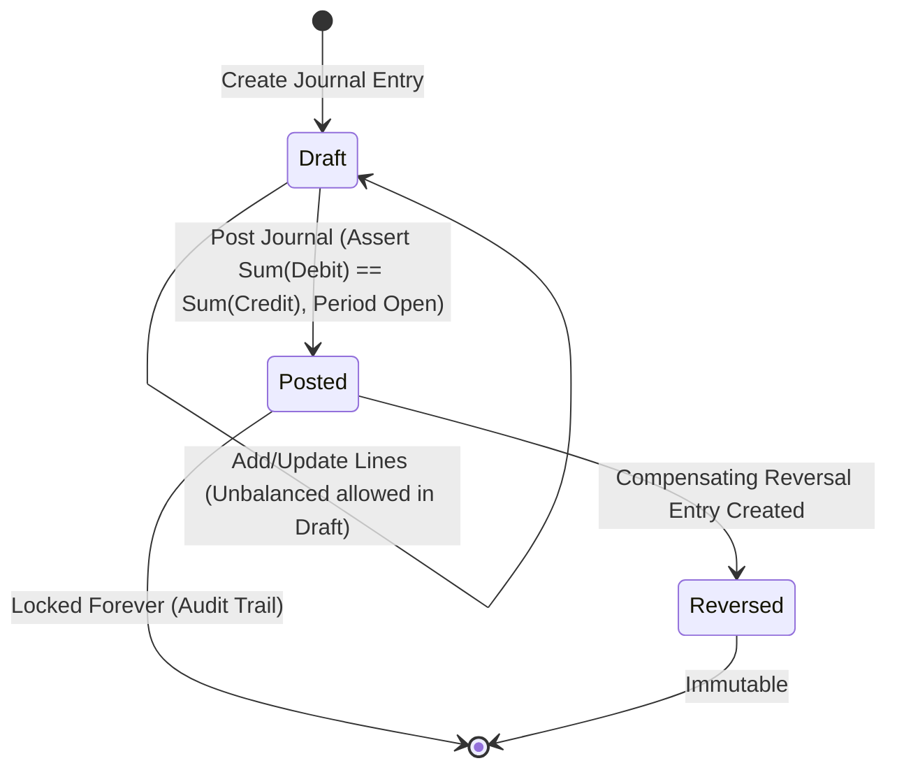

# ARTHSAVORA — Double-Entry Accounting Engine & General Ledger Architecture

## 1. Executive Summary & Purpose

The **ARTHSAVORA Double-Entry Accounting Engine and General Ledger** establishes the immutable, mathematically verifiable financial source of truth across personal, family, and business workspaces in India. While operational transactions capture business events (e.g., UPI payments, NEFT transfers, merchant swipes, invoice generation), the General Ledger (GL) translates these events into dual-entry debits and credits governed by the fundamental accounting equation:

$$\text{Assets} = \text{Liabilities} + \text{Equity} + (\text{Revenue} - \text{Expenses})$$

Every financial event posted to the ledger satisfies the invariant:

$$\sum \text{Debits} = \sum \text{Credits}$$

This document outlines the architectural principles, domain structures, mathematical precision standards, PostgreSQL database guarantees, and operational lifecycles governing the double-entry accounting engine.

---

## 2. Core Architectural Principles

### 2.1 Separation of Operational and Accounting Layers
1. **Operational Layer (Transactions & Accounts):** Fast, flexible, user-facing representation of transactions, bank accounts, credit cards, UPI handles, categories, and payment metadata.
2. **Accounting Layer (Ledger Accounts & Journal Entries):** Strict, immutable, double-entry general ledger that derives financial statements, balance sheets, trial balances, and audit trails.
3. **Decoupled Synchronization:** Changes in the operational layer invoke the `LedgerService.post_transaction_to_ledger` mapping pipeline, which generates balanced `JournalEntry` headers and `JournalLine` items.

### 2.2 Dual-Tier Immutability
- **Application Level:** The `LedgerService` prohibits updates or deletes on any journal entry with `status == "posted"`. Modifications require a compensating reversal entry.
- **Database Level:** PostgreSQL row-level triggers (`trg_prevent_posted_line_mutation` and `trg_prevent_posted_journal_deletion`) intercept raw SQL `UPDATE` and `DELETE` commands, throwing SQLSTATE `P0002` and `P0003` error codes respectively.

### 2.3 Strict Decimal & Integer Paise Precision
- All monetary amounts in the General Ledger are stored as both:
  - `amount`: Exact `NUMERIC(18, 4)` for high-precision calculations.
  - `amount_paise`: 64-bit integer (`BIGINT`) representing currency in Indian Paise ($1\text{ INR} = 100\text{ Paise}$).
- Floating-point representations (`float`, `double`) are strictly prohibited in the accounting engine to eliminate round-off drift.

### 2.4 Multi-Workspace Multi-Tenant Isolation
- Every ledger account, accounting period, journal entry, and journal line belongs to an explicit `workspace_id`.
- Cross-workspace queries, linkages, or allocations are rejected at the repository level with `404 Not Found` (anti-IDOR defense).

---

## 3. General Ledger Domain Model

```
+-----------------------------------------------------------------------------------+
|                                 Workspace                                         |
+-----------------------------------------+-----------------------------------------+
                                          |
                                          | 1:N
                                          v
+-----------------------+     +-----------------------+     +-----------------------+
|    Ledger Account     |     |   Accounting Period   |     |     Journal Entry     |
| (COA: 5 Classifications)    |  (Fiscal Year, Apr-Mar)     | (Draft, Posted, Rev.) |
+-----------------------+     +-----------------------+     +-----------+-----------+
                                                                        |
                                                                        | 1:N
                                                                        v
                                                            +-----------------------+
                                                            |     Journal Line      |
                                                            | (Debit/Credit, Paise) |
                                                            +-----------------------+
```

### 3.1 Ledger Accounts (Chart of Accounts)
- **Account Type:** `asset`, `liability`, `equity`, `revenue`, `expense`.
- **Normal Balance:** `debit` for Assets and Expenses; `credit` for Liabilities, Equity, and Revenue.
- **Hierarchical Numbering:** Standard 4-digit code range (1000–5999) with parent-child nesting support.
- **System Accounts:** Critical operational accounts (`is_system=True`) cannot be deleted or re-typed.

### 3.2 Accounting Periods
- **Indian Fiscal Year Default:** Runs from April 1 to March 31.
- **Monthly / Annual Periods:** Tracks open vs. closed accounting windows.
- **Posting Gate:** Posting into a period with `status == "closed"` is strictly blocked by the service.

### 3.3 Journal Entries & Lines
- **Journal Entry Header:** Tracks entry number (`JE-YYYY-NNNNNN`), reference date, status (`draft`, `posted`, `reversed`), description, source type (`manual`, `transaction`, `reversal`, `closing`), and reversal metadata.
- **Journal Lines:** Each line specifies:
  - `ledger_account_id`: The destination ledger account.
  - `entry_type`: `debit` or `credit`.
  - `amount` / `amount_paise`: Exact non-negative magnitude.
  - `financial_account_id`: Optional link to operational asset/liability account.
  - `counterparty_name`: Counterparty for reconciliation.

---

## 4. Ledger Workflow & State Machine



1. **Draft Stage:** Lines can be staged incrementally without requiring immediate balance.
2. **Posting Stage:**
   - Atomic database transaction initiated.
   - Row-level lock (`SELECT ... FOR UPDATE`) acquired on the journal entry.
   - Accounting period status validated as `open`.
   - Debit and Credit sums verified as exactly equal.
   - Entry status updated to `posted`.
   - PostgreSQL deferred constraint trigger verifies database-level equality at transaction commit.
   - Domain event `JOURNAL_CREATED` published.
3. **Reversal Stage:**
   - Posted entries cannot be edited or deleted.
   - To correct errors, an inverse compensating journal entry is created with inverted debits and credits, linked to the original entry with a required `reversal_reason`.
   - Original entry status updated to `reversed`.
   - Domain event `JOURNAL_REVERSED` published.

---

## 5. Mathematical Balances and Trial Balance

### 5.1 Account Balance Derivation
For any ledger account $A$:
- If normal balance is **Debit** (Assets, Expenses):
  $$\text{Balance}(A) = \sum \text{Debits} - \sum \text{Credits}$$
- If normal balance is **Credit** (Liabilities, Equity, Revenue):
  $$\text{Balance}(A) = \sum \text{Credits} - \sum \text{Debits}$$

### 5.2 Trial Balance Equation
The Trial Balance aggregates all posted lines across open/closed periods up to a given date:
$$\sum_{i=1}^N \text{Debit Balance}_i = \sum_{j=1}^M \text{Credit Balance}_j$$
Any non-zero variance triggers an immediate integrity alarm.
