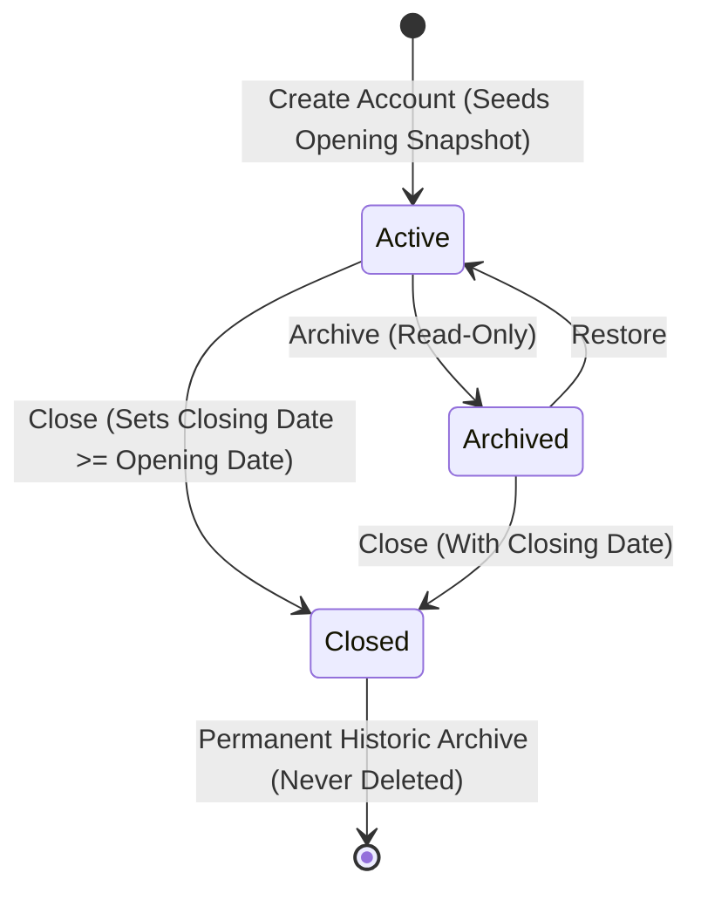

# Arthsavora — Financial Account Management Architecture

## 1. Executive Summary

Financial account management in Arthsavora provides the authoritative domain model, lifecycle state machine, and balance tracking infrastructure for all financial containers across personal, household, and small-business workspaces.

An **Account** represents an operational or asset/liability container (e.g. HDFC Salary Savings, Amazon ICICI Credit Card, Petty Cash Wallet, SBI Home Loan) belonging to a single workspace. It is distinct from accounting ledger accounts in the double-entry Chart of Accounts (COA), which map operational financial accounts into balanced debits and credits.

---

## 2. Core Domain Model

Every financial account is normalized under the `Account` entity in PostgreSQL (`accounts` table):

| Field | Type | Description |
| :--- | :--- | :--- |
| `id` | `UUID` | Immutable surrogate primary key. |
| `workspace_id` | `UUID` | Mandatory foreign key establishing strict tenant isolation. |
| `name` | `VARCHAR(128)` | User-defined or institution-provided account name. |
| `account_type` | `VARCHAR(50)` | Primary functional classification (`savings`, `credit_card`, `loan`, etc.). |
| `account_subtype` | `VARCHAR(50)` | Optional granular subtype (`salary`, `tax_saving_fd`, `overdraft`). |
| `currency` | `VARCHAR(3)` | ISO 4217 currency code (default: `INR`). |
| `institution_name` | `VARCHAR(255)` | Financial institution name (e.g. "HDFC Bank", "State Bank of India"). |
| `masked_identifier` | `VARCHAR(50)` | Masked account or card number (e.g. "••••4321"). Never full raw identifiers. |
| `status` | `VARCHAR(20)` | Lifecycle state: `active`, `inactive`, `archived`, `closed`. |
| `opening_date` | `DATE` | Operational opening date. Defaults to creation date. |
| `closing_date` | `DATE` | Operational closure date (validated: `closing_date >= opening_date`). |
| `created_by_id` | `UUID` | Auditable reference to the workspace member who created the account. |
| `description` | `VARCHAR(500)` | Optional user notes and contextual metadata. |
| `source_metadata` | `JSONB` | Non-sensitive provider metadata, loan principal details, and sync attributes. |

---

## 3. Account Lifecycle State Machine

Financial accounts follow a deterministic state machine:

### State Definitions & Transition Rules

1. **Active (`active`):**
   - Default initial state upon creation.
   - Account can receive posted transactions, journal entries, and balance snapshots.
   - Can transition to `archived` or `closed`.

2. **Archived (`archived`):**
   - Hidden from daily operational drop-downs, but fully preserved for historical reporting.
   - Modification of account attributes is rejected with `422 Unprocessable Entity`.
   - Cannot accept new transactions.
   - Can be restored to `active` via `POST /accounts/{id}/restore`.

3. **Closed (`closed`):**
   - Permanently closed financial container.
   - Requires valid `closing_date`. Temporal validation enforces: `closing_date >= opening_date`.
   - Immutable historical record. Financial integrity forbids hard deletion of accounts with historical transactions.

---

## 4. Tenancy & Workspace Scoping

Accounts are strictly workspace-scoped:
- An account belongs to exactly one `workspace_id`.
- Every repository query enforces `Account.workspace_id == workspace_context.workspace.id`.
- Attempting to access an account from another workspace returns `404 Not Found` (anti-IDOR defense).
- Account types are validated against the workspace tenancy model (`personal`, `family`, `business`).

---

## 5. Audit Logging & Domain Events

Every state change emits auditable events and persistent audit log entries:
- **`account.created`**: Emitted when an account is provisioned; includes opening balance and snapshot reference.
- **`account.updated`**: Emitted when metadata, limits, or institution references change.
- **`account.archived`**: Emitted when an account is moved to archived status.
- **`account.restored`**: Emitted when an archived account is reinstated.
- **`account.closed`**: Emitted when an account is closed with verified closing date.
- **`balance_snapshot.created`**: Emitted when an immutable point-in-time balance snapshot is recorded.
