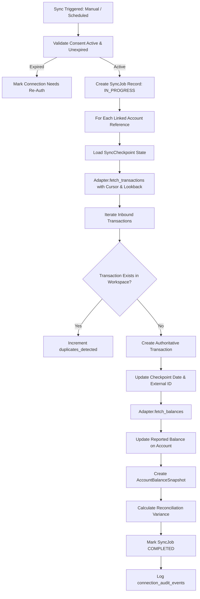

# ARTHSAVORA Account Synchronization Architecture

## 1. Overview

The ARTHSAVORA Account Synchronization Engine coordinates periodic and on-demand financial data acquisition from external financial providers.

Because external bank statements are subject to delayed posting, weekend settlements, backdated transactions, and pagination limits, the synchronization engine implements **checkpointed, incremental, idempotent ingestion**.

---

## 2. Sync Execution Flow

---

## 3. Checkpointing & Incremental State

Every linked account reference maintains a dedicated `SyncCheckpoint` record:
- `last_transaction_date`: The latest transaction date successfully ingested.
- `last_transaction_external_id`: The external ID of the latest processed transaction.
- `sync_cursor`: Provider-specific pagination token (e.g. NextPageToken or timestamp cursor).
- `last_sync_completed_at`: UTC timestamp of the last successful run.

### Lookback Window Strategy
Banks often record transactions with retroactive settlement dates (e.g., transactions initiated Friday night settling Monday morning).
To prevent dropped records:
- Checkpoints apply a **configurable lookback window** (default: 3 days prior to `last_transaction_date`).
- Inbound transactions inside the lookback window undergo deterministic deduplication against existing database transactions.
- Already ingested transactions are skipped without error, while delayed or amended postings are captured safely.

---

## 4. Sync Job Tracking (`sync_jobs`)

Every sync run creates an auditable record in `sync_jobs`:
- `job_type`: `manual_sync`, `scheduled_sync`, or `webhook_triggered`.
- `status`: `in_progress`, `completed`, `failed`, or `partial_success`.
- `records_retrieved`: Total raw transactions returned by provider adapter.
- `records_imported`: Net new transactions created in ARTHSAVORA.
- `duplicates_detected`: Number of previously imported transactions safely skipped.
- `errors_encountered`: Count of transient parsing or network errors.
- `started_at` & `completed_at`: Execution duration tracking.

---

## 5. Concurrency & Rate Limiting

To protect provider API quotas and database transactions:
1. **Connection-Level Mutex**: If a connection is already in state `SYNCHRONIZING`, subsequent sync requests for that connection are queued or rejected with HTTP 409 Conflict.
2. **Exponential Backoff**: If provider APIs return HTTP 429 (Too Many Requests) or 503 (Service Unavailable), the connection increments `sync_failure_count` and delays subsequent automatic retries.
3. **Workspace Isolation**: Sync jobs execute inside tenant-isolated database transactions. A failure in one account sync does not corrupt the state of other linked accounts.
