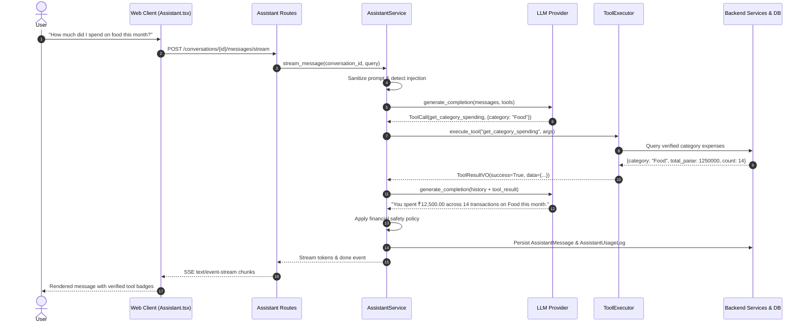

# ARTHSAVORA — AI Financial Assistant & Conversational Intelligence Architecture

## 1. Executive Summary

The **AI Financial Assistant** in Arthsavora provides institutional-grade conversational intelligence, enabling users to explore spending habits, analyze cash flow, inspect category/merchant breakdowns, monitor budget health, and stage administrative workflows through intuitive natural language.

Financial operations demand strict mathematical precision, tamper-evident auditability, zero data leakage, and rigorous permission enforcement. To uphold these principles, Arthsavora implements a **Deterministic Tool-Orchestration Architecture**:
- The Large Language Model (LLM) is strictly confined to intent recognition, parameter extraction, and human-first natural language synthesis.
- Authoritative financial records, double-entry ledgers, account balances, and business calculations remain strictly owned and calculated by backend deterministic application services.
- **Zero Ledger Mutation Principle**: The assistant cannot execute bank transfers, payments, or ledger modifications directly. All state-changing actions are proposed as reversible **Action Drafts** requiring explicit, out-of-band human confirmation.
- **Provider-Independent Abstraction**: Supports Google Gemini, OpenAI-compatible local models (Ollama, vLLM), and an offline deterministic mock provider for zero-cost repeatable CI/CD test automation.

---

## 2. Architectural Blueprint

```
                      ┌────────────────────────────────────────┐
                      │              User Client               │
                      │   (Web React 19 / Mobile / Chat UI)    │
                      └──────────────────┬─────────────────────┘
                                         │ HTTPS / SSE Stream
                                         ▼
                      ┌────────────────────────────────────────┐
                      │       FastAPI Assistant Router         │
                      │  (/api/v1/workspaces/{id}/assistant/)  │
                      └──────────────────┬─────────────────────┘
                                         │ RBAC & Tenant Context Check
                                         ▼
                      ┌────────────────────────────────────────┐
                      │        AssistantService (Core)         │
                      │  - Prompt Injection Sanitization       │
                      │  - Intent & Parameter Classification   │
                      │  - Multi-Turn Conversation History     │
                      └──────────────┬──────────────┬──────────┘
                                     │              │
                   Intent / Context  │              │ Tool Dispatch Request
                                     ▼              ▼
           ┌───────────────────────────┐  ┌──────────────────────────┐
           │   LLM Provider Layer      │  │   ToolExecutor &         │
           │  - MockDeterministic      │  │   Financial Tool Catalog │
           │  - GeminiProvider         │  │  (18 Registered Tools)   │
           │  - OpenAICompatible       │  └─────────────┬────────────┘
           └───────────────────────────┘                │
                                                        │ Authenticated Execution
                                                        ▼
                                          ┌──────────────────────────┐
                                          │ Authoritative Services:  │
                                          │ - AnalyticsService       │
                                          │ - BudgetService          │
                                          │ - GoalService            │
                                          │ - RecurringService       │
                                          │ - AnomalyRepository      │
                                          │ - TransactionService     │
                                          └─────────────┬────────────┘
                                                        │ Fixed-point / Minor Units
                                                        ▼
                                          ┌──────────────────────────┐
                                          │ PostgreSQL Database      │
                                          │ - Row-Level Security     │
                                          │ - assistant_conversations│
                                          │ - assistant_messages     │
                                          │ - assistant_action_drafts│
                                          │ - assistant_usage_logs   │
                                          └──────────────────────────┘
```

---

## 3. Core Architectural Principles

### 3.1. Separation of Cognition and Calculation
The LLM does not perform mental arithmetic or SQL queries. Instead:
1. User prompt is interpreted into a structured intent and parameter block.
2. The `ToolExecutor` invokes authoritative backend services (`AnalyticsService`, `BudgetService`, etc.).
3. Authoritative figures (in integer minor paise units or `Decimal(18, 4)`) are supplied to the LLM.
4. The LLM translates verified financial results into conversational summaries.

### 3.2. Controlled Action Drafts & Human-in-the-Loop
Any state-modifying intent (such as creating a budget, setting a savings goal, or creating a recurring rule) produces an `AssistantActionDraft` with a cryptographic `confirmation_token` and TTL.
- The action draft is presented in the UI with a distinct confirmation card.
- The backend mutation executes **only** when the user clicks "Confirm & Execute" via `POST /actions/{id}/confirm`.
- Confirmation calls enforce strict idempotency and re-validate user RBAC permissions before committing.

### 3.3. Tenant Isolation & Row-Level Security
Every conversation, message, action draft, and tool invocation is anchored to an explicit `workspace_id`. Cross-workspace queries are strictly blocked by PostgreSQL Row-Level Security (RLS) session variables and FastAPI dependency guards.

---

## 4. Key Components

| Component | File Path | Primary Responsibility |
| :--- | :--- | :--- |
| **Domain Models** | [assistant.py](file:///d:/Arthsavora/backend/app/domain/assistant.py) | Intent classification, date parsing, currency extraction, safety policies |
| **Tool Registry** | [tool_registry.py](file:///d:/Arthsavora/backend/app/services/assistant/tool_registry.py) | Catalog of 18 financial tools with strict JSON schemas and permissions |
| **Tool Executor** | [tool_executor.py](file:///d:/Arthsavora/backend/app/services/assistant/tool_executor.py) | Sandboxed tool execution, data masking, and error safety |
| **LLM Providers** | [providers/](file:///d:/Arthsavora/backend/app/services/assistant/providers/) | Pluggable provider abstraction (Mock, Gemini, OpenAI) |
| **Action Service** | [action_service.py](file:///d:/Arthsavora/backend/app/services/assistant/action_service.py) | Staging, verification, execution, and cancellation of action drafts |
| **Assistant Service** | [assistant_service.py](file:///d:/Arthsavora/backend/app/services/assistant/assistant_service.py) | Turn orchestration, SSE streaming, multi-turn history, usage auditing |
| **API Endpoints** | [assistant_routes.py](file:///d:/Arthsavora/backend/app/api/v1/assistant_routes.py) | REST and text/event-stream HTTP interfaces |
| **Web Store** | [useAssistantStore.ts](file:///d:/Arthsavora/apps/web/src/store/useAssistantStore.ts) | Zustand frontend state, message history, action confirmation actions |
| **Web UI** | [Assistant.tsx](file:///d:/Arthsavora/apps/web/src/pages/Assistant.tsx) | Responsive chat UI with prompt suggestions and action cards |

---

## 5. Sequence Diagram: Turn Orchestration


