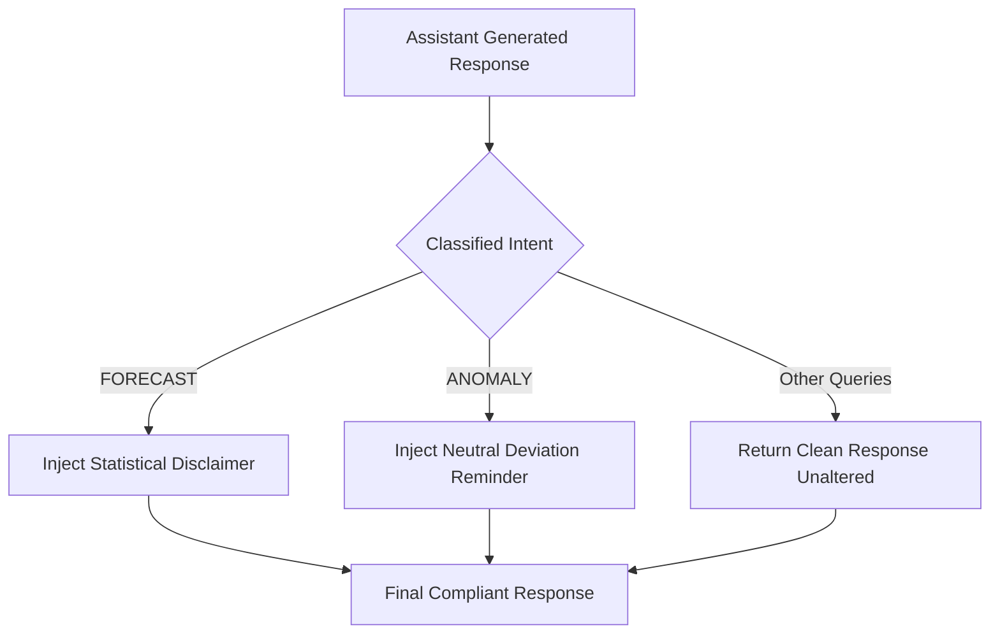

# ARTHSAVORA — Financial Safety Policy & Disclaimer Injection

## 1. Compliance & Ethical Invariants

ARTHSAVORA's AI Assistant is an informational intelligence tool. It operates under strict financial safety policies to prevent misleading users, giving unlicensed financial advice, or inciting false fraud alarms.

### 1.1. Invariant 1: Deterministic Truthfulness
- The assistant derives all balances, spending sums, and budget ratios from verified database service results.
- The assistant is forbidden from hallucinating or estimating numbers when authoritative records exist.

### 1.2. Invariant 2: Non-Speculative Forecasts
- Predictions and scenario analyses must be clearly identified as statistical models based on historical trends and scheduled commitments, not guaranteed financial returns or professional investment advice.

### 1.3. Invariant 3: Calm & Non-Accusatory Anomaly Disclosures
- A financial anomaly represents a mathematical or statistical deviation from historical baselines.
- The assistant must **never** accuse a merchant, user, or financial institution of fraud. Terms such as "suspicious deviation" or "unusual charge" are used with neutral explanations.

---

## 2. Policy Enforcement Engine (`apply_financial_safety_policy`)

Responses generated by the assistant pass through `apply_financial_safety_policy(response_text, intent)` before persistence and client transmission.

### Contextual Disclaimers

#### Forecast Responses
> *\*Note: Projections are model-based statistical estimates based on historical activity and scheduled commitments, not guaranteed financial outcomes.\**

#### Anomaly Responses
> *\*Reminder: An anomaly indicates an unusual statistical deviation, not confirmed fraud. Legitimate one-off expenses frequently deviate from baseline patterns.\**
