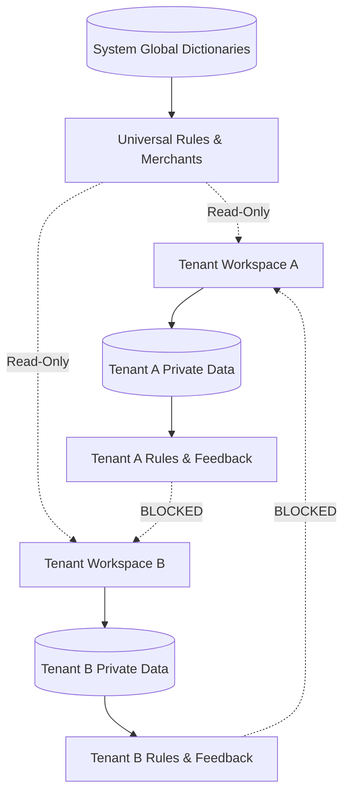

# AI Privacy & Workspace Boundary Security

## 1. Overview and Core Commitments

Arthsavora operates as an institutional fintech platform where user financial privacy is inviolable.

When building transaction intelligence, classification pipelines, and machine learning models, the platform enforces strict data boundaries:
1. **Local Sandboxed Execution**: All ML inference (vectorization and logistic regression) executes locally inside the backend container/process. No transaction text is transmitted to third-party generative APIs or public AI services for categorization.
2. **Tenant Data Isolation**: Private vendors, custom classification rules, and user corrections are strictly partitioned by `workspace_id`.
3. **No Cross-Tenant Training Bleed**: One workspace's private transaction narrations or feedback are never used to train or adjust weights that serve another tenant.
4. **General Ledger Immunity**: Intelligence predictions never touch, post, or mutate posted double-entry journal entries.



---

## 2. Multi-Workspace Isolation Architecture

### 2.1 Database-Level Scoping
All intelligence tables enforce workspace tenancy via foreign key constraints:
- `classification_rules.workspace_id`: When `NULL`, rule is universal system-wide; when set, rule is strictly scoped to that workspace.
- `transaction_classifications.workspace_id`: Scoped strictly to the owning workspace.
- `user_classification_feedback.workspace_id`: Scoped strictly to the owning workspace.
- `merchants.workspace_id`: Scoped to workspace for custom merchants.

### 2.2 Anti-IDOR (Insecure Direct Object Reference) Verification
Every repository query and service mutation validates tenant authorization:
```python
stmt = (
    select(Transaction)
    .where(
        Transaction.id == transaction_id,
        Transaction.workspace_id == workspace_id,
    )
)
res = await self.session.execute(stmt)
tx = res.scalar_one_or_none()
if not tx:
    raise NotFoundException(f"Transaction '{transaction_id}' not found in workspace.")
```
Users cannot view, evaluate, preview, or correct transactions outside their active workspace context.

---

## 3. Sandboxed Model Training & Inference

### 3.1 Fully Local Artifacts
The categorization model (`transaction_classifier_v1.joblib`) is:
- Packaged within the backend application artifact.
- Loaded into memory as a self-contained scikit-learn pipeline.
- Executed entirely offline without requiring external network calls, API keys, or cloud inference endpoints.

### 3.2 Curated Synthetic & Public Dataset
The base training dataset (`DATASET` in `ml_classifier.py`) consists entirely of curated, synthetic, and publicly standard Indian banking strings. **Zero real customer data is embedded into the global base model.**

### 3.3 Protection Against Cross-Tenant Inversion Attacks
Because the global ML model is never dynamically retrained on live raw user descriptions, it is mathematically impossible for an attacker to invert model weights or prompt the system to reveal another tenant's confidential transaction narratives.

---

## 4. Double-Entry General Ledger Immunity

A foundational invariant of Arthsavora is that **AI predictions are advisory and non-destructive**:
- Auto-categorization suggestions are stored in `transaction_classifications`.
- The authoritative general ledger (`journal_entries` and `journal_entry_lines`) is posted strictly upon transaction confirmation or reconciled import approval.
- AI categorization suggestions can be updated, corrected, or rejected without triggering retrospective general ledger adjustments, ensuring complete accounting integrity.
