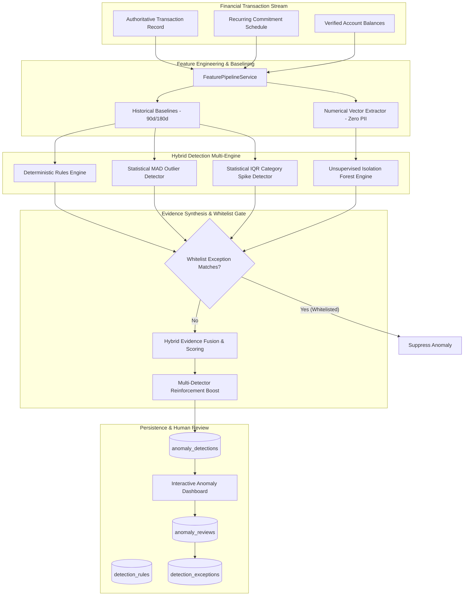

# Arthsavora Financial Anomaly Detection, Fraud Signals & Risk Intelligence Architecture

## 1. Overview & Core Philosophy

The **Arthsavora Financial Anomaly Detection Engine** provides continuous risk monitoring, transaction deviation analysis, and fraud signal intelligence across personal, family, and commercial business workspaces.

### Fundamental Principles

1. **An Anomaly is Not Automatically Fraud:**
   Unusual transactions frequently represent legitimate life events (e.g., medical emergencies, annual insurance renewals, vacation bookings, office equipment procurement). The system maintains neutral, objective, and non-alarmist phrasing across all user-facing interfaces and telemetry.

2. **Strict Read-Only Ledger Invariant (Zero Ledger Mutation):**
   No anomaly detection outcome, risk score, or automated detector may independently block payments, freeze accounts, or modify authoritative financial records, double-entry general ledger books, or account balances.

3. **In-Boundary Privacy Guarantee:**
   Private financial transaction records, descriptions, amounts, and merchant details are strictly analyzed within the local Arthsavora isolated infrastructure. Financial telemetry is never transmitted to external third-party public AI/LLM APIs.

4. **Multi-Tenant Workspace Isolation:**
   All detection events, threshold rules, and whitelist exceptions are strictly scoped to the tenant workspace (`workspace_id`). Workspaces cannot view or influence anomaly configurations of other workspaces.

5. **Exact Financial Precision:**
   All monetary amounts, thresholds, and calculations use 64-bit integer minor units (`paise`) and fixed-point `NUMERIC(18, 4)`. Floating-point arithmetic is strictly banned from financial storage and comparisons.

---

## 2. High-Level Architecture Diagram

---

## 3. Component Breakdown

### 3.1 Feature Pipeline Service (`FeaturePipelineService`)
- Extracts transaction properties, historical payment histories for specific merchants, 90-day category daily velocity, and matching active/cancelled recurring commitments.
- Ensures zero temporal leakage (future data lookahead is impossible because queries only filter $\le \text{transaction\_date}$).

### 3.2 Pure Functional Domain Engine (`app/domain/anomaly.py`)
- Independent, zero-I/O domain functions that execute deterministic checks, statistical estimations (Median, MAD, Modified Z-score, IQR), multivariate unsupervised ML inference, and whitelist matching.
- Returns immutable Value Objects (`AnomalyEvidenceVO`, `HybridDetectionResultVO`).

### 3.3 Hybrid Anomaly Detection Service (`AnomalyDetectionService`)
- Coordinates the feature pipeline, runs the detectors, applies whitelist filters, executes multi-signal evidence fusion, and persists anomalies with idempotency (`get_detection_for_transaction`).

### 3.4 Human Review Service (`AnomalyReviewService`)
- Manages the audit trail of human review actions (`acknowledge`, `mark_expected`, `mark_suspicious`, `dismiss`, `escalate`).
- Handles one-click creation of whitelist exceptions with configurable expiration windows and transaction value ceilings.
- Provides rule threshold customization and workspace-specific overrides.

---

## 4. Multi-Tenant Relational Schema

1. **`anomaly_detections`**: Source of truth for detected anomalous occurrences. Contains `workspace_id`, `transaction_id`, `account_id`, `detection_type`, `detection_method`, `severity`, `risk_score` (0-100), `status`, `explanation`, and `evidence_metadata`.
2. **`anomaly_reviews`**: Immutable chronological audit ledger of user decisions.
3. **`detection_rules`**: Configurable rules and thresholds. System defaults (`workspace_id IS NULL`) are inherited; workspace-specific overrides take precedence.
4. **`detection_exceptions`**: Whitelist exemptions matching merchant patterns, categories, accounts, and spending ceilings with optional expiration dates.
