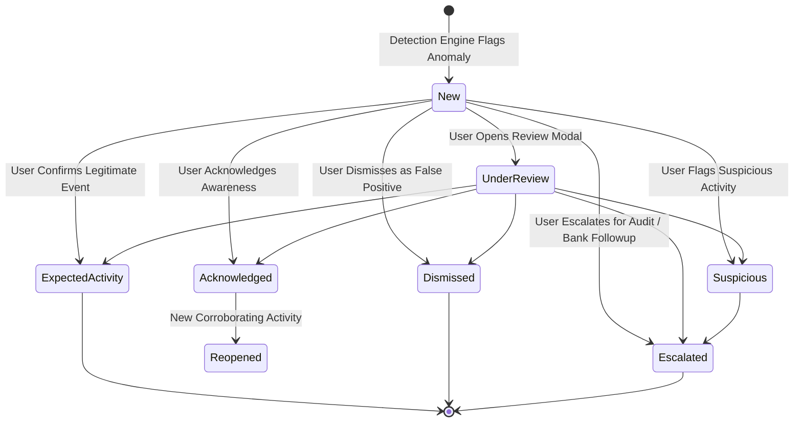

# Arthsavora Anomaly Review Lifecycle & Whitelist Exceptions

## 1. Human Review State Machine

The review workflow guarantees full human agency over risk intelligence. An anomaly detection record transitions through a strictly validated lifecycle:



### Review Actions

- **`acknowledge`**: Confirms that the user has seen the transaction. Status updates to `acknowledged`.
- **`mark_expected`**: Confirms that this is a recognized, expected expense (e.g., annual insurance premium). Status updates to `expected_activity`.
- **`mark_suspicious`**: Flags that the user does not recognize the transaction or suspects unauthorized activity. Prepares the record for banking dispute export.
- **`dismiss`**: Dismisses false alarms with optional user feedback notes.
- **`escalate`**: Marks the transaction for priority follow-up with financial institutions or accountants.
- **`create_exception`**: Automatically provisions a whitelist rule to suppress similar alerts in the future.

---

## 2. Whitelist Exceptions (`detection_exceptions`)

To eliminate alert fatigue, users can create targeted whitelist exceptions directly during review or from the Settings panel:

### Matching Dimensions & Criteria
1. **`merchant_id` / `merchant_name_pattern`**: Substring or exact match on payee identity.
2. **`category_id`**: Whitelist entire expected categories (e.g., Medical Expenses).
3. **`account_id`**: Scoped to specific credit cards or liquid accounts.
4. **`max_amount_paise` (Spending Ceiling)**: Ensures the whitelist only applies up to a safe monetary limit (e.g. whitelist Bescom electric utility up to ₹15,000; larger charges will still be flagged).
5. **`expires_at`**: Automatic expiration date (e.g. 30 days, 90 days, 1 year) so one-off exceptions do not permanently compromise security.

### Whitelist Evaluation Algorithm
```python
matched = matches_detection_exception(
    candidate_tx,
    workspace_exceptions,
    as_of_date=today,
)
if matched:
    # Anomaly is safely suppressed before persistence
    return None
```
