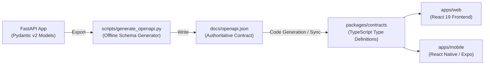

# Arthsavora — API Contract Synchronization Workflow

## 1. Overview and Contract Authority

In Arthsavora, the backend FastAPI application serves as the **single source of truth** for all API contracts, route parameters, request payloads, and response envelopes. OpenAPI 3.1.0 specifications generated directly from the codebase form the binding contract between backend micro-services, web clients, and mobile clients.



---

## 2. Generating the OpenAPI Specification

The OpenAPI specification can be exported reproducibly in an offline environment (without starting a live Uvicorn HTTP server):

```bash
# Export to default location (docs/openapi.json)
python backend/scripts/generate_openapi.py

# Export to a custom path
python backend/scripts/generate_openapi.py --output packages/contracts/openapi.json
```

### Script Guarantees
- Loads the application through `create_app()`.
- Reflects all versioned canonical V1 routes (`/api/v1/*`) and legacy transitional routes.
- Outputs human-readable, formatted JSON with 2-space indentation.
- Reports summary statistics (route count, schema component count, OpenAPI version).

---

## 3. Frontend Contract Synchronization

1. **Continuous Verification:** The CI/CD pipeline runs `generate_openapi.py` to verify that `docs/openapi.json` is always in sync with committed route handlers and schemas.
2. **TypeScript Type Generation:** Client packages consume `packages/contracts` using openapi-typescript:
   ```bash
   pnpm --filter @arthsavora/contracts run generate-types
   ```
3. **No Manual Contract Drift:** Frontend developers must never manually redefine backend API shapes in `.tsx` files; they import strictly from `@arthsavora/contracts`.

---

## 4. Breaking Change Detection Guidelines

Before merging any backend PR that modifies schemas:
- **Breaking Changes:**
  - Removing a field from a response schema.
  - Changing a field type (e.g. string to number).
  - Renaming an endpoint URL path.
  - Adding a required field to a request body without a default value.
  - Modifying the standard error schema envelope.
- **Non-Breaking Changes:**
  - Adding an optional field to an existing response schema.
  - Adding a new versioned endpoint.
  - Adding an optional query parameter with a default value.
