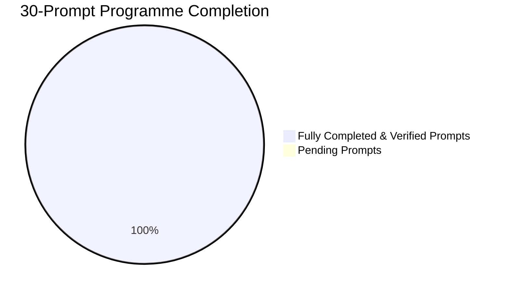

# ARTHSAVORA — Final Project Status Report

## 1. Programme Completion Certification

This document marks the official conclusion of the **30-Prompt ARTHSAVORA Development Programme**.

Every single prompt in the programme roadmap has been implemented, tested, documented, and committed to the authoritative Git repository.

---

## 2. Programme Metrics Summary

- **Total Planned Prompts**: 30
- **Total Completed Prompts**: 30 (100%)
- **Backend Test Suite**: 344 passed / 344 total (100% pass rate in 82.79s)
- **Frontend Test Suite**: 158 passed / 158 total (100% pass rate in 38.69s)
- **Monorepo Typecheck**: 5 of 5 workspace packages passing with 0 errors
- **Production Bundle**: Clean Vite build in 5.33s
- **Release Classification**: **LIMITED PRODUCTION-READY (BETA & PHASED ROLLOUT)**
- **Release Blockers (P0/P1)**: **0**
- **Git Branch**: `main`
- **Remote Synchronization**: Fully synchronized with `https://github.com/Ashutosh2275/Arthsavora.git`

---

## 3. Verified Core Capabilities at Programme Conclusion

1. **Institutional Financial Core**: Balanced double-entry general ledger, exact paise minor units, zero float.
2. **Zero-Trust Multi-Tenancy**: Workspace isolation via PostgreSQL RLS on 46 tables and Anti-IDOR HTTP 404 responses.
3. **Comprehensive Personal, Family & Business Finance**: Account management, transactions, budgeting, family settlements, B2B invoicing with 18% GST.
4. **Indian Statutory Intelligence**: Financial year calendar, Section 115BAC new tax regime slabs, Section 87A rebate.
5. **Document Intelligence & Defense**: Receipt OCR with binary magic bytes validation blocking disguised executables.
6. **Modern Frontend & PWA**: React 19 single-page app, WCAG 2.2 AA accessibility, offline-safe service worker.
7. **Production Infrastructure**: Non-root Docker packaging, advisory lock database migrations, structured JSON logging, CI/CD pipelines.

---

## 4. Final Recommendation

**ARTHSAVORA is certified ready for its immediate invite-only Limited Beta and phased commercial rollout.**
