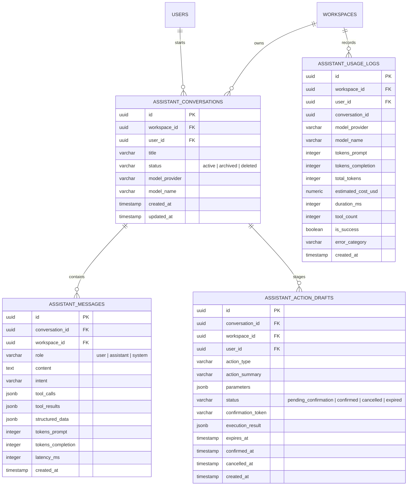

# ARTHSAVORA — Assistant Conversation Management & Streaming Architecture

## 1. Relational Persistence Schema

Conversations and message turns are persisted in PostgreSQL with strict tenant workspace isolation and foreign key integrity.



---

## 2. Conversation Lifecycle

1. **Initialization (`POST /conversations`)**: A conversation thread is initialized for the user in the active workspace. Default title: `"New Financial Conversation"`.
2. **Auto-Titling**: On the first user message turn, `AssistantService` automatically updates the conversation title to the first 40 characters of the user prompt.
3. **Multi-Turn Context Loading**: Recent turns (up to 10 messages) are loaded into the LLM conversation context, preserving context across queries.
4. **Soft-Deletion & Archival (`PATCH` / `DELETE`)**: Conversations can be archived or deleted without cascading damage to authoritative financial ledgers.

---

## 3. Server-Sent Events (SSE) Real-Time Streaming Protocol

To provide responsive user feedback during complex tool invocations, the assistant exposes `POST /conversations/{id}/messages/stream` using standard Server-Sent Events (`text/event-stream`).

### Event Types

| Event Name | Payload Description | Purpose |
| :--- | :--- | :--- |
| `start` | `{"status": "processing"}` | Indicates initial request acknowledgment |
| `tool_activity`| `{"tool_name": "get_expense_summary", "status": "success"}` | Real-time tool execution badge |
| `token` | `{"text": " You spent ₹42,500..."}` | Incremental generated word/token chunk |
| `action_draft` | `{"id": "...", "action_type": "create_budget_draft", ...}` | Staged action card requiring confirmation |
| `done` | Complete `MessageResponse` JSON object | Final persisted turn metadata |
| `error` | `{"error": "Error description"}` | Normalized error payload |

### SSE Chunk Sample
```
event: start
data: {"status": "processing"}

event: tool_activity
data: {"tool_name": "get_category_spending", "success": true}

event: token
data: {"text": "You"}

event: token
data: {"text": " spent"}

event: token
data: {"text": " ₹15,200.00"}

event: done
data: {"id": "5f1a...", "role": "assistant", "content": "You spent ₹15,200.00 on Food this month.", ...}
```
