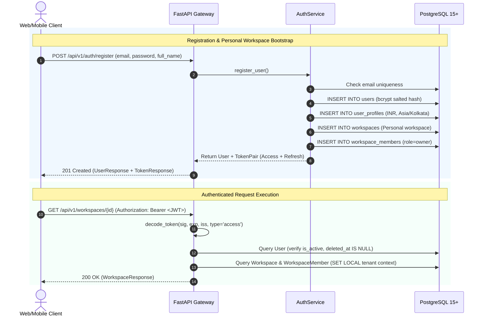

# Arthsavora — Authentication and Server-Side Authorization Architecture

## 1. Authentication Architecture

Arthsavora provides independent, server-side authentication backed by PostgreSQL as the authoritative identity store, while maintaining seamless compatibility with external OAuth/identity providers such as Supabase Auth.

---

## 2. Token Specification and Cryptographic Verification

### 2.1 Token Pair Structure
Authentication issues two distinct JSON Web Tokens:
1. **Access Token:**
   - Lifetime: 24 hours (`ACCESS_TOKEN_EXPIRE_MINUTES = 1440`).
   - Tagged: `"type": "access"`.
   - Claims: `sub` (User UUID), `email`, `type`, `iss` (`"ARTHSAVORA"`), `iat`, `exp`, `jti`.
2. **Refresh Token:**
   - Lifetime: 30 days (`REFRESH_TOKEN_EXPIRE_DAYS = 30`).
   - Tagged: `"type": "refresh"`.
   - Used exclusively at `POST /api/v1/auth/refresh` to mint fresh access tokens.

### 2.2 Independent Verification Rules
Every request bearing an `Authorization: Bearer <token>` header undergoes rigorous independent verification in `decode_token()`:
- **Signature Integrity:** Cryptographically verified using `SECRET_KEY` and HMAC-SHA256 (`HS256`). If configured, also verifies external Supabase Auth tokens via `SUPABASE_JWT_SECRET`.
- **Expiration Enforcement:** Expired tokens immediately fail with HTTP 401 `TOKEN_EXPIRED`.
- **Token Type Isolation:** Refresh tokens passed to operational API endpoints are rejected with `INVALID_TOKEN` (`expected 'access', got 'refresh'`).
- **Subject Validation:** Rejects unsigned tokens or tokens missing the `sub` claim.
- **Account State Verification:** The user extracted from `sub` is queried in PostgreSQL to verify that `is_active == True` and `deleted_at IS NULL`. Suspended accounts receive HTTP 401 `ACCOUNT_DISABLED`.

---

## 3. Server-Side Authorization and Workspace Tenancy

Authentication verifies **who the user is**. Authorization determines **what that user can see and execute** within a specific financial workspace.

### 3.1 Workspace Role Matrix

| Workspace Type | Role | Financial Ledger Access | Can Add Members | Can Post Transactions | Read-Only |
| :--- | :--- | :---: | :---: | :---: | :---: |
| **Personal** | `owner` | Full | N/A | Yes | No |
| **Family** | `owner` | Full | Yes | Yes | No |
| | `admin` | Full | Yes | Yes | No |
| | `member` | Workspace accounts | No | Yes | No |
| | `viewer` | Read-only summaries | No | No | Yes |
| **Business** | `owner` | Full (Audit & Settings) | Yes | Yes | No |
| | `admin` | Full operational | Yes | Yes | No |
| | `accountant` | Full Ledger, Tax, Reports | No | Yes | No |
| | `approver` | Payment & Invoice Approval | No | No | No |
| | `staff` | Expense submission only | No | Submissions only | No |
| | `viewer` | Read-only statements | No | No | Yes |

---

## 4. Nine-Step Tenancy Resolution Protocol

For every workspace-scoped API request (e.g. `/api/v1/workspaces/{workspace_id}` or requests bearing `X-Workspace-ID`):

1. **Authenticate Identity:** Validate Bearer JWT and retrieve `User` from PostgreSQL.
2. **Resolve Target Workspace:** Parse `workspace_id` from URL path parameter or `X-Workspace-ID` header. Validate UUID format.
3. **Verify Workspace Existence:** Query `workspaces` table. If not found or status $\neq$ `active`, return **404 Not Found**.
4. **Verify Active Membership:** Query `workspace_members` for `(workspace_id, user_id)`. If record does not exist, return **404 Not Found** (anti-IDOR).
5. **Verify Membership Status:** If membership status is `suspended` or `revoked`, return **403 Forbidden** with `MEMBERSHIP_INACTIVE`.
6. **Resolve Member Role:** Extract `membership.role` (`owner`, `admin`, `member`, `accountant`, `viewer`).
7. **Evaluate Action RBAC:** Compare `membership.role` against endpoint requirement (e.g. `require_role([WorkspaceRole.OWNER, WorkspaceRole.ADMIN])`). If insufficient, return **403 Forbidden** with `INSUFFICIENT_PERMISSIONS`.
8. **Activate Transaction RLS:** Execute `SET LOCAL app.current_workspace_id = :workspace_id` within the active PostgreSQL transaction.
9. **Return Authorized Scope:** Return filtered data strictly owned by the resolved workspace.

---

## 5. Insecure Direct Object Reference (IDOR) Defense

Arthsavora enforces a strict anti-enumeration policy:
- When a user requests a workspace or financial resource belonging to another tenant, the backend **never returns 403 Forbidden** for resource lookup.
- It returns **404 Not Found** with a generic message (`"Workspace not found."`).
- This prevents malicious actors from probing valid workspace UUIDs or determining which organizations operate within the Arthsavora ecosystem.
