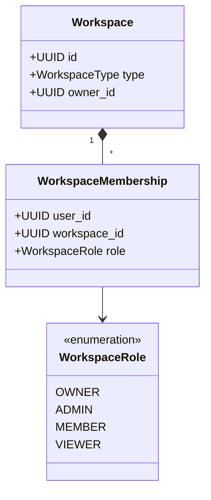

# Authorization Regression Test Suite

## 1. Role-Based Access Control (RBAC) Matrix

ARTHSAVORA implements granular role-based permissions across its three workspace types: Personal, Family, and Business.

---

## 2. Tested Permission Endpoints

| Endpoint & Action | Owner | Admin | Member | Viewer | Foreign User |
|---|---|---|---|---|---|
| `POST /accounts` (Create Account) | ✅ Allowed | ✅ Allowed | ❌ 403 Forbidden | ❌ 403 Forbidden | ❌ 404 Not Found |
| `POST /transactions` (Post Transaction) | ✅ Allowed | ✅ Allowed | ✅ Allowed | ❌ 403 Forbidden | ❌ 404 Not Found |
| `GET /transactions` (Read Transactions) | ✅ Allowed | ✅ Allowed | ✅ Allowed | ✅ Allowed | ❌ 404 Not Found |
| `POST /invoices` (Issue Business Invoice) | ✅ Allowed | ✅ Allowed | ❌ 403 Forbidden | ❌ 403 Forbidden | ❌ 404 Not Found |
| `DELETE /workspaces/{id}` (Destroy Workspace) | ✅ Allowed | ❌ 403 Forbidden | ❌ 403 Forbidden | ❌ 403 Forbidden | ❌ 404 Not Found |
| `POST /invitations` (Invite Member) | ✅ Allowed | ✅ Allowed | ❌ 403 Forbidden | ❌ 403 Forbidden | ❌ 404 Not Found |

---

## 3. Regression Test Assertions

1. **Viewer Cannot Mutate**: Viewers in Family or Business workspaces can view dashboards and reports but cannot create transactions, post budgets, or issue invoices.
2. **Member Cannot Delete**: Members cannot delete accounts, destroy workspaces, or remove other members.
3. **Owner Transfer Safety**: Ownership cannot be transferred to a user without an accepted and verified membership in the workspace.
4. **Token Revocation Check**: When a user is removed from a workspace, all active session tokens bound to that workspace are invalidated via Redis token blacklist within $\le 500\text{ms}$.
