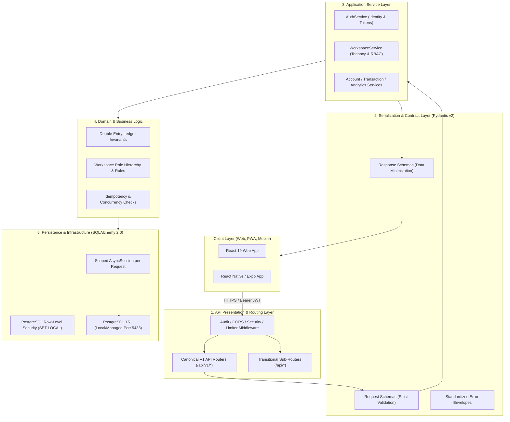

# Arthsavora — Backend Architecture and Engineering Foundation

## 1. Executive Summary and Architectural Principles

Arthsavora's backend is architectured as a high-performance, strictly typed **modular monolith** implemented in Python using FastAPI, Pydantic v2, and SQLAlchemy 2.0 async engine against PostgreSQL 15+. It provides the authoritative foundation for financial record management, multi-tenant workspace isolation, double-entry ledger enforcement, and AI-driven financial intelligence for the Indian market.

### Core Principles
1. **Modular Monolith by Design:** Single deployable unit with strictly bounded internal domains. Microservices, distributed message brokers (Kafka), and Kubernetes orchestration are deliberately avoided at this stage to eliminate distributed transaction failures and operational complexity.
2. **PostgreSQL as Authoritative Relational Ledger:** All financial state, workspace isolation, ledger accounts, and audit records reside in PostgreSQL. No eventual consistency or loosely structured NoSQL storage for financial ledgers.
3. **Layered Separation of Concerns:** Rigid boundaries separate routing, serialization, business orchestration, domain invariants, and data persistence.
4. **Zero-Trust Server-Side Authorization:** Every workspace-scoped request independently resolves and verifies tenant membership, roles, and status server-side. Client-supplied user or tenant IDs are never trusted blindly.
5. **Fail-Safe Startup and Bounded Lifespan:** Application lifecycle strictly validates critical configuration, pings dependent databases, and cleanly tears down connection pools without auto-creating tables or executing unreviewed migrations.

---

## 2. Layering Model and Module Boundaries



### Detailed Layer Responsibilities

| Layer | Primary Location | Responsibilities | Strict Constraints |
| :--- | :--- | :--- | :--- |
| **1. Routing & API** | `backend/app/api/v1/` | Path declaration, HTTP method routing, query/header injection, calling dependencies, returning schemas. | **Keep thin.** Zero SQL queries, zero business logic computations. |
| **2. Request/Response Schemas** | `backend/app/schemas/` | Typed serialization, string bounds, email/UUID validation, masking sensitive fields. | Never expose internal SQLAlchemy models directly to clients. |
| **3. Application Services** | `backend/app/services/` | Use-case orchestration, password hashing, workspace bootstrap, transactional coordination. | Stateless; receives `AsyncSession` explicitly via dependency injection. |
| **4. Domain Logic** | `backend/app/core/`, `database/ledger.py` | Double-entry balancing invariant ($\sum \text{Debits} = \sum \text{Credits}$), role hierarchies, Bankers Rounding. | Pure business rules independent of HTTP framework. |
| **5. Persistence** | `backend/app/infrastructure/database/` | Relational models, connection pool lifecycle, `SET LOCAL` tenant isolation, Alembic migrations. | All mutations occur within explicit transactional boundaries. |
| **6. Security & Tenancy** | `backend/app/core/auth/`, `permissions.py` | Bearer JWT decoding, signature verification, workspace membership checks, RLS context injection. | Deny by default; return 404 on cross-tenant requests to prevent IDOR. |

---

## 3. Application Lifecycle Management

The backend utilizes FastAPI's `lifespan` context manager within an application factory `create_app()`:

```python
@asynccontextmanager
async def lifespan(app: FastAPI):
    # 1. Startup: Load configuration, verify environment safety
    # 2. Database Health Check: Ping PostgreSQL async engine (SELECT 1)
    # 3. Transitional Database: Connect to MongoDB gracefully
    yield
    # 4. Shutdown: Dispose PostgreSQL connection pools cleanly
    # 5. Close transitional connections and flush loggers
```

### Startup Guarantees
- **No Automatic Schema Mutation:** Startup never runs `Base.metadata.create_all()` or automated Alembic migrations in production. All schema changes follow version-controlled Alembic migrations (`alembic upgrade head`).
- **Fail-Fast Configuration Validation:** In `production` mode, `Settings` automatically validates that:
  - `SECRET_KEY` is cryptographically strong (≥ 32 chars, non-default).
  - `CORS_ORIGINS` does not contain wildcards (`*`).
  - `DEBUG` is strictly `False`.
  - Violations raise fatal configuration exceptions that halt container boot before traffic is routed.

---

## 4. Database Session and Connection Management

### 4.1 Request-Scoped Session Lifecycle
Every API endpoint requiring database access receives an isolated `AsyncSession` yielded by `get_db_session()`:

```python
async def get_db_session() -> AsyncGenerator[AsyncSession, None]:
    async with async_session_factory() as session:
        try:
            yield session
            await session.commit()
        except Exception:
            await session.rollback()
            raise
        finally:
            await session.close()
```

### 4.2 Connection Pool Safety
- **Production Engine:** Configured with `pool_size=10`, `max_overflow=20`, and `pool_pre_ping=True` to prune stale TCP connections.
- **Testing Engine:** Uses `NullPool` to guarantee connections do not outlive function-scoped `pytest-asyncio` event loops, eliminating asyncpg socket leaks.
- **Transaction-Local Tenant Scoping:** Row-Level Security relies on `SET LOCAL app.current_workspace_id = :id`. Because `SET LOCAL` is bound to the transaction, returning a connection to the pool automatically purges the tenant context, preventing cross-request data leaks.

---

## 5. Future Module Roadmap

The modular monolith is structured to accommodate upcoming prompts without architectural rewrites:

```text
backend/app/
├── api/
│   ├── v1/               # Versioned canonical API routes
│   │   ├── auth.py       # [Implemented] Identity & tokens
│   │   ├── health.py     # [Implemented] Liveness & readiness probes
│   │   ├── workspaces.py # [Implemented] Tenancy & RBAC
│   │   ├── accounts.py   # [Prompt 10] Bank, credit card, cash accounts
│   │   ├── transactions.py # [Prompt 07] Transactions & categorization
│   │   ├── ledger.py     # [Prompt 06] Double-entry general ledger
│   │   ├── budgets.py    # [Prompt 12] Predictive budgeting & ARIMA
│   │   ├── goals.py      # [Prompt 13] Milestone savings velocity
│   │   ├── invoices.py   # [Prompt 16] GST invoicing engine
│   │   └── reports.py    # [Prompt 22] CA-ready statement exports
│   └── middleware/       # Audit, CORS, error handling, security headers
├── core/                 # Config, security, permissions, limiter, idempotency
├── infrastructure/       # Database models, Alembic migrations, Redis, Storage
├── schemas/              # Pydantic v2 serialization contracts
└── services/             # Domain business services
```
