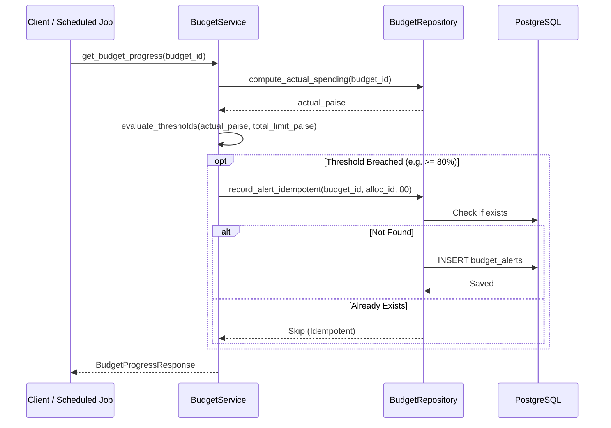

# Arthsavora — Budget Alerting & Spending Threshold Engine

## 1. Overview & Objectives

The **Budget Alerting Engine** provides timely, actionable warnings when spending approaches or exceeds predefined allocation limits.

Key principles:
- **Zero Alert Fatigue / Anti-Spam**: Each warning threshold for a given budget or category allocation is dispatched **at most once per budget period**.
- **Idempotent Triggering**: Running the calculation or viewing progress dozens of times never creates duplicate alert records.
- **Hierarchical Scopes**: Alerts can trigger at the **Overall Budget** level or at an individual **Category Allocation** level.
- **Transparent Attribution**: Alerts record the exact spending percentage and timestamp when the threshold was breached.

---

## 2. Threshold Tiers & Warning States

Arthsavora establishes deterministic threshold boundaries:

| Threshold Percentage | Classification | Default Severity | User Message Template |
|---|---|---|---|
| **50%** | `NORMAL` / Midpoint | Info | *"Spending has reached 50% of budget limit."* |
| **75%** | `WARNING` | Low Warning | *"Spending has reached 75% of budget limit."* |
| **80%** | `WARNING` | Medium Warning | *"Spending has reached 80% of budget limit."* |
| **90%** | `WARNING` | High Warning | *"Urgent: Spending has reached 90% of budget limit."* |
| **100%** | `EXHAUSTED` / `EXCEEDED` | Critical | *"Alert: Budget limit has been 100% exhausted or exceeded."* |

When spending is under 50%, the state remains `NORMAL` and no alerts are fired.

---

## 3. Alert Schema Specification

The `budget_alerts` table records all dispatched notifications:

| Column | Type | Constraints | Description |
|---|---|---|---|
| `id` | `UUID` | Primary Key | Unique alert identifier. |
| `workspace_id` | `UUID` | FK `workspaces.id` ON DELETE CASCADE | Associated workspace boundary. |
| `budget_id` | `UUID` | FK `budgets.id` ON DELETE CASCADE | Target budget record. |
| `allocation_id` | `UUID` | FK `budget_allocations.id`, NULLABLE | Target category allocation (`NULL` for overall budget). |
| `threshold_percentage` | `INTEGER` | NOT NULL (`50`, `75`, `80`, `90`, `100`) | Breached threshold tier. |
| `notification_channel` | `VARCHAR(32)` | NOT NULL (Default: `in_app`) | Delivery mechanism (`in_app`, `email`, `push`). |
| `is_read` | `BOOLEAN` | NOT NULL, Default `FALSE` | Read acknowledgement state. |
| `message` | `TEXT` | NOT NULL | Human-readable alert summary. |
| `triggered_at` | `TIMESTAMPTZ` | NOT NULL | Breached event timestamp. |

---

## 4. Idempotency & Deduplication Engine

### 4.1 Check-and-Insert Pattern
In relational databases, unique constraints involving nullable columns (such as `allocation_id = NULL`) require careful handling. In Arthsavora, the alert engine enforces deduplication via a two-layer check:

1. **Pre-Query Check**: The repository executes an indexed query checking whether an alert with `(budget_id, allocation_id, threshold_percentage)` already exists.
2. **Atomic Insert**: If no record exists, the alert is inserted within the active session transaction.

```python
existing = await self.db.execute(
    select(BudgetAlert).where(
        BudgetAlert.budget_id == budget_id,
        BudgetAlert.allocation_id == allocation_id,
        BudgetAlert.threshold_percentage == threshold_percentage,
    )
)
if existing.scalar_one_or_none():
    return None  # Threshold already alerted for this period
```

### 4.2 Lifecycle Reset on Rollover
When a budget period rolls over (e.g. from October 2026 to November 2026), a new `Budget` row with a new `budget_id` is created. Consequently, alerts reset cleanly for the new period without requiring complex status mutations on historical alert rows.

---

## 5. Alert Trigger Workflow



---

## 6. Implementation References

- Database Model: [budget.py](file:///d:/Arthsavora/backend/app/infrastructure/database/models/budget.py)
- Alert Engine Repository: [budget_repository.py](file:///d:/Arthsavora/backend/app/repositories/budget_repository.py)
- Progress & Alert Service: [budget_service.py](file:///d:/Arthsavora/backend/app/services/budget/budget_service.py)
- API Endpoint: [budget_routes.py](file:///d:/Arthsavora/backend/app/api/v1/budget_routes.py)
