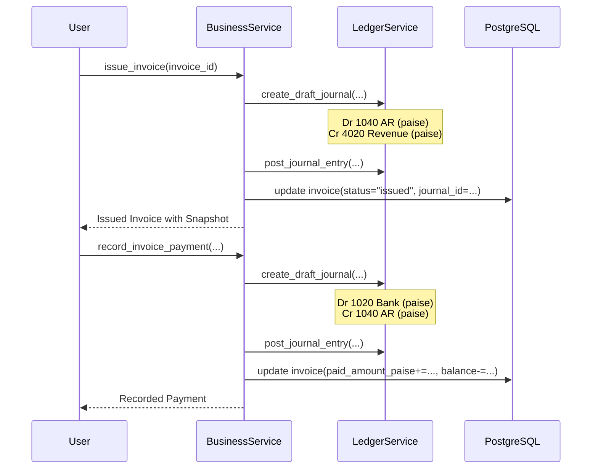

# Business General Ledger & Double-Entry Accounting Integration

## 1. Accounting Integration Philosophy

Small business finance in Arthsavora is not an isolated spreadsheet module; it is deeply integrated into the institutional double-entry general ledger.

Every commercial transaction directly posts balanced, immutable journal entries through `LedgerService`.



---

## 2. Standard Business Chart of Accounts

| Account Code | Account Name | Type | Normal Balance | Purpose |
| :--- | :--- | :--- | :--- | :--- |
| **1020** | Operating Bank Account | Asset | Debit | Primary business checking account |
| **1040** | Accounts Receivable | Asset | Debit | Client billing on credit terms |
| **2020** | Accounts Payable | Liability | Credit | Unpaid vendor bills and liabilities |
| **4020** | Business Sales & Invoicing | Revenue | Credit | Invoiced revenue on accrual basis |
| **5000** | Operating Expenses | Expense | Debit | Software, hosting, consulting, office |

---

## 3. Reversal Integrity

When an issued invoice is cancelled:
- An opposing reversal journal is constructed:
  ```
  Debit:  4020 Business Sales & Invoicing
  Credit: 1040 Accounts Receivable
  ```
- This permanently preserves audit integrity: past entries are never deleted from the ledger.
