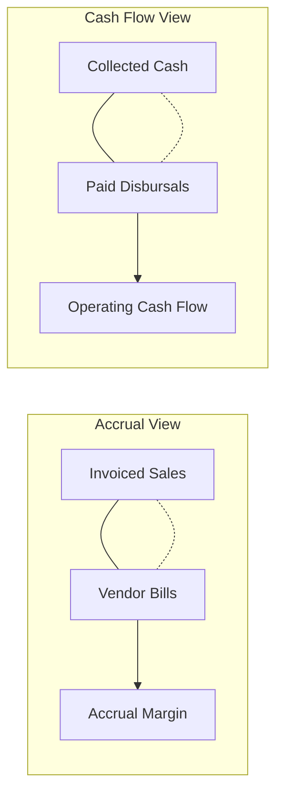

# Business Cash Flow Monitoring & Liquidity Management

## 1. Cash Flow vs. Accrual Profitability

A service business can be highly profitable on an accrual basis while suffering from severe cash shortages due to delayed client payments.

Arthsavora explicitly distinguishes:
1. **Accrual Operating Result**:
   `Accrual Result = Invoiced Sales (Revenue) - Billed Vendor Costs (Expenses)`
2. **Net Operating Cash Flow**:
   `Net Cash Flow = Collected Client Cash - Paid Vendor Disbursals`

---

## 2. Cash Flow Summary Contract (`CashFlowSummaryVO`)

- `cash_inflow_paise`: Realized cash collected into operating bank accounts.
- `cash_outflow_paise`: Realized cash disbursed for bills and expenses.
- `net_cash_flow_paise`: `cash_inflow_paise - cash_outflow_paise`.
- `accounts_receivable_paise`: Total client collections currently outstanding.
- `accounts_payable_paise`: Total vendor liabilities currently pending payment.
- `period_start` & `period_end`: Date boundaries for the cash flow reporting cycle.
