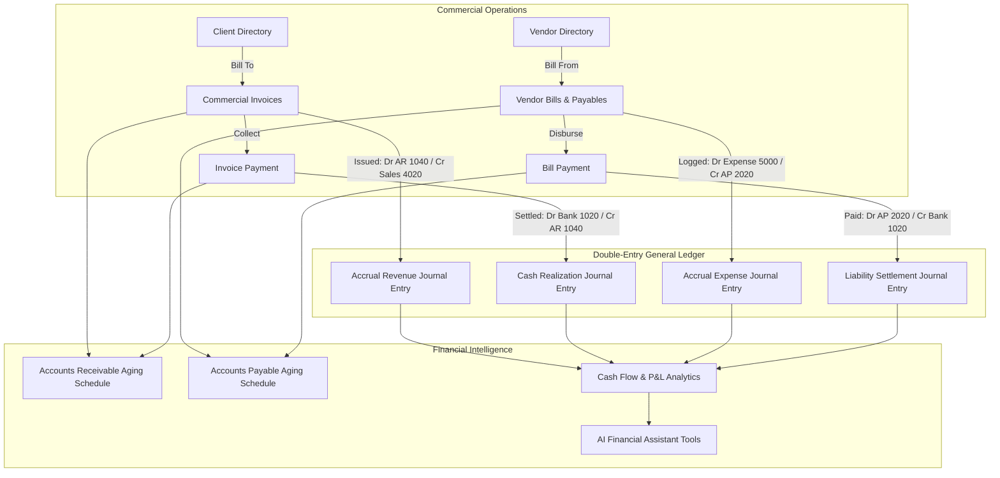

# Arthsavora Small Business Finance Architecture

## 1. Executive Summary

Arthsavora provides an institutional-grade, multi-tenant commercial financial management system designed specifically for Indian freelancers, consultants, independent professionals, small agencies, and service enterprises.

The architecture directly bridges commercial day-to-day operations—such as invoicing, payment tracking, client management, vendor billing, and accounts payable—with the core double-entry accounting engine (`LedgerService`) and financial accounts. This guarantees that small business finances remain completely synchronized with the authoritative general ledger, trial balance, and audit trail without duplicate ledgers or reconciled drift.

---

## 2. Fundamental Architectural Invariants

1. **Double-Entry Foundation Invariant**: Business finance must use the existing double-entry general ledger (`LedgerService`). It never maintains an independent or decoupled ledger.
2. **Accrual vs. Cash Distinction**:
   - An issued invoice recognizes revenue on an accrual basis (Debit `1040 Accounts Receivable`, Credit `4020 Sales & Revenue`).
   - A payment marks cash realization (Debit `1020 Bank Account`, Credit `1040 Accounts Receivable`).
   - A draft invoice is strictly an off-ledger working document.
3. **Exact Minor Unit Arithmetic**: All amounts are computed and stored in integer minor units (paise) with non-negative constraints.
4. **Immutable Snapshots**: Once an invoice is issued, its line items, rates, client details, and tax breakdowns are permanently snapshotted in `issued_snapshot` (JSONB) to guarantee legal and historical immutability.
5. **No Blind Deletions**: Invoices with financial history cannot be deleted; they must undergo formal cancellation with an automated journal reversal.
6. **Over-Allocation Prevention**: Payment recordings cannot exceed the invoice's remaining balance (`balance_amount_paise`).

---

## 3. Component Architecture

- **Domain Layer (`app/domain/business.py`)**: Pure mathematical functions for GST computation (CGST, SGST, IGST), invoice total calculations, aging categorization, sequence formatting, and formula injection sanitization.
- **Relational Models (`app/infrastructure/database/models/business.py`)**: PostgreSQL entities for `BusinessProfile`, `BusinessClient`, `BusinessVendor`, `BusinessInvoice`, `BusinessInvoiceLineItem`, `BusinessInvoicePayment`, `BusinessPayable`, `BusinessPayablePayment`, and `BusinessActivity`.
- **Repository Layer (`app/repositories/business_repository.py`)**: Scoped multi-tenant queries with strict workspace isolation.
- **Service Layer (`app/services/business_service.py`)**: Business logic orchestrator linking commercial workflows to general ledger journals, audit trails, and notification dispatches.
- **API Layer (`app/api/v1/business_routes.py`)**: FastAPI REST endpoints secured with fine-grained role-based access control.
- **Frontend Layer (`apps/web/src/pages/Business.tsx`)**: Reactive commercial dashboard with 7 management tabs and 5 operational modals.
