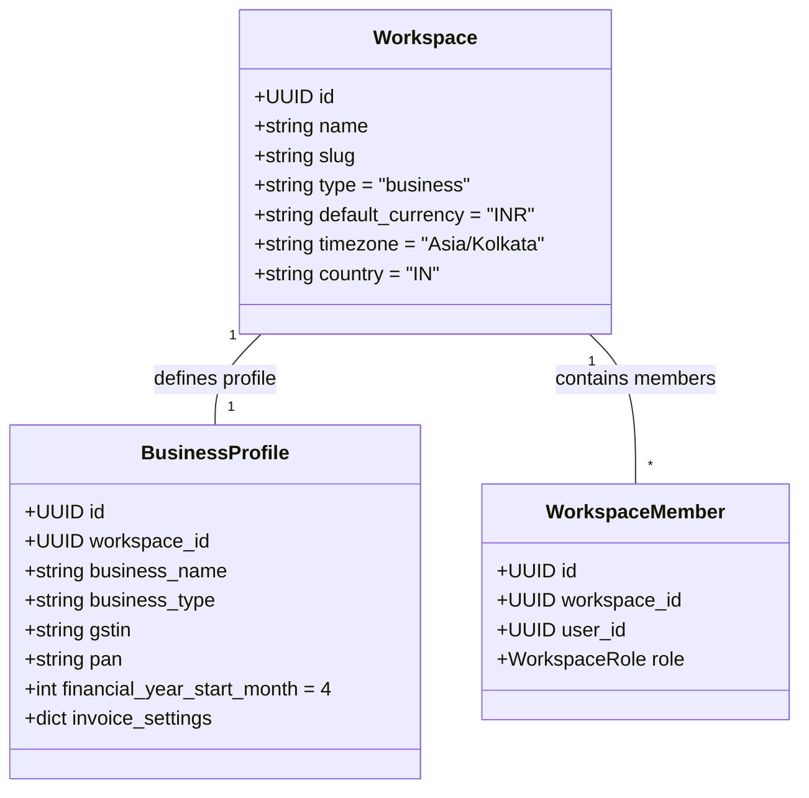

# Arthsavora Business Workspace Model & Multi-Tenancy

## 1. Multi-Tenant Workspace Boundary

In Arthsavora, multi-tenancy is established at the `Workspace` entity level. A workspace of type `business` represents a distinct commercial entity (e.g. sole proprietorship, partnership, LLC, consulting practice, or digital agency).

---

## 2. Workspace Roles in Business Context

Business workspaces support 6 distinct granular roles:

1. **Owner (`owner`)**: Founder or primary business stakeholder. Full administrative authority, statutory tax configuration, workspace management, and financial disposal.
2. **Admin (`admin`)**: Operational partner or general manager. Manages clients, vendors, invoices, payments, and team members.
3. **Accountant (`accountant`)**: Professional bookkeeper or chartered accountant. Full access to ledger, journal postings, invoices, aging schedules, and tax reporting. Cannot delete workspaces or modify ownership.
4. **Approver (`approver`)**: Department head or finance approver. Can review and approve invoices, bills, and payments without direct administrative privileges.
5. **Staff (`staff`)**: Operational employee or consultant. Can draft invoices, add clients, and record time/expenses. Cannot cancel issued invoices or modify statutory settings.
6. **Viewer (`viewer`)**: Auditor, silent partner, or legal counsel. Read-only visibility across reports, invoices, and analytics.

---

## 3. Statutory Configuration & India Defaults

- **Base Currency**: `INR` (Indian Rupee) with minor units in paise.
- **Financial Year**: Indian fiscal cycle starting Month 4 (April) and ending Month 3 (March).
- **Timezone**: Defaulted to `Asia/Kolkata`.
- **Statutory Identifiers**:
  - GSTIN: 15-character Goods and Services Tax Identification Number.
  - PAN: 10-character Permanent Account Number.
