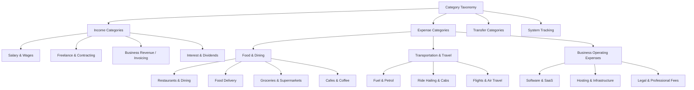

# Category Taxonomy Architecture

## 1. Overview and Core Philosophy

Arthsavora enforces a structured, hierarchical financial taxonomy designed specifically for Indian personal, family, and small-business finance. The taxonomy provides:
- Consistent classification across bank statements, credit card feeds, UPI handles, and manual entries.
- Clear separation between Income, Expense, Transfer, and System accounts.
- Dual-layer tenancy: Protected, universal **system categories** shared across all workspaces, and workspace-scoped **custom categories** tailored to individual business workflows or household needs.
- Mathematical and relational integrity: Strict prevention of cyclic hierarchies, deletion protection for categories linked to posted transactions, and explicit transaction-type compatibility contracts.



---

## 2. Taxonomy Types and Profiles

Categories are categorized by both `category_type` and `workspace_type`:

| Category Type | Description | Allowed Directions | Example Root Slugs |
| :--- | :--- | :--- | :--- |
| `income` | Inflow transactions representing earnings, revenue, dividends, and interest | `inflow` | `income` |
| `expense` | Outflow transactions representing household or business consumption | `outflow` | `food-dining`, `transportation`, `housing-utilities`, `operating-expenses` |
| `transfer` | Internal account transfers, credit card bill settlements, self-investments | `inflow` / `outflow` | `transfers`, `investment-transfers` |
| `system` | Administrative adjustments, reconciliation balancers, foreign exchange deltas | `inflow` / `outflow` | `reconciliation-adjustments` |

### Workspace Profile Applicability
1. **Personal (`workspace_type = 'all'`)**: Essential living costs, entertainment, healthcare, investments, personal taxes.
2. **Family (`workspace_type = 'all'` or `'family'`)**: Shared household groceries, utilities, childcare, tuition, domestic maintenance.
3. **Business (`workspace_type = 'business'` or `'all'`)**: Professional services, office rent, SaaS subscriptions, inventory procurement, GST payments, contractor fees.

---

## 3. Relational Hierarchy and Integrity Invariants

### 3.1 Self-Referential Adjacency Tree
Categories use an adjacency list model where `parent_id` points to another `Category.id` within the `categories` table. Root categories have `parent_id = NULL`.

```sql
ALTER TABLE categories
ADD CONSTRAINT fk_categories_parent_id
FOREIGN KEY (parent_id) REFERENCES categories (id)
ON DELETE SET NULL;
```

### 3.2 Circular Hierarchy Prevention
Circular relationships (e.g. A is parent of B, B is parent of C, and C is set as parent of A) are mathematically prohibited. Before setting or modifying `parent_id`, the system recursively walks up the ancestry tree. If the target parent matches the category itself or any of its descendants, a `CircularCategoryHierarchyError` is raised.

```python
async def _validate_no_circular_ancestry(self, category_id: uuid.UUID, target_parent_id: uuid.UUID) -> None:
    current_parent_id = target_parent_id
    visited: Set[uuid.UUID] = {category_id}
    while current_parent_id:
        if current_parent_id in visited:
            raise CircularCategoryHierarchyError(str(category_id), str(target_parent_id))
        visited.add(current_parent_id)
        parent_row = await self.get_by_id(current_parent_id)
        current_parent_id = parent_row.parent_id if parent_row else None
```

### 3.3 Deletion Safety and System Protection
1. **System Category Protection**: Categories flagged with `is_system = True` cannot be deleted or renamed by any user, regardless of workspace role (`SystemCategoryProtectedError`).
2. **Transaction Usage Protection**: A category cannot be deleted if there are any transactions referencing it. Attempting to delete an in-use category raises `CategoryInUseError`.

---

## 4. Seeding and Database Representation

System categories are idempotently seeded from `SYSTEM_CATEGORIES` in `backend/app/domain/category_taxonomy.py`.

```sql
CREATE TABLE categories (
    id UUID PRIMARY KEY DEFAULT gen_random_uuid(),
    workspace_id UUID REFERENCES workspaces(id) ON DELETE CASCADE, -- NULL for system categories
    parent_id UUID REFERENCES categories(id) ON DELETE SET NULL,
    name VARCHAR(100) NOT NULL,
    slug VARCHAR(100) NOT NULL,
    category_type VARCHAR(20) NOT NULL,
    description VARCHAR(500),
    icon VARCHAR(50),
    color VARCHAR(20),
    is_system BOOLEAN DEFAULT FALSE NOT NULL,
    status VARCHAR(20) DEFAULT 'active' NOT NULL,
    workspace_type VARCHAR(30) DEFAULT 'all' NOT NULL,
    transaction_type_compatibility JSONB DEFAULT '[]'::jsonb NOT NULL,
    display_order INTEGER DEFAULT 0 NOT NULL,
    created_at TIMESTAMP WITH TIME ZONE DEFAULT CURRENT_TIMESTAMP NOT NULL,
    updated_at TIMESTAMP WITH TIME ZONE DEFAULT CURRENT_TIMESTAMP NOT NULL,
    CONSTRAINT uq_workspace_category_slug UNIQUE (workspace_id, slug)
);

CREATE INDEX ix_categories_workspace_id ON categories (workspace_id);
CREATE INDEX ix_categories_parent_id ON categories (parent_id);
CREATE INDEX ix_categories_category_type ON categories (category_type);
```
