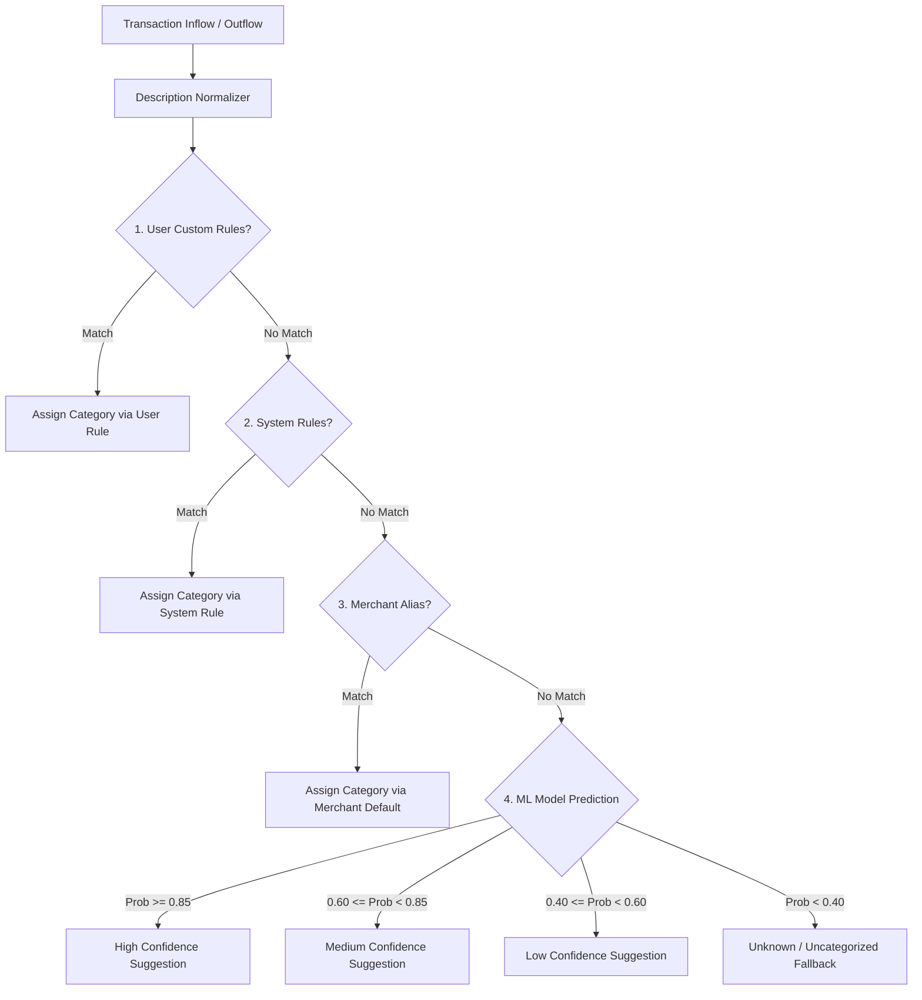

# Hybrid Classification Engine Architecture

## 1. Overview and Core Philosophy

The Arthsavora Classification Engine automatically categorizes financial transactions, isolates merchant candidates, and computes confidence scores.

To protect the financial accuracy of user accounts, the engine is built on two strict principles:
1. **Zero Silent Mutation**: AI predictions and auto-classifications are staged in `transaction_classifications` and only mutate `transaction.category_id` upon explicit user confirmation or verified deterministic rules. They **never** alter double-entry general ledger journal entries.
2. **Deterministic Priority Over Probabilistic Models**: Explicit user rules and verified merchant dictionaries always take precedence over machine-learning predictions.



---

## 2. Decision Pipeline Hierarchy

### Tier 1: User-Defined Workspace Rules
- **Precedence**: Highest.
- **Execution**: Evaluated in strict descending priority order (`priority DESC`).
- **Confidence**: Fixed at `1.0000` (`ConfidenceBand.HIGH`).
- **Scope**: Isolated to the owning tenant workspace.

### Tier 2: Universal System Rules
- **Precedence**: Secondary.
- **Execution**: Evaluated for cross-tenant patterns (e.g. `SALARY CREDIT` $\rightarrow$ `salary`, `GST CHALLAN` $\rightarrow$ `gst-taxes`).
- **Confidence**: Fixed at `1.0000` (`ConfidenceBand.HIGH`).
- **Scope**: Universal (`workspace_id IS NULL`).

### Tier 3: Merchant Alias Resolution
- **Precedence**: Tertiary.
- **Execution**: Matches normalized statement tokens against canonical merchants with a defined `default_category_id`.
- **Confidence**: Inherited from `MerchantAlias.confidence` (typically `0.9000`–`1.0000`).

### Tier 4: Machine-Learning Classifier
- **Precedence**: Quaternary fallback.
- **Execution**: TF-IDF character-subword Logistic Regression pipeline trained on curated Indian financial descriptions.
- **Confidence**: Calibrated model probability $P(y \mid X) \in [0.0, 1.0]$.

### Tier 5: Unknown Fallback
- **Precedence**: Final fallback.
- **Execution**: Triggered when ML confidence is below `0.40` or text is missing.
- **Status**: Flagged as `ConfidenceBand.UNKNOWN`. Requires manual user assignment.

---

## 3. Safe Condition Evaluation (Zero Code Execution)

The rule engine prohibits `eval`, `exec`, or dynamic AST interpretation. Rules evaluate structured JSON conditions against transaction parameters:

```json
{
  "description_contains": ["INSTAMART", "ZEPTO"],
  "direction": "outflow",
  "min_amount_paise": 10000,
  "max_amount_paise": 500000,
  "merchant_name": "SWIGGY",
  "account_types": ["savings", "credit_card"]
}
```

### Supported Condition Operators
1. `description_contains`: Case-insensitive substring matching against normalized description tokens.
2. `direction`: Matches `'inflow'` or `'outflow'`.
3. `min_amount_paise` / `max_amount_paise`: Exact integer paise range checks ($O(1)$ integer comparisons).
4. `account_ids` / `account_types`: Account scoping constraints.
5. `merchant_name`: Substring or equality matching against extracted merchant candidates.

---

## 4. Confidence Bands & Thresholds

Every prediction is tagged with a calibrated confidence band:

| Band | Probability Range | UI Treatment | Auto-confirmation Eligibility |
| :--- | :--- | :--- | :--- |
| **`high`** | $\ge 0.85$ (85%+) | Green badge, pre-selected in review modal | Eligible if user enabled auto-approve rules |
| **`medium`** | $0.60 - 0.84$ (60%–84%) | Indigo badge, suggested with one-click accept | Suggested to user for quick acceptance |
| **`low`** | $0.40 - 0.59$ (40%–59%) | Amber badge, presented with category dropdown | Review required; top 3 choices shown |
| **`unknown`** | $< 0.40$ (<40%) | Slate badge, marked "Uncategorized" | User manual assignment mandatory |

---

## 5. Explainability Architecture

Every classification result carries an explicit, human-readable rationale:
- *Rule Match*: `"Matched rule 'Swiggy Instamart Groceries' (Priority 200)"`
- *Merchant Match*: `"Matched verified merchant 'Swiggy' with alias 'BUNDL TECHNOLOGIES'"`
- *ML Model*: `"ML model predicted 'Food Delivery' with 88.5% confidence based on text patterns."`

```json
{
  "suggested_category_id": "7faa6689-57cc-4288-9874-681c7497ed17",
  "suggested_category_name": "Groceries & Supermarkets",
  "confidence_score": 0.9500,
  "confidence_band": "high",
  "method": "user_rule",
  "rule_id": "822e086d-ad84-49f6-85ee-3e117497ed17",
  "explanation": "Matched rule 'Swiggy Instamart Groceries' (Priority 200)"
}
```
