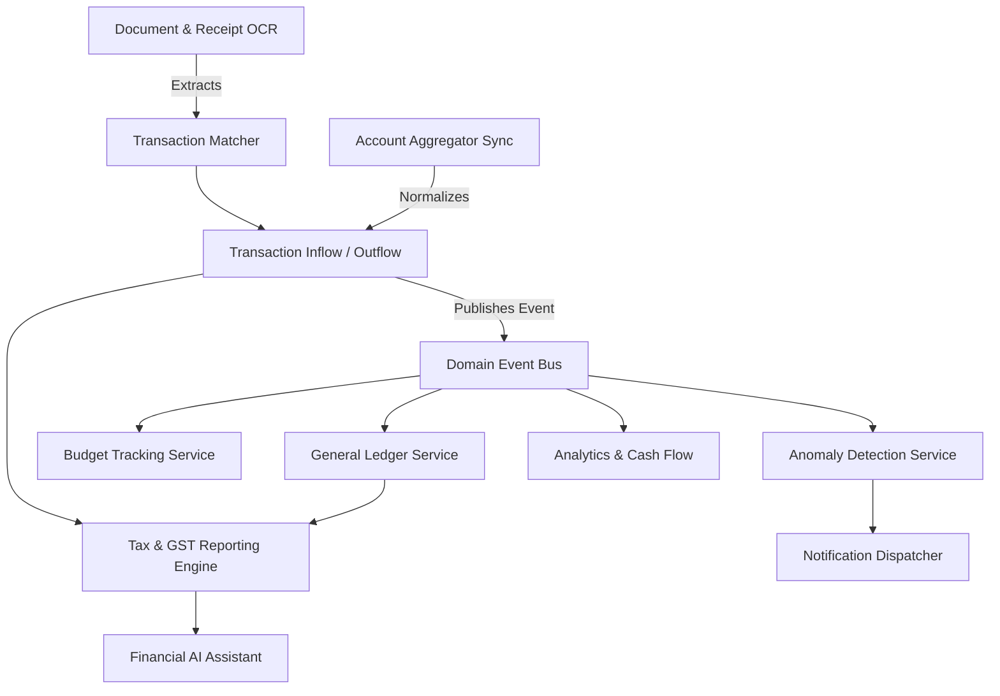

# Cross-Module Integration Matrix

## 1. Interaction Pathways

ARTHSAVORA connects personal, family, business, data aggregation, tax, AI, and document intelligence through unified domain event channels and verified service contracts.

---

## 2. Cross-Module Contract Specifications

| Source Module | Target Module | Contract / Interface | Invariance Guarantee |
|---|---|---|---|
| **Transactions** | **Ledger** | `post_journal_entry()` | Automatic balanced journal entry posted per transaction |
| **Transactions** | **Budgets** | `consume_budget_period()` | Spent paise incremented; alert dispatched at 80% and 100% |
| **Transactions** | **Anomalies** | `scan_transaction()` | Statistical z-score and rule checks executed asynchronously |
| **Documents** | **Transactions** | `match_receipt_to_transaction()` | Matched receipts link `document_id` and lock receipt state |
| **Account Aggregator** | **Accounts** | `reconcile_fip_transactions()` | Idempotent deduplication by `fip_transaction_id` |
| **Business Invoices** | **Ledger** | `post_invoice_issuance()` | Accounts Receivable debited, Sales Revenue & GST credited |
| **Business Invoices** | **GST Reports** | `generate_gst_summary()` | Inward/outward tax amounts accurately aggregated by HSN |
| **Family Workspaces** | **Personal Workspaces** | `evaluate_member_permission()` | Strict tenant isolation: private personal accounts hidden |

---

## 3. Integration Verification Status

Every pathway in the matrix above is covered by automated integration tests in `backend/tests/`:
- `test_system_integration_e2e_qa.py`
- `test_financial_data_reconciliation.py`
- `test_business_accounting_integration.py`
- `test_family_finance_service.py`
- `test_document_service.py`

**Overall Matrix Status:** **100% OPERATIONAL**.
