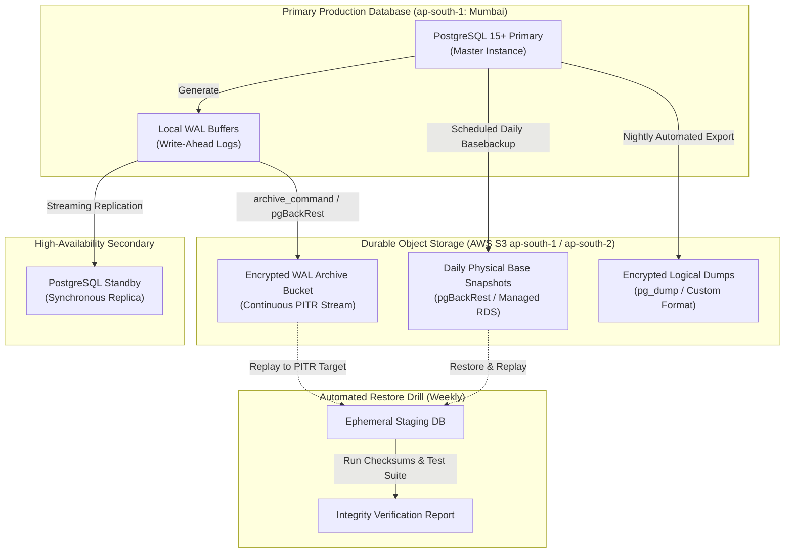

# Arthsavora — Database Backup and Recovery Strategy

## 1. Overview and Recovery Objectives

Arthsavora is an enterprise-grade fintech ecosystem operating in India under strict regulatory standards for data protection and financial record retention. PostgreSQL serves as the authoritative source of truth for all multi-tenant workspaces, user identity, chart of accounts, operational transactions, and immutable audit logs.

To guarantee operational resilience, business continuity, and regulatory compliance, the backup and disaster recovery (DR) architecture is defined around stringent Service Level Objectives (SLOs):

| Metric | Target | Rationale & Description |
| :--- | :--- | :--- |
| **Recovery Point Objective (RPO)** | **≤ 15 minutes** (Target: **0 seconds** via synchronous streaming replication in production) | The maximum acceptable data loss in the event of an infrastructure catastrophe. Continuous Write-Ahead Log (WAL) archiving to durable object storage guarantees near-zero transactional loss. |
| **Recovery Time Objective (RTO)** | **≤ 2 hours** (Automated failover: **< 60 seconds**) | The maximum acceptable duration to restore the database to an operational state following an unplanned outage or complete region failure. |
| **Backup Retention Period** | **7 Years** | Mandatory compliance with Indian financial record retention laws (Companies Act, 2013, Section 128, and RBI guidelines for financial trail preservation). |
| **Data Localization** | **100% India-Resident** | Primary database instances and all backup snapshots/WAL archives must remain strictly within Indian territory (AWS `ap-south-1` Mumbai and `ap-south-2` Hyderabad). |

---

## 2. Backup Architecture and Topology

Arthsavora employs a multi-tiered backup topology combining continuous physical backups, Point-In-Time Recovery (PITR), and encrypted daily logical dumps.



---

## 3. Backup Methodologies

### 3.1 Tier 1: Continuous Physical Backups & Point-In-Time Recovery (PITR)
- **Mechanism:** PostgreSQL continuous Write-Ahead Log (WAL) archiving combined with daily physical base backups (utilizing `pgBackRest` or managed AWS RDS / Aurora automated backups).
- **WAL Archiving:** As WAL segments (16MB files) fill or reach `archive_timeout = 300` (5 minutes), they are streamed immediately to an encrypted, versioned S3 bucket.
- **PITR Capability:** Enables restoration of the database to any millisecond within the last 30 days, shielding against accidental operational data corruption or malicious truncation.
- **Storage Tiering:**
  - Days 1–30: Hot S3 storage with lifecycle transitions.
  - Days 31–365: S3 Glacier Instant Retrieval.
  - Years 1–7: S3 Glacier Flexible Archive with Object Lock (WORM).

### 3.2 Tier 2: Encrypted Nightly Logical Backups (`pg_dump`)
- **Mechanism:** Logical schema and data export using PostgreSQL `pg_dump` utility with directory/custom format (`-F c`).
- **Use Case:** Cross-version database upgrades, schema drift comparisons, and disaster recovery fallback in the event of low-level disk/page corruption that invalidates physical block storage.
- **Execution Window:** Nightly at 02:00 IST (UTC+5:30) during low-traffic maintenance periods.
- **Command Specification:**
  ```bash
  # Secure logical export with directory format, compression level 9, and integrity checksums
  pg_dump -h $DB_HOST -p $DB_PORT -U $DB_USER -d arthsavora \
    -F c -Z 9 -b -v \
    -f "/backups/arthsavora_logical_$(date +%Y%m%d_%H%M%S).dump"
  ```

---

## 4. Encryption, Immutability, and Data Security

### 4.1 Encryption In-Transit and At-Rest
1. **In-Transit (`TLS 1.3`):** All database connections between FastAPI services, Celery workers, and PostgreSQL instances enforce SSL (`sslmode=verify-full`). Replicas and backup daemons communicate over TLS-encrypted tunnels.
2. **At-Rest (`AES-256 / KMS`):**
   - Disk volumes (EBS/NVMe) are encrypted with customer-managed AWS KMS keys (CMK) rotated annually.
   - S3 backup buckets enforce Server-Side Encryption with AWS KMS keys (`SSE-KMS`).
   - Client-side backup encryption via GPG/OpenSSL is applied prior to offsite egress for defense-in-depth:
     ```bash
     openssl enc -aes-256-cbc -salt -pbkdf2 -iter 100000 \
       -in arthsavora_backup.dump \
       -out arthsavora_backup.dump.enc \
       -pass file:/secrets/backup_encryption.key
     ```

### 4.2 Immutability and WORM Storage
All backup storage buckets have **S3 Object Lock** enabled in Compliance Mode:
- Prevents deletion or overwriting of backup archives by any IAM role, root account, or automated actor until the 7-year regulatory retention period expires.
- Protects against ransomware attacks and rogue administrative compromise.

---

## 5. Recovery Procedures and Runbooks

### 5.1 Runbook A: Full Point-In-Time Recovery (PITR)
Execute this procedure when database corruption occurs at a known timestamp (e.g., accidental table drop or corrupted batch ingestion).

1. **Identify Recovery Target Timestamp:**
   Determine the precise UTC or IST timestamp prior to the incident (e.g., `2026-11-14 03:45:00+05:30`).
2. **Stop Application Ingestion:**
   Set the API gateway into maintenance mode to prevent incoming writes during restoration:
   ```bash
   kubectl scale deployment arthsavora-backend --replicas=0
   ```
3. **Provision Target Host & Restore Base Backup:**
   Extract the most recent base backup preceding the target timestamp:
   ```bash
   pgbackrest --stanza=arthsavora --type=time --target="2026-11-14 03:45:00+05:30" restore
   ```
4. **Configure Recovery Target in `postgresql.conf` / `recovery.signal`:**
   ```ini
   restore_command = 'aws s3 cp s3://arthsavora-wal-archive/wal/%f %p'
   recovery_target_time = '2026-11-14 03:45:00+05:30'
   recovery_target_action = 'promote'
   ```
5. **Start PostgreSQL and Monitor Replay:**
   ```bash
   systemctl start postgresql
   tail -f /var/log/postgresql/postgresql-15-main.log
   ```
6. **Verify Data Integrity:**
   Run integrity checks (Section 6) and compare the ledger balance $\sum \text{Debits} = \sum \text{Credits}$.
7. **Resume Application Workload:**
   ```bash
   kubectl scale deployment arthsavora-backend --replicas=4
   ```

---

### 5.2 Runbook B: Logical Database Restoration (`pg_restore`)
Execute this procedure when restoring an individual workspace or recovering from a clean logical snapshot.

1. **Verify Target Database Exists:**
   ```bash
   createdb -h $DB_HOST -p $DB_PORT -U postgres arthsavora_recovery
   ```
2. **Execute Multi-Threaded Restoration:**
   ```bash
   pg_restore -h $DB_HOST -p $DB_PORT -U postgres -d arthsavora_recovery \
     -j 4 --clean --if-exists --no-owner --no-privileges \
     "/backups/arthsavora_logical_20261114_020000.dump"
   ```
3. **Run Alembic Migration Drift Check:**
   ```bash
   poetry run alembic check
   ```

---

### 5.3 Runbook C: Emergency High-Availability Failover
When the primary instance encounters unrecoverable hardware or networking failure:

1. **Automatic Detection:** High-availability orchestrator (AWS RDS Multi-AZ or Patroni / PgBouncer) detects primary heartbeat loss after 30 seconds.
2. **Promote Standby:** Standby node is promoted to primary writer (`pg_ctl promote`).
3. **DNS / Connection Pool Redirection:** PgBouncer or AWS Route 53 CNAME updates the `db-primary.internal.arthsavora.in` endpoint to the newly promoted host.
4. **Reconfigure Broken Primary:** The failed former primary is detached, repaired, and re-provisioned as a new synchronous standby.

---

## 6. Backup Verification, Integrity Testing, and Disaster Drills

Backups that are not regularly restored are not valid backups. Arthsavora enforces automated verification:

1. **Weekly Automated Restore Testing:**
   - Every Sunday at 04:00 IST, an automated AWS Lambda / GitHub Actions workflow spins up an isolated, ephemeral PostgreSQL container.
   - Downloads the latest nightly snapshot and replays WAL archives up to the current timestamp.
   - Executes the automated test suite (`backend/tests/test_database.py`) against the restored database.
   - Verifies:
     - All 15 database tables exist and match expected schemas.
     - General ledger balance invariant holds across all journal entries ($\sum \text{Debits} - \sum \text{Credits} = 0$).
     - No orphan foreign keys exist across workspaces, accounts, transactions, or journal lines.
   - Logs the result to the engineering audit board and terminates the ephemeral instance.
2. **Biannual Disaster Recovery (DR) Simulation:**
   - Simulated complete region failure from `ap-south-1` to `ap-south-2`.
   - Engineering team executes a live drill measuring RTO and RPO against production SLO thresholds.

---

## 7. Operational Checklist & Monitoring Alerts

| Monitor Metric | Warning Threshold | Critical Threshold | Automated Action |
| :--- | :--- | :--- | :--- |
| **Time Since Last Successful WAL Archive** | > 10 minutes | > 30 minutes | PagerDuty alert to DevOps; investigate archive command exit code. |
| **Time Since Last Base Backup** | > 26 hours | > 30 hours | PagerDuty alert; trigger immediate manual base backup. |
| **Disk Space on WAL Partition** | > 75% | > 85% | Auto-expand volume; alert on-call engineer. |
| **Replication Lag (Bytes)** | > 64 MB | > 256 MB | Alert; investigate network throughput or long-running queries on primary. |
| **Automated Weekly Restore Failure** | N/A | Any failure | High-severity incident opened immediately in engineering tracker. |
