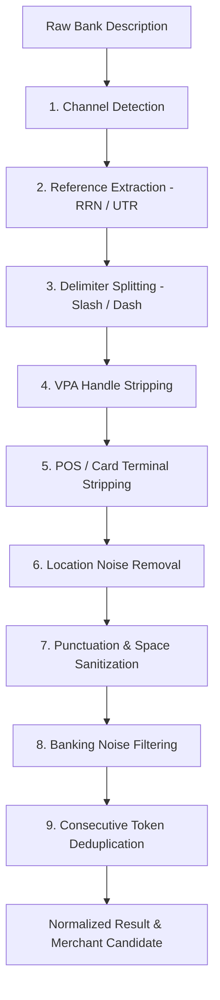

# Description Normalization Pipeline

## 1. Overview and Problem Statement

Financial transactions acquired from Indian banking networks (NPCI UPI, NEFT, RTGS, IMPS, NACH, POS EDC terminals) contain excessive syntactic noise, technical routing metadata, and terminal identifiers that obscure the true underlying economic activity.

Example raw descriptions:
- `UPI/SWIGGY/123456789012/PAYMENT TO SWIGGY BANGALORE`
- `POS 4402 STARBUCKS COFFEE KORAMANGALA BANGALORE IN`
- `NEFT CR-HDFC0001234-INFOSYS LIMITED-SALARY MARCH`
- `ACH D-ZERODHA BROKING LTD MUTUAL FUND SIP 87654321`
- `ATM WDL CASH HDFC ATM SAKET NEW DELHI`
- `AMZN MKTP IN*404092 LUXURY GOODS`

The `DescriptionNormalizer` pipeline transforms raw strings into deterministic, reproducible normalized descriptions while extracting payment channels, reference numbers, and merchant candidates.

---

## 2. Nine-Stage Sequential Pipeline

### Stage 1: Channel Detection
Identifies the payment medium using prefix and keyword regex analysis:
- **`upi`**: `UPI/`, `UPI-`, `BHIM/`, or containing `@` VPA handle.
- **`pos`**: `POS/`, `POS `, `EDC/`, `SWIPE/`.
- **`neft`**: `NEFT/`, `NEFT-`, `NEFT `.
- **`imps`**: `IMPS/`, `IMPS-`, `IMPS `.
- **`rtgs`**: `RTGS/`, `RTGS-`, `RTGS `.
- **`nach_mandate`**: `ACH/`, `NACH/`, `ECS/`, `ACH D-`, `NACH D-`.
- **`atm`**: `ATM WDL`, `CASH WDL`, `ATM CASH`, `CWDR`.
- **`general`**: Fallback channel for unclassified entries.

### Stage 2: Reference Token Extraction
Extracts authoritative tracking identifiers and suppresses them from the cleaned text:
- **UPI RRN**: 12-digit numeric sequences (`\b(\d{12})\b`).
- **Banking UTR**: 16-character alphanumeric bank reference numbers (`[A-Z]{4}[A-Z0-9]{7,18}`).

### Stage 3: Delimiter Splitting
Splits structured banking formats on delimiters (`/`, `-`, `|`), isolating the primary merchant segment while discarding trailing transaction codes.

### Stage 4: VPA Handle Stripping
Detects and strips virtual payment addresses while retaining useful username prefixes:
- Regex: `[\w\.\-]+@(okhdfcbank|okaxis|oksbi|okicici|paytm|apl|ibl|ybl|axl|gpay|icici|hdfcbank|sbi|postbank|jupiteraxis)`
- Example: `merchant@paytm` $\rightarrow$ candidate token: `merchant`.

### Stage 5: POS Terminal ID & Card Mask Stripping
Removes terminal IDs, EDC batch numbers, and masked card numbers:
- Regex: `\b(?:POS\s*\d+|TERM\s*\d+|TID\s*\d+)\b`, `[*#]\d{4,8}`.

### Stage 6: Location Noise Removal
Removes Indian metropolitan and state identifiers commonly appended to merchant names:
- Cities: `BANGALORE`, `BENGALURU`, `MUMBAI`, `DELHI`, `NEW DELHI`, `HYDERABAD`, `CHENNAI`, `PUNE`, `KOLKATA`, `AHMEDABAD`, `GURGAON`, `GURUGRAM`, `NOIDA`, `JAIPUR`, `IN`, `IND`.

### Stage 7: Punctuation and Whitespace Sanitization
Replaces special characters (`#`, `*`, `@`, `:`, `;`, `,`, `.`) with clean spaces and collapses redundant whitespace.

### Stage 8: Banking Noise & Preposition Filtering
Filters out non-semantic financial abbreviations:
- Noise tokens: `P2A`, `P2M`, `BIL`, `REV`, `DR`, `CR`, `MB`, `INET`, `MOB`, `TPV`, `WDL`, `TRF`, `TXN`, `DEP`, `CHQ`, `REF`, `AUTH`, `SETTL`, `ONLINE`, `DIRECT`, `PAYMENT`, `PURCHASE`, `RECHARGE`, `ECOM`, `MERCHANT`, `RETAIL`, `TRANSFER`, `INSTANT`.
- Prepositions: `TO`, `FOR`, `FROM`, `VIA`, `BY`, `IN`, `AT`, `ON`, `OF`.

### Stage 9: Consecutive Token Deduplication & Candidate Selection
Deduplicates repeated words (e.g. `SWIGGY SWIGGY` $\rightarrow$ `SWIGGY`) and selects the first 1–3 meaningful tokens as the `merchant_candidate`.

---

## 3. Immutability and Non-Destructive Invariant

The normalization process never alters the authoritative raw text:
- `transaction.description`: Immutable raw statement text as ingested from the bank or CSV file.
- `transaction.normalized_description`: Cleaned, versioned normalized text used for search, filtering, rule matching, and ML classification.
- `transaction.merchant_name`: Canonical merchant name resolved from merchant intelligence or candidate extraction.
