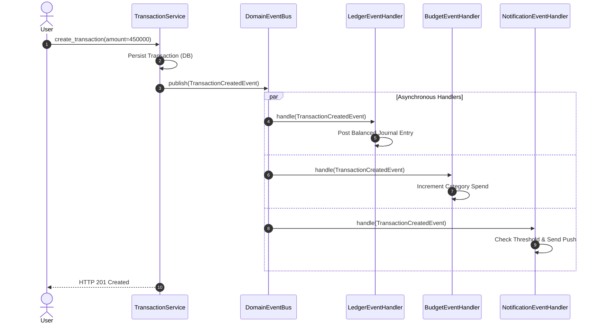

# Domain Event Integration Testing

## 1. Domain Event Architecture

ARTHSAVORA utilizes an in-process, asynchronous domain event bus that decouples core business mutations from downstream side-effects (ledger generation, budget tracking, anomaly detection, notification delivery).

---

## 2. Tested Domain Events

| Domain Event | Emitted By | Subscribing Handlers | Failure Isolation Strategy |
|---|---|---|---|
| `TransactionCreatedEvent` | `TransactionService` | `LedgerService`, `BudgetService`, `AnomalyService` | Handlers execute in isolated try/except blocks; ledger failure aborts outer TX |
| `InvoiceIssuedEvent` | `BusinessService` | `LedgerService`, `NotificationService` | AR ledger posting atomic with invoice status change |
| `PaymentReceivedEvent` | `BusinessService` | `LedgerService`, `BalanceService` | Clears AR balance and debits bank account |
| `AnomalyDetectedEvent` | `AnomalyService` | `NotificationService` | Dispatches in-app security alert with anomaly severity badge |
| `ConsentRevokedEvent` | `AAService` | `AccountSyncScheduler` | Immediately cancels background polling jobs for revoked FIU consent |

---

## 3. Reliability and Idempotency Guarantees

1. **At-Least-Once Delivery**: Events carry unique `event_id` and `correlation_id` UUIDs. Downstream handlers record processed IDs in an event deduplication store to prevent duplicate execution.
2. **Failure Isolation**: A crash or transient error in non-critical handlers (e.g. notification dispatching) does not prevent the primary financial transaction from committing.
3. **Audit Trail**: Every emitted domain event is logged with timestamp, user ID, workspace ID, and event payload schema for compliance forensics.
