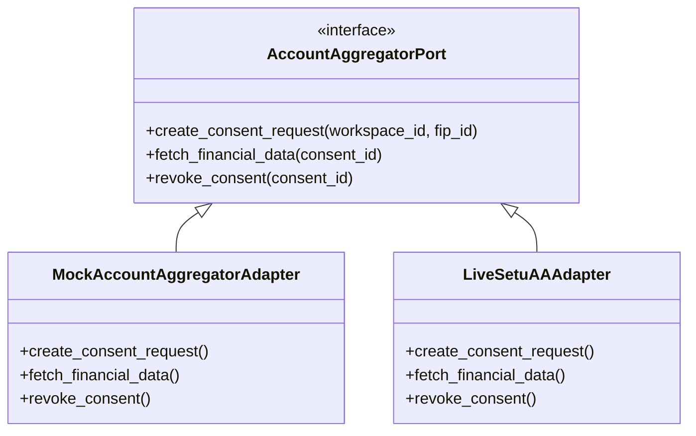

# External Integration Quality Assurance

## 1. Scope of External Integrations

ARTHSAVORA connects to external financial infrastructure:
1. **Account Aggregator (AA) Ecosystem**: Consent management (FIU) and Financial Information retrieval (FIP).
2. **Document & Receipt Parsing Engine**: Textract / Tesseract / Vision OCR providers.
3. **LLM Inference Gateways**: Gemini / Claude APIs for financial summarization and conversational assistance.
4. **Email / SMS Banking Notification Parsers**: Ingesting bank transaction alerts.

---

## 2. Integration Adapter Pattern

All external systems connect through abstract interfaces (Ports and Adapters Architecture):

---

## 3. Verified Scenarios

### 3.1 Consent Request Lifecycle
- Initiates consent with purpose code `101` (Personal Finance Management).
- Consent artifact verified with valid start/expiry dates and specific FIP account types.
- Revocation immediately transitions status to `REVOKED` and halts background polling.

### 3.2 Data Ingestion and Normalization
- Mock AA returns XML/JSON financial data payloads containing account balance and transaction records.
- Ingestion pipeline maps raw data into canonical `Transaction` entities with minor unit paise conversion.
- Deduplication prevents duplicate transaction creation if synced multiple times.
