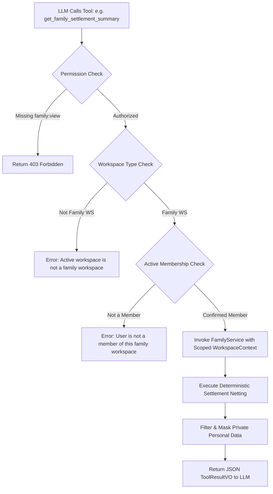

# ARTHSAVORA — FAMILY FINANCE AI ASSISTANT INTEGRATION

## 1. Executive Summary

Natural language queries in a household context must adhere to strict tenant isolation and individual member privacy. When a user asks ARTHSAVORA's AI Assistant (Prompt 18) about family finances, the assistant must operate strictly through verified deterministic tools that enforce workspace permissions, active membership, and personal data masking.

---

## 2. Registered Family Tools

In accordance with the Tool Registry (`app/services/assistant/tool_registry.py`), three dedicated tools are exposed to the AI model:

| Tool Name | Scope | Required Permission | Description |
| :--- | :--- | :--- | :--- |
| `get_family_overview` | Family Workspace | `family:view` | Retrieves high-level family metrics: total shared expenses, pool contributions, member count, and shared accounts. |
| `get_family_settlement_summary` | Family Workspace | `family:view` | Retrieves member net positions and peer settlement recommendations for a specified period (e.g. `2026-11`). |
| `get_family_commitments` | Family Workspace | `family:view` | Retrieves upcoming household recurring obligations (rent, utilities, subscriptions) and designated responsible members. |

---

## 3. Server-Side Execution Guardrails

When the Assistant plans a tool call, `ToolExecutor` executes the following multi-layer security validation:

---

## 4. Supported Natural Language Scenarios

| User Query | Orchestrated Tool | Synthesized Response Example |
| :--- | :--- | :--- |
| *"Who owes money in the household this month?"* | `get_family_settlement_summary(period="2026-11")` | "For November 2026, Bob has a net balance of -₹4,000 and Charlie owes -₹2,000. Alice paid for rent and is owed ₹6,000. The recommended settlement is Bob pays Alice ₹4,000, and Charlie pays Alice ₹2,000." |
| *"What family bills are due this week?"* | `get_family_commitments()` | "You have 2 upcoming household commitments: Apartment Maintenance (₹4,500 due on Nov 18, assigned to Alice) and Fiber Broadband (₹1,199 due on Nov 20, assigned to Bob)." |
| *"Give me a summary of our household expenses."* | `get_family_overview()` | "Sharma Household has 4 members and 2 shared accounts. For November 2026, total shared expenses are ₹48,200 across 12 allocations, and ₹35,000 in pool contributions have been recorded." |

---

## 5. Anti-Hallucination & Zero-Surveillance Invariants

1. **Deterministic Grounding:** The assistant never calculates settlement debts in the LLM neural network. It relies 100% on the deterministic output of `get_family_settlement_summary`.
2. **Personal Privacy Guard:** If a user in a family workspace asks *"How much did Alice spend on her personal credit card?"*, the system returns zero data because personal accounts are invisible to family tool queries.
3. **No Autonomous Transfers:** If the user says *"Pay Alice what I owe her"*, the assistant explicitly clarifies that it cannot execute bank transfers and provides the peer settlement details so the user can make the transfer via their preferred UPI/banking app.
