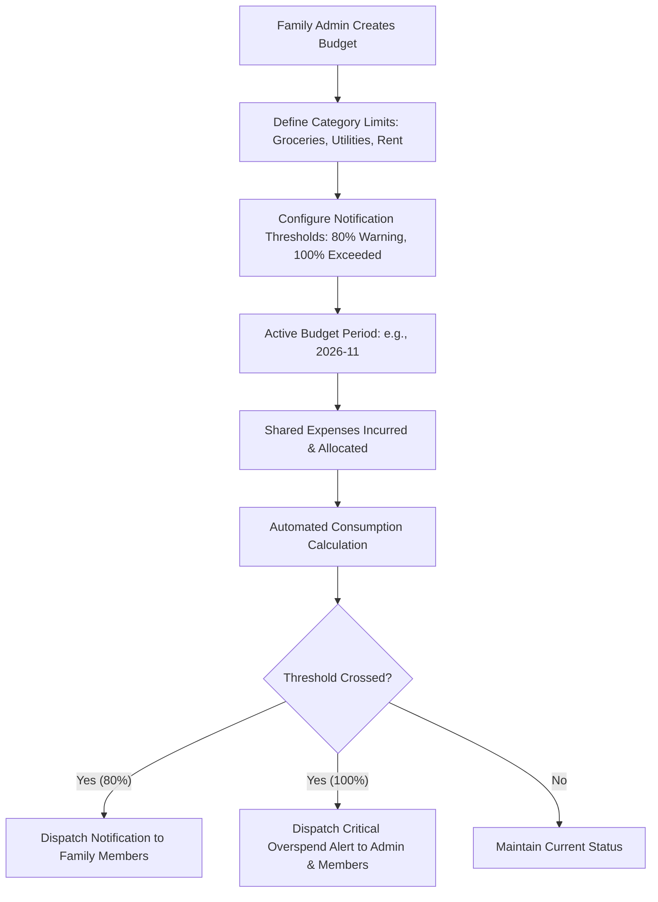

# ARTHSAVORA — COLLABORATIVE HOUSEHOLD BUDGETING

## 1. Executive Summary

Household financial peace depends on mutual agreement around spending limits, transparent tracking of collective consumption, and early warning before categories exceed agreed thresholds. 

The **ARTHSAVORA Collaborative Family Budgeting Engine** empowers households to create and monitor shared budgets while preserving individual members' personal spending discretion.

---

## 2. Personal vs. Family Budget Boundaries

```
+-----------------------------------------------------------------------------------------+
|                                BUDGET BOUNDARY MATRIX                                   |
|                                                                                         |
|   PERSONAL BUDGETS (Personal Workspace)       FAMILY BUDGETS (Family Workspace)        |
|   -------------------------------------       ---------------------------------        |
|   * Solely managed by individual user         * Co-managed by family members           |
|   * Private personal categories               * Shared household operational categories|
|     (e.g., Personal Hobbies, Discretionary)     (e.g., Groceries, Rent, Utilities, Kids)|
|   * Evaluated only against personal txns      * Evaluated only against shared txns     |
|   * Zero visibility to other family members   * Visible according to family RBAC       |
|   * Private alerts                            * Multi-member household alerts          |
+-----------------------------------------------------------------------------------------+
```

---

## 3. Collaborative Budget Lifecycle

Family budgets are standard ARTHSAVORA budget entities created with `workspace_id == family_ws.id`:



### 3.1 Spending Aggregation Rules
Family budget consumption incorporates:
1. All expenses recorded directly within the family workspace under the targeted category.
2. Transactions originating from bridged personal accounts where the category matches and the share scope includes transaction visibility.
3. **Exclusion:** Personal transactions outside the family workspace never consume family budget capacity under any circumstance.

---

## 4. Role-Based Budget Permissions & Youth Controls

| Action | Family Owner | Family Admin | Family Member | Restricted (Youth/Dep) | Family Viewer |
| :--- | :---: | :---: | :---: | :---: | :---: |
| **Create Budget** | Yes | Yes | No | No | No |
| **Modify Limits** | Yes | Yes | No | No | No |
| **View Household Budgets** | Yes | Yes | Yes | If `allow_restricted_view_budgets` is True | Yes |
| **Receive Alert Notifications** | Yes | Yes | Yes | Configurable | Read Only |

### 4.1 Restricted Member Controls (`allow_restricted_view_budgets`)
In many households, parents want teenagers and dependents to understand household financial discipline without seeing every granular line item or total family net worth. The `FamilyProfile.allow_restricted_view_budgets` flag allows parents to toggle whether restricted members can inspect the household budget progress bar and remaining balances.

---

## 5. Multi-Member Alert Orchestration

When a family budget reaches warning or critical levels:
- **Notification Engine (Prompt 20 Integration):** Emits `FAMILY_BUDGET_THRESHOLD_WARNING` or `FAMILY_BUDGET_EXCEEDED` events.
- **Recipient Routing:** By default, all Admins and active Members who opt in receive in-app and push alerts.
- **Contextual Transparency:** The notification message highlights the category name, total limit, current consumption, and percentage consumed—without revealing private personal account details.
