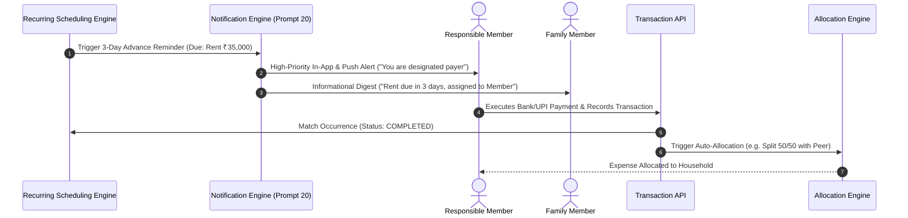

# ARTHSAVORA — HOUSEHOLD RECURRING COMMITMENTS & SUBSCRIPTION GOVERNANCE

## 1. Executive Summary

Households run on recurring operational cycles: monthly house rent, society maintenance charges, electricity and water utility bills, domestic staff salaries, fiber broadband, school tuition fees, and multi-user entertainment subscriptions.

The **ARTHSAVORA Household Recurring Commitments Engine** (built atop Prompt 15 Recurrence Architecture) manages these scheduled obligations, tracks next expected dates, assigns payment responsibilities to specific household members, and ensures payments are not missed or double-paid.

---

## 2. Personal vs. Household Recurring Commitments

```
+-----------------------------------------------------------------------------------------+
|                                COMMITMENT BOUNDARY                                      |
|                                                                                         |
|   PERSONAL COMMITMENTS (Personal Workspace)   HOUSEHOLD COMMITMENTS (Family Workspace)  |
|   -----------------------------------------   ----------------------------------------  |
|   * Individual gym memberships, phone EMI,    * House rent, electricity, maintenance,   |
|     personal streaming services, loans          broadband, family OTT, domestic staff   |
|   * Solely visible to individual user         * Visible to all authorized family members|
|   * Paid exclusively from personal accounts   * Assigned to designated responsible member|
|   * Does not appear on family calendar        * Synced to household financial calendar  |
+-----------------------------------------------------------------------------------------+
```

---

## 3. Recurring Commitment Attributes & Responsible Member

Household commitments are stored in `recurring_definitions` and `subscriptions` with `workspace_id == family_ws.id`:

| Attribute | Type | Description |
| :--- | :--- | :--- |
| `name` | String | Obligation title (e.g., "Apartment 402 Society Maintenance") |
| `amount` | Decimal / Paise | Expected recurring obligation amount |
| `cadence` | Enum | Frequency (`monthly`, `quarterly`, `annual`, `weekly`) |
| `due_day` | Integer | Day of cycle when obligation falls due (e.g., 5th of each month) |
| `next_expected_date`| Date | Computed next due date |
| `responsible_member_id` | UUID | Family member designated as the primary payer/coordinator |
| `auto_allocation` | Boolean | Whether an allocation item should be automatically drafted upon occurrence |
| `status` | Enum | State (`active`, `paused`, `cancelled`) |

---

## 4. Payment Responsibility and Verification Protocol



### 4.1 Strict Financial Invariant: Scheduled Commitment $\ne$ Completed Transfer
In alignment with ARTHSAVORA institutional principles:
- An upcoming or scheduled commitment is strictly an **expected cash-flow commitment**.
- The system will **never** treat an occurrence as an actual transaction until confirmed by a matched bank record or explicit user entry.
- Double-payment protection flags if two different members record transactions matching the same occurrence reference within the active billing window.
