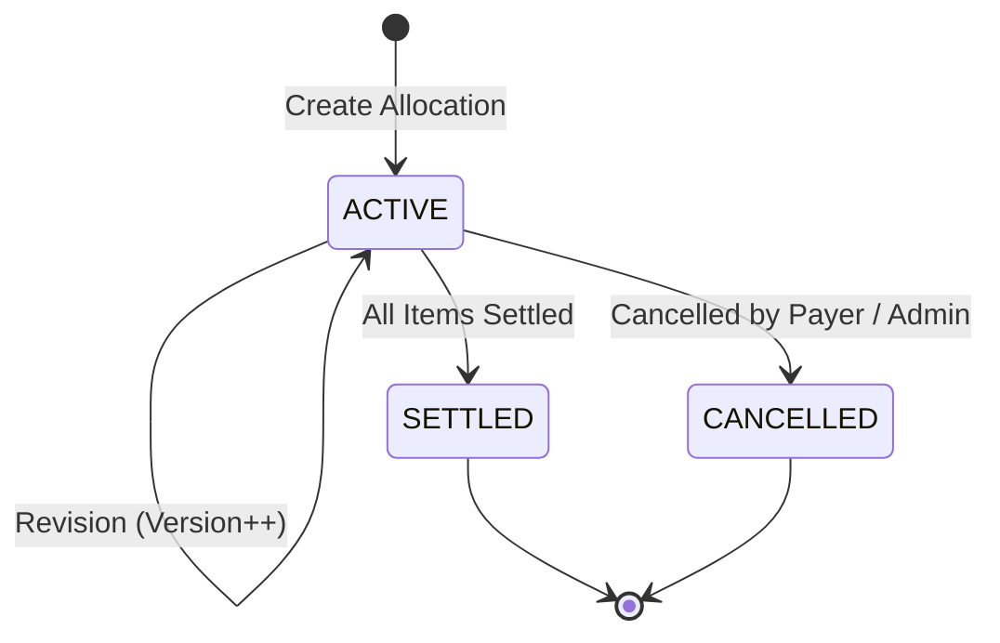

# ARTHSAVORA — FAMILY EXPENSE ALLOCATION ENGINE

## 1. Executive Overview

The **ARTHSAVORA Expense Allocation Engine** provides a mathematically rigorous, deterministic mechanism for dividing shared household expenditures among family members. It supports flexible domestic arrangements—ranging from equal student-roommate splits to income-proportional household sharing and custom fixed-contribution models.

All calculations are executed in integer minor units (**paise**), guaranteeing exact financial conservation:
$$\sum_{i=1}^N \text{share}_i = \text{Total Expense}$$
No floating-point drift or fractional currency units ever occur.

---

## 2. Allocation Methods & Mathematical Models

```
+-----------------------------------------------------------------------------------------+
|                                ALLOCATION METHODS                                       |
|                                                                                         |
|   1. EQUAL ALLOCATION               2. PERCENTAGE ALLOCATION                            |
|      * Divide equally among N          * Proportional to defined percentages            |
|      * Remainder to payer              * Must sum exactly to 100.00%                    |
|      * Best for shared dinners, bills  * Best for income-proportional sharing           |
|                                                                                         |
|   3. FIXED ALLOCATION               4. CUSTOM ALLOCATION                                |
|      * Specified exact amounts         * Itemized adjustments with variable weights     |
|      * Must sum exactly to total       * Must sum exactly to total                      |
|      * Best for partial subsidies      * Best for complex multi-category receipts       |
+-----------------------------------------------------------------------------------------+
```

### 2.1 Method 1: EQUAL Allocation
Divides the total expense $T$ (in integer paise) among $N$ selected participating members.
- **Base Share Calculation:**
  $$B = \lfloor \frac{T}{N} \rfloor$$
- **Remainder Calculation:**
  $$R = T \pmod N \quad (0 \le R < N)$$
- **Remainder Assignment:**
  To guarantee exact conservation, the remainder $R$ is assigned to the first $R$ members in the deterministic sorted member list (or the paying member):
  $$\text{Share}_i = \begin{cases} B + 1 & \text{if } i \le R \\ B & \text{if } i > R \end{cases}$$

#### Example: ₹100.00 shared among 3 members
- Total $T = 10,000$ paise.
- $N = 3$.
- $B = \lfloor 10,000 / 3 \rfloor = 3,333$ paise (₹33.33).
- $R = 10,000 \pmod 3 = 1$ paise.
- **Result:**
  - Member 1 (Payer): $3,333 + 1 = 3,334$ paise (₹33.34)
  - Member 2: $3,333$ paise (₹33.33)
  - Member 3: $3,333$ paise (₹33.33)
  - Total: $3,334 + 3,333 + 3,333 = 10,000$ paise ($\equiv \text{₹}100.00$).

---

### 2.2 Method 2: PERCENTAGE Allocation
Allocates shares based on designated percentages $P_i \in (0, 100]$ assigned to each member:
- **Precondition:** $\sum_{i=1}^N P_i = 100.00\%$ (enforced with high precision).
- **Provisional Share:**
  $$S_i = \lfloor \frac{T \times P_i}{100} \rfloor$$
- **Remainder:**
  $$R = T - \sum_{i=1}^N S_i$$
- The remainder $R$ paise (caused by integer truncation) is allocated to the member with the largest fractional remainder $(T \times P_i \pmod{100})$, or the primary payer, ensuring exact balance.

#### Example: ₹1,500.00 split 60% / 40% between 2 members
- Total $T = 150,000$ paise.
- Member A (60%): $150,000 \times 0.60 = 90,000$ paise (₹900.00).
- Member B (40%): $150,000 \times 0.40 = 60,000$ paise (₹600.00).
- Sum $= 150,000$ paise.

---

### 2.3 Method 3 & 4: FIXED & CUSTOM Allocations
- Each participating member is explicitly assigned an exact amount in paise $A_i$.
- **Validation Invariant:**
  $$\sum_{i=1}^N A_i \equiv T$$
- If the sum of specified amounts does not match $T$ down to the exact paise, the request is rejected with `ValidationError("Sum of fixed allocations must equal total amount")`.

---

## 3. Allocation Lifecycle & Immutability

Allocations maintain an explicit audit lifecycle and versioning scheme:



### 3.1 Revision Protocol
When household members agree to alter a previously recorded allocation (e.g., someone was inadvertently included in an expense):
1. The original allocation record has its `version` incremented ($v_2 = v_1 + 1$).
2. Previous allocation items are updated or replaced.
3. A `FAMILY_ACTIVITY` record is emitted: `ALLOCATION_REVISED` detailing the author and prior vs. new allocations.
4. Net settlement balances recalculate reactively.

### 3.2 Cancellation
If an allocation was created in error:
- Only the original payer or a Family Workspace Owner/Admin can cancel it.
- Its status changes to `CANCELLED`.
- Its shares are immediately excluded from all future settlement aggregations and net debt calculations.
- Historical records remain queryable with full audit transparency.
