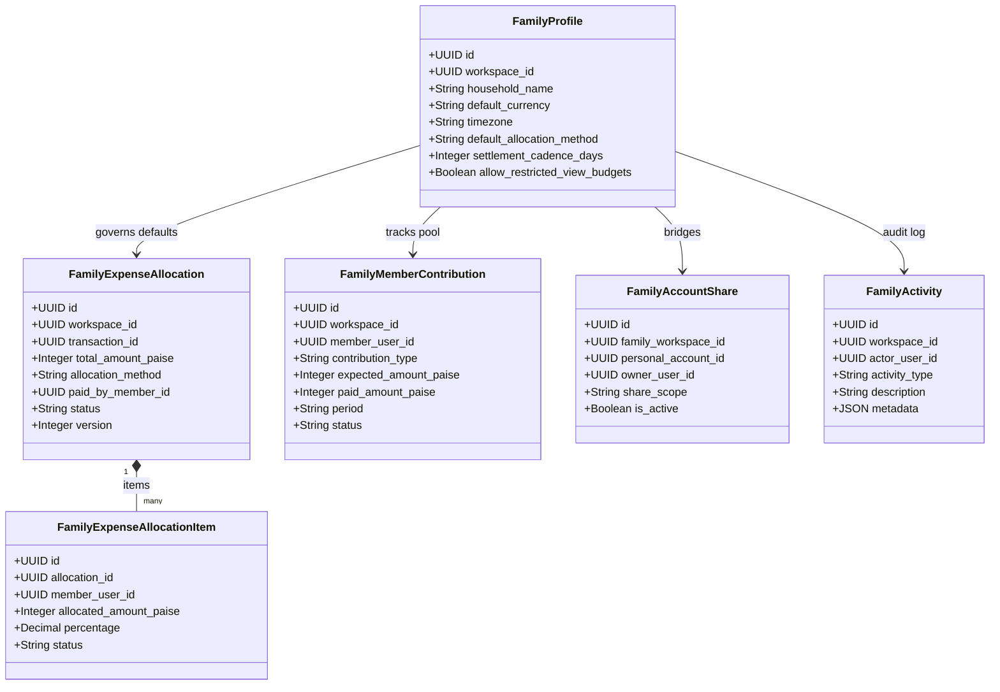
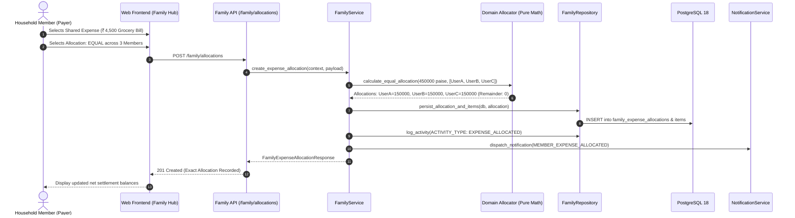

# ARTHSAVORA — FAMILY FINANCE ARCHITECTURE

## 1. Executive Summary & Vision

The **ARTHSAVORA Family Finance Module** provides an institutional-grade, multi-member collaborative financial operating environment. It enables modern households, joint families, and shared domestic partnerships to manage household visibility, track shared expenditures, coordinate pooled budgets, and schedule recurring commitments—**without compromising individual personal privacy or creating synthetic legal ownership**.

Modern financial platforms often fail household dynamics through one of two extremes:
1. **Total Surveillance:** Forcing every family member to expose all personal bank accounts, individual discretionary spending, and personal savings to the entire household.
2. **Disconnected Fragmentation:** Treating members as complete strangers with manual, external split-sheet calculations that lack integration with general ledgers, budgets, recurring schedules, and verified accounts.

ARTHSAVORA introduces the **Zero-Trust Family Boundary**:
- **A Family Workspace is a collaboration boundary, never an automatic authorization to read or mutate a member's private financial assets.**
- Personal accounts, transactions, and budgets remain private by default.
- Household resources (accounts opened directly within the family workspace, or explicitly bridged via selective disclosure) are visible according to granular workspace roles.
- Shared expenses can be partitioned using deterministic exact-paise allocation algorithms (`EQUAL`, `PERCENTAGE`, `FIXED`, `CUSTOM`).
- Member contributions and settlement netting provide informational peer recommendations without initiating automated, unverified bank transfers.

---

## 2. Core Architectural Principles

```
+-----------------------------------------------------------------------------------------+
|                                ARTHSAVORA ECOSYSTEM                                     |
|                                                                                         |
|   +--------------------------+                         +----------------------------+   |
|   |  Member A Personal Space |                         |   Member B Personal Space  |   |
|   |  * Private Bank Accounts |                         |   * Private Bank Accounts  |   |
|   |  * Private Transactions  |                         |   * Private Transactions   |   |
|   |  * Personal Budgets      |                         |   * Personal Budgets       |   |
|   +-------------+------------+                         +-------------+--------------+   |
|                 |                                                    |                  |
|                 | Explicit Selective Bridge                          | Explicit Bridge  |
|                 | (e.g., Shared Grocery Account)                     | (Read Only)      |
|                 v                                                    v                  |
|   +---------------------------------------------------------------------------------+   |
|   |                             FAMILY WORKSPACE                                    |   |
|   |                                                                                 |   |
|   |   * Family Profile (Household Currency, Defaults, Settlement Cadence)           |   |
|   |   * Family Shared Accounts & Bridge Privacy Filters                             |   |
|   |   * Collaborative Budgets & Shared Goals                                        |   |
|   |   * Recurring Commitments & Assigned Responsibility                             |   |
|   |   * Expense Allocation Engine (Equal / % / Fixed / Custom Exact Paise)          |   |
|   |   * Household Contribution Pool & Informational Settlement Netting              |   |
|   |   * Family Audit Activity Timeline                                              |   |
|   +---------------------------------------------------------------------------------+   |
+-----------------------------------------------------------------------------------------+
```

### 2.1 The Zero-Trust Privacy Invariant
Personal financial records belong exclusively to their authenticated owner (`workspace_id == personal_ws.id`). An invitation to or membership within a Family Workspace grants zero permissions to access any member's personal workspace. Crossing the privacy boundary requires an explicit `FamilyAccountShare` bridge created and controlled exclusively by the account owner.

### 2.2 Exact Minor-Unit Precision (Paise)
Financial allocations and settlements must never suffer from floating-point rounding errors or lost currency units. All monetary values are represented as integer paise ($1\text{ INR} = 100\text{ paise}$). When dividing indivisible amounts across $N$ members:
$$\sum_{i=1}^N \text{allocated\_share\_paise}_i \equiv \text{total\_expense\_paise}$$
Any remaining fractional paise are deterministically awarded to the transaction payer or designated member, maintaining an exact ledger balance.

### 2.3 Informational Settlement vs. Automated Execution
Settlement netting identifies peer liabilities based on historical expense payments and contribution deposits. ARTHSAVORA explicitly designates settlement recommendations as **informational calculations**. The system will **never** trigger unverified automated bank transfers or direct account debits. Settlements are marked as settled only upon explicit human confirmation or verified matching transaction pairing.

---

## 3. System Components & Domain Model



---

## 4. Interaction Lifecycle

### 4.1 Household Expense Allocation Lifecycle



---

## 5. Security Architecture & Role Enforcement

Every family action is validated against the active tenant context:

| Capability | Workspace Owner | Family Admin | Family Member | Restricted (Teen/Dep) | Family Viewer |
| :--- | :---: | :---: | :---: | :---: | :---: |
| **Manage Family Profile** | Yes | Yes | Read Only | Read Only | Read Only |
| **Invite Family Members** | Yes | Yes | No | No | No |
| **Bridge Personal Account** | Own Only | Own Only | Own Only | No | No |
| **Create Expense Allocation** | Yes | Yes | Yes | No | No |
| **Revise/Cancel Allocation** | Yes (or Payer) | Yes (or Payer) | Payer Only | No | No |
| **Record Pool Contribution** | Yes | Yes | Self Only | No | No |
| **Mark Settlement Paid** | Yes | Yes | Involved Member | No | No |
| **View Household Ledgers** | Yes | Yes | Yes | If Permitted | Read Only |

---

## 6. Verification and Compliance Standards

1. **Zero Negative Balances in Minor Units:** All `_paise` columns enforce `CHECK (column >= 0)`.
2. **Strict Foreign Key Isolation:** All shared records require explicit `workspace_id` referencing the verified family workspace.
3. **Idempotent Settlement Calculations:** Re-running settlement queries across any period produces deterministic results invariant to database read order.
4. **Audit Trail Completeness:** All configuration changes, allocations, revisions, contributions, and settlements are permanently logged to `family_activities`.
