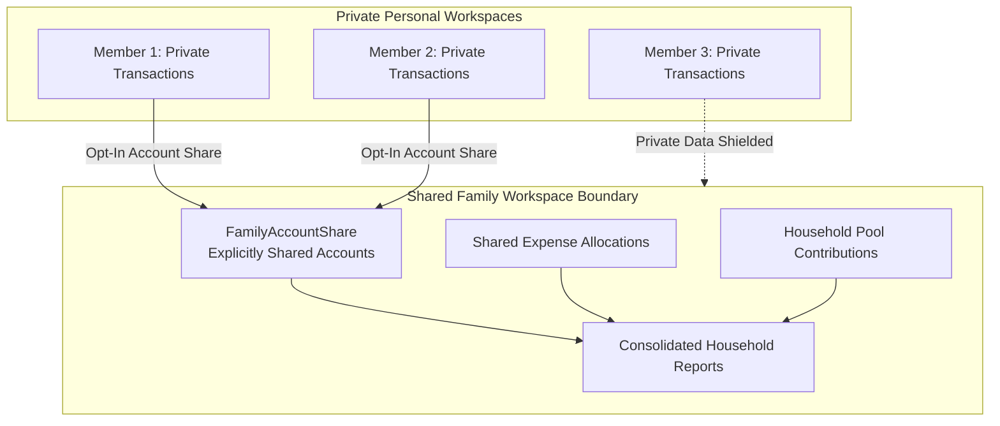

# ARTHSAVORA — FAMILY FINANCIAL REPORTING

## 1. Overview & Household Financial Visibility

Family financial reporting aggregates shared household expenditures, collaborative budget execution, and family member pool contributions within a shared household workspace boundary.

---

## 2. Shared vs Personal Boundary

---

## 3. Household Financial Statements

### 3.1 Consolidated Family Income & Expense Report
- Aggregates shared household inflows (e.g. joint rental income, shared pool disbursements) and shared living costs (groceries, rent, utilities, family vacations, child tuition).
- Distinguishes shared household expenses from individual discretionary spending.

### 3.2 Member Contribution & Settlement Summary
- Tracks each family member's agreed monthly contribution vs actual contributions.
- Generates transparent settlement schedules without exposing unshared individual line items.

### 3.3 Data Privacy Rules
- Non-admin members (e.g. `member`, `child`) see only summary totals or categories permitted by their workspace role.
- Reports never leak private merchant descriptions or transaction notes from unshared personal accounts.
