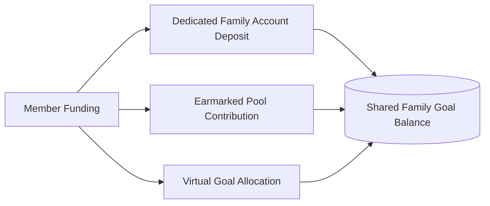

# ARTHSAVORA — SHARED FINANCIAL GOALS & COLLABORATIVE SAVINGS

## 1. Executive Summary

Long-term domestic stability often centers around shared milestones: building a 6-month household emergency fund, saving for a home downpayment, funding children's higher education, or financing an annual family vacation.

The **ARTHSAVORA Shared Financial Goals Engine** allows families to define collective targets, assign contribution milestones across members, and monitor progress transparently.

---

## 2. Personal Goals vs. Shared Family Goals

```
+-----------------------------------------------------------------------------------------+
|                                GOAL BOUNDARY COMPARISON                                 |
|                                                                                         |
|   PERSONAL GOALS (Personal Workspace)         SHARED FAMILY GOALS (Family Workspace)   |
|   -----------------------------------         --------------------------------------   |
|   * Individual savings (e.g., personal tech,  * Household milestones (e.g., Family     |
|     personal retirement, individual loan)       Vacation, Emergency Reserve, House)    |
|   * Funded solely by individual owner         * Multi-member collaborative funding     |
|   * Progress hidden from family members       * Progress visible to all family members |
|   * Target linked to personal account         * Linked to native or bridged accounts   |
+-----------------------------------------------------------------------------------------+
```

---

## 3. Shared Goal Structure & Attributes

Family goals are stored in the core `financial_goals` table with `workspace_id == family_ws.id`:

| Attribute | Type | Description |
| :--- | :--- | :--- |
| `name` | String | Household milestone title (e.g., "Kashmir Family Holiday 2027") |
| `target_amount` | Decimal / Paise | Total required monetary sum |
| `current_amount` | Decimal / Paise | Verified accumulated savings earmarked for this goal |
| `target_date` | Date | Projected completion deadline |
| `priority` | Enum | Priority weighting (`low`, `medium`, `high`, `critical`) |
| `category` | Enum | Classification (`emergency`, `education`, `travel`, `asset`, `general`) |
| `status` | Enum | Progress lifecycle (`in_progress`, `achieved`, `paused`, `cancelled`) |

---

## 4. Multi-Member Funding Mechanisms

Household members can advance family goals through three verified mechanisms:



1. **Dedicated Family Account Deposit:** Direct deposit into a native family savings account linked to the goal.
2. **Earmarked Pool Contribution:** Member records a contribution of type `GOAL_SAVINGS` targeted toward a specific goal identifier.
3. **Virtual Allocation:** Reallocating surplus funds from existing family operational balances without moving physical bank deposits.

---

## 5. Milestone Celebrations and Notifications

- **Progress Increments (Prompt 20 Integration):** Emits notifications to household members at 25%, 50%, 75%, and 100% completion milestones.
- **Goal Achievement Ceremony:** When `current_amount >= target_amount`, the goal status automatically updates to `achieved`, triggering celebration banners in the family dashboard and notifying all participants.
- **Pace Tracking & Predictive Intelligence:** Uses historical contribution cadence to estimate whether the family will meet the target date, warning administrators if monthly contributions fall below the required rate.
