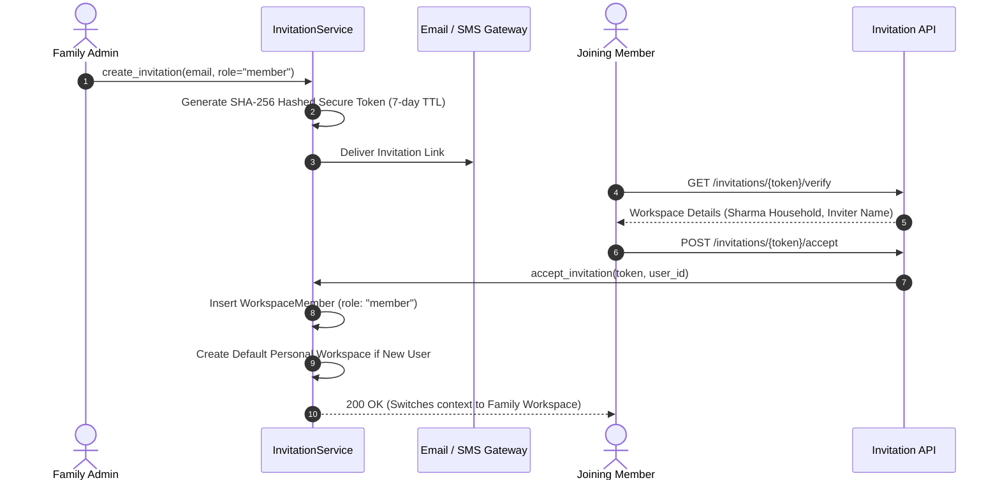

# ARTHSAVORA — FAMILY PRIVACY, SECURITY & AUTHORIZATION

## 1. Executive Summary

Domestic finance presents unique privacy challenges: family members love and trust one another, yet individual financial autonomy, dignity, and personal confidentiality are non-negotiable human needs. Coercive surveillance architectures destroy adoption and damage domestic harmony.

The **ARTHSAVORA Zero-Trust Family Model** guarantees that joining a family workspace never compromises an individual's personal privacy, leaks personal transaction history, or permits involuntary asset discovery.

---

## 2. Granular Family Permissions

ARTHSAVORA enforces 5 dedicated family workspace permissions:

| Permission | Identifier | Description |
| :--- | :--- | :--- |
| `VIEW_FAMILY_FINANCE` | `family:view` | Inspect shared family dashboard, overview KPIs, and shared accounts |
| `MANAGE_FAMILY_FINANCE` | `family:manage` | Configure household settings, currency, and settlement cadence |
| `MANAGE_FAMILY_ALLOCATIONS` | `family:allocations:manage`| Create, revise, or cancel shared expense allocations |
| `MANAGE_FAMILY_CONTRIBUTIONS`| `family:contributions:manage`| Record, confirm, or waive pool contributions |
| `MANAGE_FAMILY_SETTINGS` | `family:settings:manage`| Modify family profile and restricted member view policies |

---

## 3. The Family Role-Permission Matrix

Within a Family Workspace, roles map to specific permission sets:

| Permission | Owner | Admin | Member | Restricted (Youth/Dep) | Viewer (Auditor/Guest) |
| :--- | :---: | :---: | :---: | :---: | :---: |
| `VIEW_WORKSPACE` | Yes | Yes | Yes | Yes | Yes |
| `UPDATE_WORKSPACE` | Yes | Yes | No | No | No |
| `VIEW_MEMBERS` | Yes | Yes | Yes | Yes | Yes |
| `INVITE_MEMBERS` | Yes | Yes | No | No | No |
| `UPDATE_MEMBER_ROLE` | Yes | Yes | No | No | No |
| `REMOVE_MEMBERS` | Yes | Yes | No | No | No |
| `VIEW_ACCOUNTS` | Yes | Yes | Yes | If Permitted | Read Only |
| `MANAGE_ACCOUNTS` | Yes | Yes | No | No | No |
| `VIEW_TRANSACTIONS` | Yes | Yes | Yes | If Permitted | Read Only |
| `CREATE_TRANSACTIONS`| Yes | Yes | Yes | No | No |
| `VIEW_FAMILY_FINANCE`| Yes | Yes | Yes | Yes | Yes |
| `MANAGE_FAMILY_FINANCE`| Yes | Yes | No | No | No |
| `MANAGE_FAMILY_ALLOCATIONS`| Yes | Yes | Yes | No | No |
| `MANAGE_FAMILY_CONTRIBUTIONS`| Yes | Yes | Self Only | No | No |
| `MANAGE_FAMILY_SETTINGS`| Yes | Yes | No | No | No |

---

## 4. Youth & Dependent Protection (`restricted` Role)

The `restricted` role is specifically engineered for children, teenagers, domestic assistants, or dependents:
- **Zero Mutative Privileges:** Cannot create transactions, bridge accounts, alter allocations, or change household configuration.
- **Controlled Visibility:** By default, cannot view adult bank account balances or individual salary records.
- **Budget Education Toggle:** Parents can enable `allow_restricted_view_budgets` to let youth observe household budgeting discipline without exposing sensitive underlying numbers.

---

## 5. Invitation Lifecycle & Member Onboarding

---

## 6. Immutable Activity Logging

All significant actions within the family workspace are permanently logged to `family_activities`:
- `MEMBER_INVITED`, `MEMBER_JOINED`, `MEMBER_REMOVED`, `ROLE_CHANGED`
- `EXPENSE_ALLOCATED`, `ALLOCATION_REVISED`, `ALLOCATION_CANCELLED`
- `CONTRIBUTION_RECORDED`, `CONTRIBUTION_PAID`
- `SETTLEMENT_RECORDED`
- `ACCOUNT_SHARED`, `ACCOUNT_UNSHARED`

Each entry captures the `actor_user_id`, timestamp, action type, description, and structured JSON metadata.
