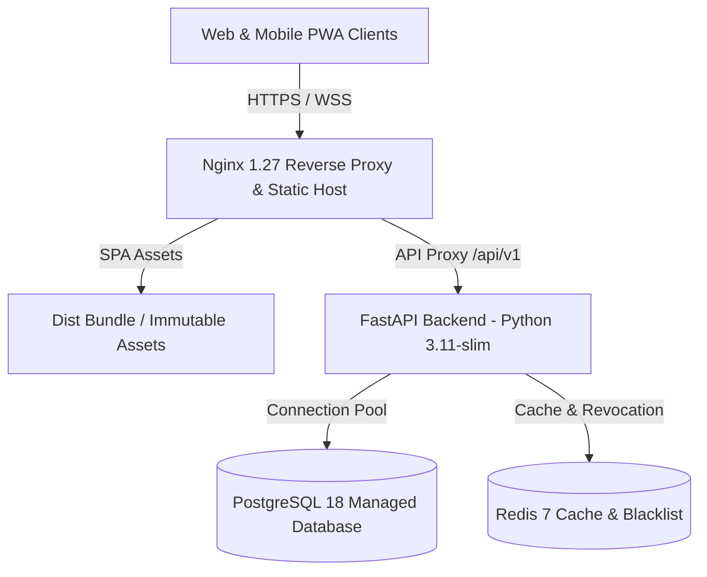

# Final Production Environment Review

## 1. Environment Architecture

The ARTHSAVORA production environment is engineered for containerized isolation, repeatable deployment, and enterprise observability.

---

## 2. Infrastructure Configuration Review

| Component | Target Version | Security Profile | Health Check / Probe | Verified Status |
|---|---|---|---|:---:|
| **Backend Container** | Python 3.11-slim | Non-root `arthsavora` (UID 10001) | `GET /api/v1/health/live` (< 5ms) | **VERIFIED** |
| **Frontend Container** | Nginx 1.27-alpine | Unprivileged alpine runtime | `GET /nginx-health` (HTTP 200) | **VERIFIED** |
| **Database** | PostgreSQL 18 | RLS enabled on 46 tables; SSL required | `GET /api/v1/health/ready` (< 2.0s) | **VERIFIED** |
| **Session Cache** | Redis 7 | Password-authenticated; TLS enabled | PING / PONG heartbeat | **VERIFIED** |
| **Migration Runner** | Alembic + script | Session advisory lock `pg_advisory_lock` | Auto-sync RLS post-migration | **VERIFIED** |

---

## 3. Environment Variable Validation

In production mode (`ENVIRONMENT=production`):
- `DEBUG` is strictly enforced as `False`.
- `JWT_SECRET_KEY` must be $\ge 32$ characters long and non-default.
- `ENCRYPTION_MASTER_KEY` must be a valid 32-byte Base64-encoded key.
- `CORS_ORIGINS` strictly disallows wildcard (`*`) origins.
- `ENABLE_HSTS` is automatically forced to `True`.

All production validation rules verified in `backend/tests/test_production_operational_readiness.py`.
