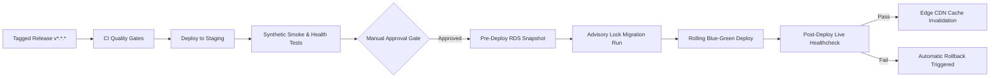

# Final Release Pipeline Specification

## 1. Overview of Release Pipeline

The ARTHSAVORA continuous integration and release delivery workflow is orchestrated via GitHub Actions:
- `.github/workflows/ci.yml`: Automated pull request and push verification.
- `.github/workflows/deploy.yml`: Staged automated deployment to Staging and Production.

---

## 2. CI/CD Quality Gate Stages

1. **Security Audit**: Automated dependency vulnerability check via `pnpm audit` and SAST scan with `bandit`.
2. **Backend Verification**: Executes full test suite (344 tests) against ephemeral PostgreSQL 18 and Redis 7 containers.
3. **Frontend Verification**: Monorepo TypeScript check (`pnpm -r run typecheck`), ESLint, and 158 Vitest tests.
4. **Bundle Verification**: Production build via `vite build` validating asset generation and chunk integrity.
5. **Container Build Preflight**: Docker build verification confirming non-root user execution and healthchecks.

---

## 3. Deployment Safety Controls

- **Zero-Downtime Rolling Updates**: New container tasks must pass live and ready probes before traffic is diverted.
- **Migration Advisory Locks**: Prevents dual-runner race conditions during multi-container deployments.
- **Pre-Deploy Database Snapshots**: Automated snapshot created prior to applying production DDL alterations.
