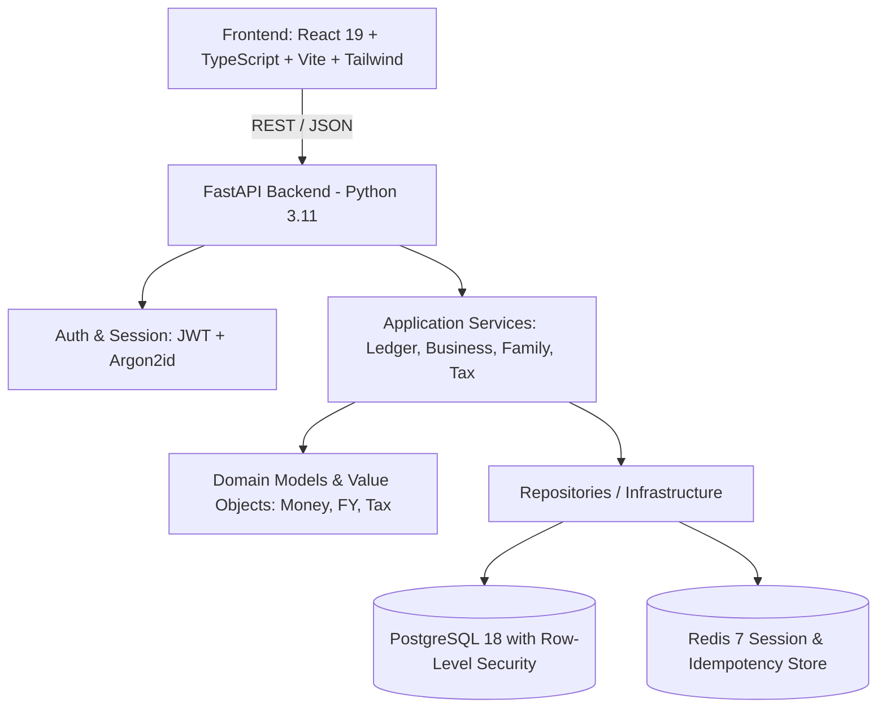

# Final Technical Handover Document

## 1. Technical Architecture Overview

ARTHSAVORA is an institutional-grade commercial FinTech platform architected using Domain-Driven Design (DDD), Clean Architecture, and strict event-driven boundaries.

---

## 2. Technology Stack & Key Libraries

### Backend Stack
- **Runtimes**: Python 3.11.x (managed via `uv`).
- **Framework**: FastAPI 0.110+, Pydantic v2, Uvicorn / Gunicorn.
- **Persistence**: SQLAlchemy 2.0 (asyncio + asyncpg), Alembic migrations.
- **Security**: Argon2id (`argon2-cffi`), PyJWT, cryptography (`AES-256-GCM`).
- **Accounting**: Strict minor unit paise integer representation, `Money` value object (`Decimal`).

### Frontend Stack
- **Monorepo**: Managed via `pnpm` workspaces (`packages/*` + `apps/web`).
- **Framework**: React 19, TypeScript 5.4, Vite 7.3.
- **Routing & State**: React Router v6, Zustand.
- **Design & UI**: Tailwind CSS, Lucide React, accessible ARIA primitives.
- **PWA**: W3C Web App Manifest, Service Worker caching strategies.

---

## 3. Core Entry Points

- **Backend Application Entry**: `backend/app/main.py`
- **Database Schema Models**: `backend/app/infrastructure/database/models.py`
- **Double-Entry Ledger Engine**: `backend/app/services/ledger/ledger_service.py`
- **Migration & RLS Runner**: `backend/scripts/run_migrations.py`
- **Frontend SPA Entry**: `apps/web/src/main.tsx`
- **Frontend App Shell & Routing**: `apps/web/src/App.tsx`
- **Shared API Contracts**: `packages/contracts/src/`

---

## 4. Key Engineering Invariants

1. **Double-Entry Balance**: Never post an unbalanced journal. Always verify $\sum \text{Debits} == \sum \text{Credits}$.
2. **Zero-Float Money**: Never store or calculate money in floating-point format (`float`). Use integer `paise` or `Money`.
3. **Anti-IDOR**: Never return HTTP 403 on foreign workspace entity queries; always return **HTTP 404 (Not Found)**.
4. **Advisory Migration Lock**: Never execute Alembic upgrades without `pg_advisory_lock(987654321)`.
