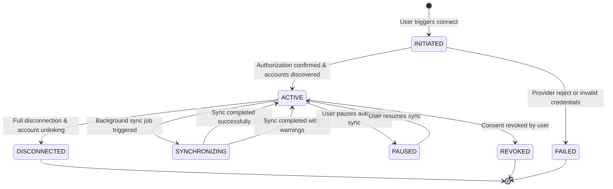

# ARTHSAVORA Financial Connection Lifecycle & Health Monitoring

## 1. Overview

A Financial Connection (`FinancialConnection`) represents an ongoing, tenant-scoped integration between an ARTHSAVORA workspace and an external financial institution via a registered provider.

Managing this integration requires tracking connection states, monitoring sync health, evaluating credential validity, and gracefully handling provider downtimes.

---

## 2. Connection State Machine



### Connection States (`ConnectionStatus`)
- `INITIATED`: New connection initialized, authorization link active, waiting for user consent.
- `ACTIVE`: Consent authorized and valid. Feeds are operational.
- `SYNCHRONIZING`: Ingesting data or computing reconciliation.
- `PAUSED`: Temporarily paused by user or workspace admin.
- `FAILED`: Fatal authorization or setup failure.
- `REVOKED`: Associated consent revoked.
- `DISCONNECTED`: Completely unlinked, historical connection soft-deleted.

---

## 3. Health Monitoring & Status Calculation

ARTHSAVORA implements a deterministic health evaluation algorithm (`compute_connection_health` in `app/domain/financial_connection.py`):

```python
def compute_connection_health(
    connection_status: str,
    consent_is_valid: bool,
    sync_failure_count: int,
    last_successful_sync_at: Optional[datetime],
    now: datetime,
) -> ConnectionHealthStatus:
    if connection_status == ConnectionStatus.DISCONNECTED.value:
        return ConnectionHealthStatus.DISCONNECTED

    if not consent_is_valid or connection_status == ConnectionStatus.REVOKED.value:
        return ConnectionHealthStatus.CONNECTION_EXPIRED

    if connection_status == ConnectionStatus.INITIATED.value:
        return ConnectionHealthStatus.NEEDS_AUTHORIZATION

    if sync_failure_count >= 5:
        return ConnectionHealthStatus.PROVIDER_UNAVAILABLE

    if sync_failure_count >= 2:
        return ConnectionHealthStatus.SYNC_DELAYED

    if last_successful_sync_at:
        days_since_sync = (now - last_successful_sync_at).total_seconds() / 86400.0
        if days_since_sync > 7.0:
            return ConnectionHealthStatus.SYNC_DELAYED

    return ConnectionHealthStatus.HEALTHY
```

### Health Statuses (`ConnectionHealthStatus`):
1. **`HEALTHY`**: Feeds running on schedule without consecutive errors.
2. **`NEEDS_AUTHORIZATION`**: Hand-off link generated, user needs to complete login/OTP.
3. **`SYNC_DELAYED`**: Sync failed 2-4 times or last successful sync is older than 7 days.
4. **`CONNECTION_EXPIRED`**: Consent duration elapsed or consent revoked.
5. **`PROVIDER_UNAVAILABLE`**: 5+ consecutive provider API errors; backoff active.
6. **`DISCONNECTED`**: Connection terminated.

---

## 4. Account Discovery & Linking Lifecycle

When a connection transitions to `ACTIVE`, account discovery is executed:
1. Provider API returns discovered accounts from authorized FIPs.
2. Accounts are persisted in `external_account_references` with state `DISCOVERED`.
3. The user or automated matching logic can link each external reference:
   - **Link to Existing Account**: Associates `provider_account_id` with an existing `Account` in the workspace.
   - **Create New Account**: Automatically scaffolds a new `Account` with matching name, masked number, and opening balance.
4. Linked accounts transition to state `LINKED`.
5. If the user chooses to disconnect, references transition to `UNLINKED` and `account.connection_status` is updated to `disconnected`.
