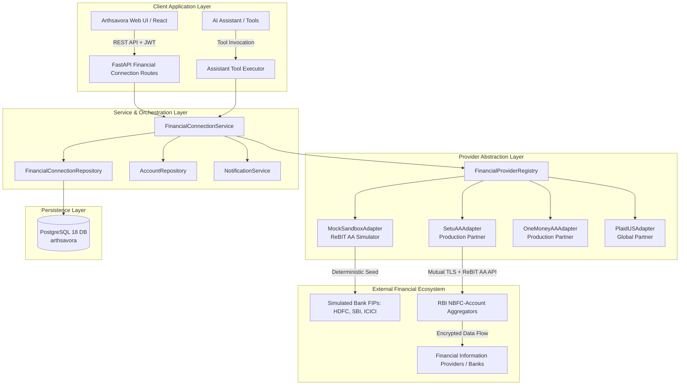

# ARTHSAVORA Financial Connectivity Architecture

## 1. Executive Summary

The ARTHSAVORA Financial Connectivity and Account Aggregation layer provides an institutional-grade, multi-tenant financial data synchronization framework. It enables users, families, and businesses to connect authorized external financial accounts (savings, current, credit cards, loans) and automatically synchronize transactions, monitor reported balances, and reconcile bank statements with the internal double-entry ledger.

The architecture prioritizes the **India Account Aggregator (AA) ecosystem** governed by Reserve Bank of India (RBI) and ReBIT standards, while maintaining a strictly provider-agnostic abstraction layer capable of supporting global Open Banking standards (such as UK Open Banking, EU PSD2, and US Plaid/MX) without modifying core domain logic.

---

## 2. Core Architectural Principles & Invariants

1. **Provider Independence**: Core domain models, synchronization logic, and ledger accounts have zero dependency on any specific provider SDK. All provider implementations inherit from `FinancialProviderAdapter`.
2. **Strict Consent Governance**: No financial account may be inspected, connected, or synced without an explicit, cryptographically verifiable, user-approved consent record (`FinancialConsent`) with unambiguous purpose codes, data categories, and validity bounds.
3. **No Direct Banking Scraping**: ARTHSAVORA never collects user banking credentials, netbanking passwords, PINs, OTPs, or CVVs. All connectivity utilizes regulated consent tokens or Open Banking OAuth redirects.
4. **Idempotent Ingestion**: Data ingestion is strictly idempotent. Repeated synchronizations cannot produce duplicate transactions or double-counted balances. Deduplication is enforced at database and workspace bounds via `external_transaction_id`.
5. **Audited Balance Separation**: External bank-reported balances (`provider_reported_balance_paise`) and internal book balances (`current_book_balance_paise`) are maintained as separate, independent fields. Bank balances never overwrite internal ledger balances.
6. **Immutable Audit Trails**: Every consent issuance, authorization confirmation, account linking, sync execution, variance detection, and revocation produces an immutable record in `connection_audit_events`.

---

## 3. Layered System Architecture

### 3.1 Domain Layer (`app/domain/financial_connection.py`)
Encapsulates pure value objects, domain enums, and deterministic calculation rules without I/O or database dependencies:
- **Enums**: `ConnectionStatus`, `ConnectionHealthStatus`, `ConsentStatus`, `ProviderCategory`, `ProviderStatus`, `SyncJobType`, `SyncJobStatus`, `ReconciliationStatus`, `AccountLinkStatus`.
- **Value Objects**: `NormalizedAccountVO`, `NormalizedTransactionVO`, `ReconciliationVarianceVO`, `ConsentSummaryVO`.
- **Pure Functions**:
  - `mask_account_identifier`: Masks account numbers into secure format (e.g., `•••• 4321`).
  - `normalize_transaction_direction`: Normalizes provider debit/credit strings into canonical `inflow` / `outflow` directions and positive minor unit integers.
  - `calculate_reconciliation_variance`: Evaluates difference between bank-reported and internal book balance, computing status (`matched`, `variance_detected`, `critical_discrepancy`).
  - `compute_connection_health`: Computes connection health from sync failures and consent status.
  - `evaluate_consent_validity`: Verifies consent active window against current UTC time.

### 3.2 Database Models (`app/infrastructure/database/models/financial_connection.py`)
- `financial_providers`: Catalog of external aggregator providers and status (`sandbox`, `unconfigured`, `active`).
- `financial_connections`: Tenant-scoped connection representing an established integration with a provider and banking institution.
- `financial_consents`: Explicit consent agreements with handle tokens, purpose codes, and validity windows.
- `external_account_references`: Discovered accounts under consent, with linking state to internal `accounts`.
- `sync_jobs`: Execution tracking for incremental transaction and balance fetch jobs.
- `sync_checkpoints`: High-water mark state per linked account ensuring cursor-based incremental sync.
- `reconciliation_records`: Point-in-time variance audits between reported and book balances.
- `connection_audit_events`: Tamper-evident audit log for security and compliance.

### 3.3 Provider Adapter Layer (`app/services/financial_providers/`)
- `base.py`: Defines abstract base class `FinancialProviderAdapter` with unified asynchronous interface:
  - `initiate_consent(...)`
  - `check_consent_status(...)`
  - `revoke_consent(...)`
  - `discover_accounts(...)`
  - `fetch_transactions(...)`
  - `fetch_balances(...)`
- `registry.py`: `FinancialProviderRegistry` manages provider lifecycle and runtime adapter resolution.
- `mock_sandbox_adapter.py`: Fully functional ReBIT-compliant Account Aggregator simulator with deterministic data generators for HDFC, SBI, and ICICI bank accounts.
- `india_aa_adapter.py`: Standard ReBIT AA adapter structure ready for production partner configuration (Setu, OneMoney, Finvu).

### 3.4 Service Layer (`app/services/financial_connection_service.py`)
Orchestrates the complete lifecycle:
- Initiation & consent handle generation.
- Authorization confirmation and account discovery.
- Account linking (mapping to existing accounts or creating new accounts).
- Incremental transaction synchronization with checkpointing.
- Balance synchronization with historical point-in-time snapshots (`AccountBalanceSnapshot`).
- Discrepancy calculation and reconciliation record generation.
- Consent revocation and graceful disconnection.
- Dispatching user notifications via `NotificationService`.

---

## 4. Architectural Boundaries: FIU vs. FIP vs. AA

In the Indian financial ecosystem governed by RBI:
- **Financial Information Provider (FIP)**: The institution holding user financial data (e.g., HDFC Bank, State Bank of India, Zerodha).
- **Account Aggregator (AA)**: An RBI-regulated NBFC-AA that operates as a secure, consent-driven data pipe without storing or reading data in plaintext (e.g., Setu, OneMoney, Finvu, Sahamati ecosystem).
- **Financial Information User (FIU)**: The entity receiving normalized financial information to provide value-added services. ARTHSAVORA operates as an FIU (either via direct registration or through authorized TSP gateway partners like Setu).

ARTHSAVORA explicitly documents its connectivity status:
- In development/testing: runs against the built-in `MOCK_SANDBOX_AA` adapter.
- In production: marks live AA providers as `unconfigured` or `sandbox` until authorized credentials and mTLS certificates are provisioned.
