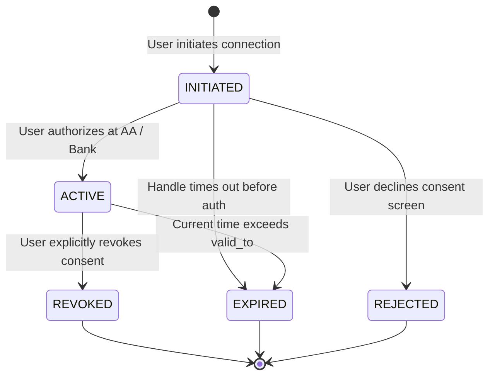

# ARTHSAVORA Financial Consent Management

## 1. Overview & Privacy Principles

Financial data access in ARTHSAVORA is strictly **consent-governed**. The system treats financial consent as an explicit, granular, revocable legal contract between the user and ARTHSAVORA, fully aligned with the **Digital Personal Data Protection (DPDP) Act, 2023** and **RBI Account Aggregator Guidelines**.

Key principles:
1. **Explicit Notice**: Users are informed of exactly what data is retrieved, why it is retrieved, who provides it, and how long the consent lasts.
2. **Granular Scoping**: Consent is scoped to specific data categories (`TRANSACTIONS`, `BALANCES`, `PROFILE`) and account types (`savings`, `current`, `credit_card`).
3. **Revocability**: Users retain an unconditional right to revoke consent at any time from the Web UI or via API. Revocation immediately halts all data synchronization.
4. **Purpose Limitation**: Data acquired under a specific consent purpose code (e.g., `101` - Personal Financial Management) cannot be repurposed for undisclosed secondary purposes.
5. **No Coercion**: A user cannot be forced to share all accounts; they may grant consent to only a specific subset of their bank accounts.

---

## 2. Consent Lifecycle State Machine

### Lifecycle States:
- **`INITIATED`**: Consent artefact request has been registered with the provider and a consent handle has been issued. Awaiting user interaction at the consent gateway.
- **`ACTIVE`**: User has authenticated with their banking / AA credentials, selected accounts, and granted authorization. Valid data synchronization can proceed.
- **`REJECTED`**: User explicitly declined or canceled the consent request at the AA interface.
- **`EXPIRED`**: The authorization window has passed the `valid_to` timestamp. No further automated sync jobs can run without re-consent.
- **`REVOKED`**: User or workspace administrator revoked consent prior to its scheduled expiration.

---

## 3. Data Categories & Purpose Codes

### 3.1 Purpose Codes (ReBIT Catalog)
- **`101`**: Personal Financial Management (PFM) & Automated Bookkeeping.
- **`102`**: Credit Assessment & Loan Underwriting.
- **`103`**: Financial Advisory, Scenario Analysis & Budgeting.
- **`104`**: Small Business Invoicing & Cash Flow Monitoring.

### 3.2 Granular Data Categories
- **`TRANSACTIONS`**: Inflows, outflows, counterparty narratives, transaction dates, and settlement references.
- **`BALANCES`**: Current ledger balance, available spendable balance, and balance timestamp.
- **`PROFILE`**: Account holder name, masked identifier, account type, and currency.

---

## 4. Revocation & Compliance Enforcement

When a user clicks **Revoke Consent** or **Disconnect** in ARTHSAVORA:
1. `FinancialConnectionService.revoke_consent` or `disconnect_connection` is called within the workspace tenancy boundary.
2. The remote provider adapter is invoked (`adapter.revoke_consent(handle)`) to notify the regulated AA / bank that authorization is terminated.
3. The local `financial_consents` record transitions to `REVOKED` with `revoked_at` set to current UTC and a logged reason.
4. The associated `financial_connections` status transitions to `REVOKED` or `DISCONNECTED`.
5. Background schedulers immediately ignore this connection. Any attempted synchronization query throws `BusinessRuleViolationException("Cannot synchronize connection: Consent has expired or been revoked.")`.
6. An immutable compliance audit log is appended to `connection_audit_events`.
