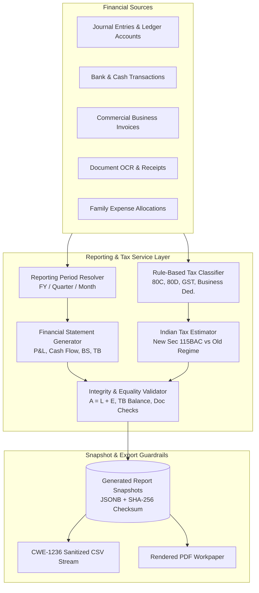

# ARTHSAVORA — FINANCIAL REPORTING ARCHITECTURE

## 1. Executive Summary & Purpose

The **ARTHSAVORA Financial Reporting, Tax Intelligence, and Compliance Readiness Engine** transforms verified double-entry ledgers, banking transactions, household shared allocations, and commercial invoices into structured, explainable financial statements, statutory tax intelligence summaries, and auditable export packages.

### Scope & Legal Boundaries
> [!IMPORTANT]
> **Statutory Notice & Regulatory Non-Filing Disclaimer:**  
> ARTHSAVORA is an institutional financial recordkeeping, business intelligence, and tax preparation software ecosystem. ARTHSAVORA is **NOT** a certified tax-filing intermediary (ERI), registered chartered accountancy firm, certified public auditor, or legal counsel.  
> Reports generated by this engine are strictly informational financial records and preparatory workpapers. ARTHSAVORA does not submit tax returns directly to the Income Tax Department (ITD) or GST Network (GSTN), nor does it certify statutory compliance without independent human professional review.

---

## 2. Architectural Blueprint & Data Pipeline

The reporting engine sits downstream of the immutable double-entry ledger, transaction storage, and commercial billing services.

---

## 3. Core Domain Entities & Relational Schema

### 3.1 Relational Models (`financial_reports`)
1. **`GeneratedReport` (`generated_reports`):**
   - Immutable snapshot of a generated financial report.
   - Stores exact execution parameters (`parameters_json`), statement data (`report_data_json`), accounting basis (`cash` or `accrual`), validation status, and SHA-256 integrity checksum.
2. **`TaxClassificationRecord` (`tax_classification_records`):**
   - Links an authoritative transaction to a statutory tax category (e.g. `section_80c`, `section_80d`, `business_expense_deductible`).
   - Tracks review status (`unclassified`, `suggested`, `confirmed`, `reviewed`, `excluded`), confidence score, deductible percentage, and statutory justification.
3. **`TaxRule` (`tax_rules`):**
   - Declarative versioned tax classification rules matching merchant names, transaction categories, and accounts with statutory codes.
4. **`TaxEstimateSnapshot` (`tax_estimate_snapshots`):**
   - Point-in-time calculation snapshot comparing New Tax Regime (Section 115BAC) vs Old Tax Regime, standard deductions, slab breakdowns, and marginal relief.
5. **`ReportValidationFinding` (`report_validation_findings`):**
   - Audit discrepancies generated during reporting validation runs (e.g. `VAL_TB_EQUALS`, `VAL_BS_EQUALS`, `VAL_DOC_EVIDENCE`).

---

## 4. Architectural Invariants

1. **Deterministic Calculation:** Financial statement metrics are derived exclusively from verified transactions or posted journal entries. No figures may be hallucinated or estimated by LLMs.
2. **Immutability of Historical Snapshots:** Once a report is generated and stamped with a SHA-256 checksum, its historical record in `generated_reports` cannot be mutated; revisions create a new versioned report.
3. **Formula Injection Sanitization (CWE-1236):** Any textual data emitted into CSV or spreadsheet workpapers starting with `=`, `+`, `-`, or `@` is unconditionally prefixed with a single quote (`'`).
4. **Multi-Tenant Workspace Isolation:** All statement generation, tax rules, and validation checks are strictly scoped to the caller's active `workspace_id`.
