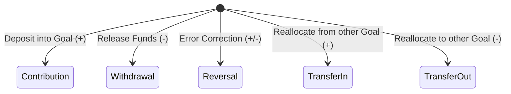

# Arthsavora — Goal Activity & Contribution Ledger

## 1. Overview & Purpose

The **Goal Activity Ledger** provides an auditable, append-only historical record of all capital movements into and out of financial goals.

Every change in a goal's accumulated balance must correspond to an explicit ledger row in the `goal_activities` table. This guarantees:
- Exact mathematical reconciliation of current balances against historical events.
- Attribution of which authenticated user initiated the transaction and when.
- Provenance tracking linking goal deposits/withdrawals to real underlying bank or cash transactions when available.
- Absolute prevention of negative goal balances.

---

## 2. Ledger Schema Specification

The `goal_activities` table is defined as follows:

| Column | Type | Constraints | Description |
|---|---|---|---|
| `id` | `UUID` | Primary Key | Unique activity identifier. |
| `goal_id` | `UUID` | FK `financial_goals.id` ON DELETE CASCADE | Associated financial goal. |
| `workspace_id` | `UUID` | FK `workspaces.id` ON DELETE CASCADE | Scoped workspace boundary. |
| `activity_type` | `VARCHAR(32)` | NOT NULL | Type of balance adjustment. |
| `amount_paise` | `BIGINT` | NOT NULL, `> 0` | Absolute value of capital moved (in minor units / paise). |
| `resulting_balance_paise` | `BIGINT` | NOT NULL, `>= 0` | Snapshot of goal balance immediately after this activity. |
| `transaction_id` | `UUID` | FK `transactions.id`, NULLABLE | Optional link to underlying bank/cash transaction. |
| `notes` | `TEXT` | NULLABLE | User-provided memorandum or reason. |
| `performed_by_id` | `UUID` | FK `users.id` | Authenticated user who performed the action. |
| `created_at` | `TIMESTAMPTZ` | NOT NULL | Immutable creation timestamp. |

---

## 3. Activity Types

The ledger supports five distinct activity classifications:



1. **`contribution`**:
   - Increases goal accumulated balance: $C_{t} = C_{t-1} + A$
   - Triggered when user earmarks liquid capital towards the savings objective.
2. **`withdrawal`**:
   - Decreases goal accumulated balance: $C_{t} = C_{t-1} - A$
   - Triggered when funds are expended for the intended milestone or returned to unallocated liquidity.
3. **`reversal`**:
   - Reverses a previous mistaken entry or adjustment.
4. **`transfer_in` / `transfer_out`**:
   - Reallocates reserved savings from one goal directly to another within the same workspace without leaving the savings ecosystem.

---

## 4. Invariants & Financial Guardrails

### 4.1 Non-Negative Balance Constraint
A goal balance cannot fall below zero:
$$C_{\text{paise}} \ge 0 \quad \forall t$$

If a requested withdrawal amount $W$ exceeds the current balance $C_{\text{paise}}$ ($W > C_{\text{paise}}$), the transaction is immediately rejected with:
```json
{
  "code": "BUSINESS_RULE_VIOLATION",
  "rule_name": "INSUFFICIENT_GOAL_BALANCE",
  "detail": "Cannot withdraw 50000 paise from goal with balance 35000 paise"
}
```

### 4.2 Single-Direction Monetary Unit Rule
`amount_paise` is strictly stored as a positive integer ($A > 0$). The mathematical direction of the balance adjustment is governed entirely by `activity_type`.

### 4.3 Separation from General Ledger & Operating Cash Flow
Goal activities do **not** affect operating income, operating expenses, or journal entry postings:
- A goal deposit is a mental/earmarked hold on existing liquidity, **not an expense**.
- A goal withdrawal releases earmarked funds, **not new revenue**.
- Total workspace net worth remains unchanged during goal contributions and withdrawals.

---

## 5. Auditability & Verification Flow

When an activity is posted:
1. An exclusive transaction lock is acquired on the `financial_goals` row to prevent race conditions.
2. The current balance is read and evaluated against withdrawal/contribution constraints.
3. The new balance is calculated and updated atomically.
4. The immutable `goal_activities` record is written with `resulting_balance_paise`.
5. If the new balance meets or exceeds the target, goal status is set to `completed`. If a withdrawal drops the balance below the target, a `completed` goal reverts to `active`.

---

## 6. Implementation References

- Database Model: [goal.py](file:///d:/Arthsavora/backend/app/infrastructure/database/models/goal.py)
- Repository Engine: [goal_repository.py](file:///d:/Arthsavora/backend/app/repositories/goal_repository.py)
- Domain Rules: [budget.py](file:///d:/Arthsavora/backend/app/domain/budget.py)
- Service Orchestration: [goal_service.py](file:///d:/Arthsavora/backend/app/services/budget/goal_service.py)
- API Routes: [goal_routes.py](file:///d:/Arthsavora/backend/app/api/v1/goal_routes.py)
