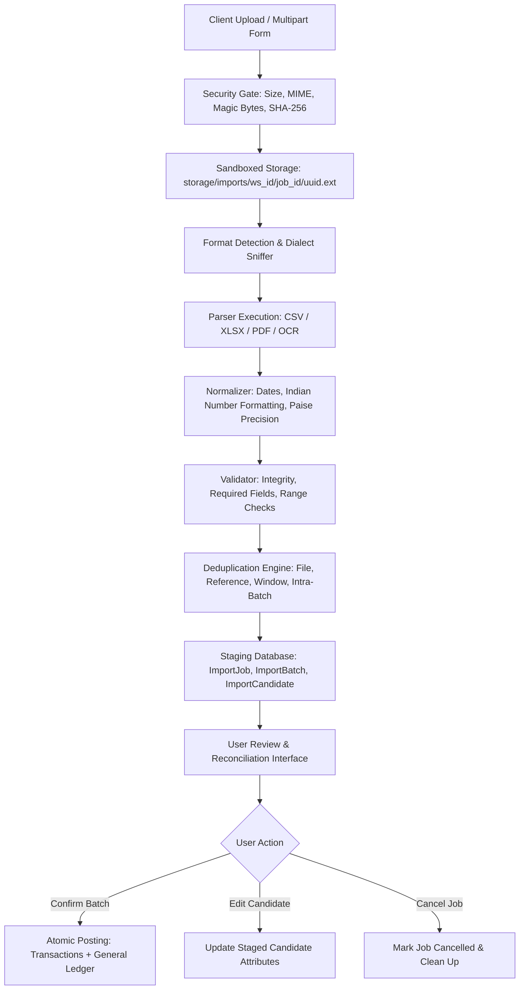

# ARTHSAVORA — FINANCIAL STATEMENT IMPORT PIPELINE

## 1. Pipeline Overview

The Arthsavora statement import pipeline is an asynchronous, multi-stage data acquisition system designed for deterministic conversion of unstructured bank statements into verified accounting transactions.

---

## 2. Pipeline Execution Stages

### Stage 1: Ingestion & Security Validation
- Receives uploaded multipart file.
- Checks size against the 10 MB maximum limit (`FileTooLargeError`).
- Inspects magic bytes against extension (`UnsafeFileError`).
- Calculates SHA-256 file checksum and queries `import_jobs` in the workspace to reject duplicate uploads (`DuplicateImportError`).
- Writes to local sandboxed directory using a randomized UUID name.

### Stage 2: Parsing & Header Resolution
- Routes file to the appropriate parser:
  - `CsvStatementParser`: Sniffs delimiters, detects encoding, scans for header row using `HEADER_SYNONYMS` dictionaries.
  - `XlsxStatementParser`: Loads workbook in read-only mode with `data_only=True` to ignore malicious or active formulas.
  - `PdfStatementParser`: Reads PDF stream, parses vector tables via `pdfplumber`, applies text coordinate fallback when table lines are absent, extracts opening and closing statement balances.
  - `OcrStatementAdapter`: Converts scanned image pages to text via Tesseract OCR when digital text is absent (< 50 chars).
- Suppresses statement footer totals, opening balance, and closing balance rows to prevent recording statement summaries as transactions.

### Stage 3: Normalization
- Converts all dates into ISO 8601 `YYYY-MM-DD`. Handles formats:
  - `DD/MM/YYYY`, `DD-MM-YYYY`, `YYYY-MM-DD`, `DD-Mon-YYYY`, `DD-Month-YYYY`.
- Cleans and converts currency strings into exact `Decimal` and integer minor units (`paise`):
  - Strips `₹`, `Rs.`, `INR`, `$`.
  - Removes Indian comma separation (`1,25,000.50` -> `125000.50`).
  - Detects negative indicators (parentheses `(1,250.00)`, trailing minus `1250.00-`, or debit marker `1250.00 Dr`).
- Resolves direction (`inflow` vs `outflow`) and base transaction types (`income`, `expense`, `transfer`, `withdrawal`, `refund`, `dividend`, `interest`).

### Stage 4: Validation
- Runs every normalized candidate through `StatementValidator`.
- Flags:
  - `VALID`: Valid date, non-zero positive amount, valid direction.
  - `INVALID`: Missing or unparseable date, zero or missing amount, invalid direction.
  - `AMBIGUOUS`: Both debit and credit columns present with conflicting or unclear direction.

### Stage 5: Deduplication
- Runs `StatementDeduplicator.deduplicate_batch`.
- Evaluates:
  - Exact reference number matches against existing posted transactions.
  - Probable duplicates matching date ($\pm 1$ day) and exact amount in paise.
  - Intra-batch duplicates matching previous rows in the same uploaded file.
- Automatically unchecks exact duplicates (`selected_for_import = False`) while preserving them in the review staging table for user inspection.

### Stage 6: Balance Reconciliation
- Computes statement arithmetic:
  $$\text{Calculated Closing Balance} = \text{Opening Balance} + \sum \text{Inflows} - \sum \text{Outflows}$$
  $$\text{Reconciliation Discrepancy} = \text{Reported Closing Balance} - \text{Calculated Closing Balance}$$
- Flags discrepancy to the user if the reported bank closing balance does not match the sum of extracted movements.

### Stage 7: Confirmation & Ledger Posting
- Triggered explicitly via `POST /api/v1/workspaces/{workspace_id}/imports/jobs/{job_id}/batches/{batch_id}/confirm`.
- Within an atomic database transaction:
  1. Filters all candidates where `selected_for_import = True` and `validation_status = "valid"`.
  2. Creates operational `Transaction` records linked to the target account.
  3. Updates the target account's `current_book_balance_paise`.
  4. Invokes `LedgerService.post_transaction_to_ledger` to generate balanced double-entry journal entries.
  5. Updates `ImportJob` status to `completed` (or `partially_confirmed`) and records `imported_records`.
