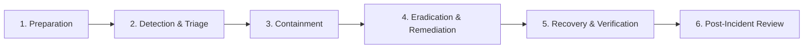

# ARTHSAVORA — Security Incident Response Plan (IRP)

## 1. Objectives & Governance

This Incident Response Plan (IRP) establishes the standard operating procedures for identifying, triaging, containing, investigating, recovering from, and documenting cybersecurity and data integrity incidents across the ARTHSAVORA platform.

Special emphasis is placed on compliance with **CERT-In Cyber Security Directions (April 2022)** requiring mandatory notification of specified cybersecurity incidents within **6 hours** of notice.

---

## 2. Incident Classification & Severity Levels

| Severity | Definition | Target Triage Time | CERT-In Reporting |
| :--- | :--- | :--- | :--- |
| **SEV-1 (Critical)** | Active data exfiltration, database compromise, general ledger tampering, systemic cross-workspace data leak, or complete outage of financial services. | < 15 Minutes | **Mandatory (< 6 Hours)** |
| **SEV-2 (High)** | Compromise of an individual administrative account, discovery of an unexploited critical vulnerability in production, or persistent denial-of-service attack. | < 30 Minutes | Evaluated for scope |
| **SEV-3 (Medium)** | Isolated authorization bug affecting a single tenant, repeated credential stuffing against rate limits, or transient third-party provider failure. | < 2 Hours | Internal tracking |
| **SEV-4 (Low)** | Informational scan activity, low-severity dependency advisory with no active exploit path, or single user login issue. | < 24 Hours | Internal log review |

---

## 3. Six-Phase Incident Response Lifecycle

### Phase 1: Preparation
- Pre-configured alert rules for rate-limit breaches, authentication spikes, and unhandled 500 errors.
- Maintenance of verified database backups and tested restore procedures.
- Rotation scripts for database passwords, JWT signing keys, and provider secrets.

### Phase 2: Detection & Triage
- Automated detection via structured telemetry, correlation ID traces, and exception alerts.
- Triage Lead verifies whether the incident is a true positive and assigns Severity classification.
- An incident war room is initiated with designated Lead Investigator, Infrastructure Engineer, and Communications Officer.

### Phase 3: Containment
- **Short-Term Containment:**
  - Revoke compromised user sessions or tokens via `revoke_token_jti`.
  - Disable compromised accounts via `User.is_active = False`.
  - Isolate affected workspace by updating `Workspace.status = WorkspaceStatus.SUSPENDED`.
  - Apply edge WAF IP blocks to mitigate botnet flood.
- **Evidence Preservation:**
  - Preserve database snapshots, web access logs, and container state prior to altering filesystem or restarting services.
  - **Do NOT delete log files or execute destructive database drops during response.**

### Phase 4: Eradication & Remediation
- Identify root cause (e.g., software defect, misconfigured permission, compromised key).
- Deploy hotfix with automated test verification.
- Rotate affected secrets (database password, JWT secret, external provider keys).

### Phase 5: Recovery & Verification
- Restore services to normal operation.
- Run comprehensive regression suites (`pytest`, `vitest`, typecheck).
- Verify database integrity and double-entry balance across all ledgers.
- Maintain enhanced monitoring for 72 hours post-recovery.

### Phase 6: Post-Incident Review & Statutory Notification
- Conduct blameless post-mortem within 48 hours.
- Author formal Incident Post-Mortem Report detailing timeline, root cause, impact, and action items.
- If classified as SEV-1 or applicable under CERT-In mandate, submit formal report to CERT-In (`incident@cert-in.org.in`) within statutory 6-hour window.

---

## 4. Specific Incident Playbooks

### Playbook A: Discovered Exposed Credential / API Key
1. **Immediate Source Invalidation:** Revoke the key immediately at the upstream provider (e.g., Google Cloud, Supabase, database).
2. **Issue Replacement:** Provision a fresh secret and update the secrets manager.
3. **Audit History Inspection:** Query access logs for unauthorized use of the exposed key during its active exposure window.
4. **Git Cleansing:** Clean Git commit history using `git-filter-repo` if committed accidentally.

### Playbook B: Cross-Workspace Data Leakage Report
1. **Immediate Suspension:** Suspend the affected workspace endpoint or feature flag.
2. **Session Termination:** Invalidate active sessions of users involved in cross-tenant access.
3. **Forensic Trace:** Filter audit logs by `correlation_id` and `workspace_id` to establish the exact extent of unauthorized disclosure.
4. **Data Principal Notification:** In accordance with DPDP Act 2023 principles, assess impact and notify affected workspace owners.

### Playbook C: Double-Entry Ledger Imbalance Alert
1. **Transaction Abort:** Verify that database transaction rollback prevented partial commit.
2. **State Freeze:** Pause automated imports for the affected workspace account.
3. **Balance Reconciliation:** Run deterministic balance audit comparing `JournalLine` debits/credits against `account_balance_snapshots`.
4. **Remediation Posting:** Post formal compensating reversal if corruption occurred.
