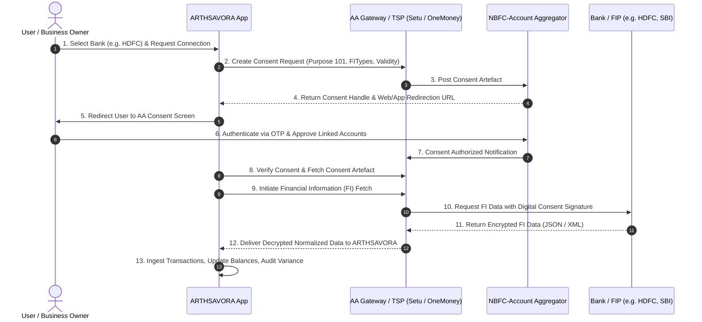

# India Account Aggregator (AA) Integration Architecture

## 1. Overview & Regulatory Context

The Reserve Bank of India (RBI) established the **Account Aggregator (AA)** regulatory framework (Master Direction - Non-Banking Financial Company - Account Aggregator Directions, 2016) to create a consent-based financial data sharing network across India.

Under this framework:
- Financial data sharing is **user-centric, consent-bound, and revocable**.
- Data travels in an **end-to-end encrypted** envelope directly from Financial Information Providers (FIPs) to Financial Information Users (FIUs).
- The Account Aggregator (AA) acts as a data-blind conduit: it cannot decrypt, store, or view user financial records.
- Standards are defined by the **Reserve Bank Information Technology (ReBIT)** specification.

ARTHSAVORA operates as an FIU application within this ecosystem, enabling users to seamlessly connect Indian bank accounts, credit cards, and investment portfolios with explicit consent.

---

## 2. ReBIT Protocol Workflow

---

## 3. Supported Financial Information Types (FITypes)

Under ReBIT specifications, ARTHSAVORA supports the following primary FI Types:
- **`DEPOSIT`**: Savings accounts and Current accounts.
- **`TERM_DEPOSIT`**: Fixed deposits (FD) and Recurring deposits (RD).
- **`CREDIT_CARD`**: Credit card accounts, statement liabilities, and payment due dates.
- **`LOAN`**: Personal loans, business loans, and home loans.

---

## 4. ReBIT Consent Artefact Specification

The consent artefact exchanged between ARTHSAVORA and the AA network contains:
- `consentId`: Unique UUID generated by the AA.
- `consentMode`: `VIEW` or `STORE`.
- `fetchType`: `PERIODIC` (for scheduled recurring sync) or `ONETIME`.
- `consentTypes`: `["TRANSACTIONS", "PROFILE", "SUMMARY"]`.
- `fiTypes`: `["DEPOSIT", "CREDIT_CARD"]`.
- `purpose`: Object containing purpose code (`101` - Personal Finance Management) and narrative text.
- `dataRange`: `from` and `to` date bounds for historical financial extraction.
- `dataLife`: Duration the FIU is authorized to retain the data.
- `frequency`: Sync frequency (e.g., unit `DAY`, value `1`).
- `signature`: Digital cryptographic signature of the AA.

---

## 5. Security & Cryptographic Exchange

In production ReBIT implementations:
1. **Mutual TLS (mTLS)**: All API communication between ARTHSAVORA, the TSP gateway, and the AA requires X.509 certificate authentication.
2. **Ephemeral Key Exchange (Diffie-Hellman / ECDH)**: Financial data transmitted from FIP to FIU is encrypted using Elliptic Curve Diffie-Hellman (`secp256r1` / Curve25519) with ephemeral session keypairs.
3. **Data-Blindness**: The AA NBFC facilitates message routing but has zero access to the private decryption keys. Only ARTHSAVORA's server-side decryption agent can open the data payload.

---

## 6. Development & Sandbox Architecture

To enable complete end-to-end development, local testing, and automated CI/CD without requiring live banking credentials, ARTHSAVORA provides a built-in **`MockSandboxAdapter`**:
- Simulates realistic ReBIT consent creation, OTP verification, and instant activation.
- Generates synthetic accounts for HDFC Bank, State Bank of India, and ICICI Bank.
- Generates realistic Indian transaction lines (UPI, IMPS, NEFT, salary credits, utility bill debits).
- Maintains state in memory, allowing full lifecycle testing without third-party dependencies.
