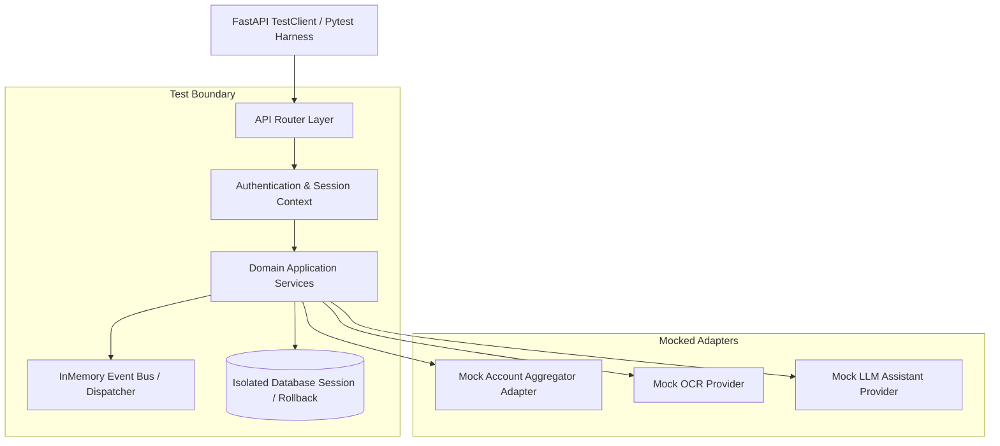

# Integration Test Architecture

## 1. Architectural Strategy

The ARTHSAVORA integration testing framework verifies cross-module contracts, asynchronous event handling, transactional isolation, and database boundary enforcement without relying on fragile external network dependencies.

---

## 2. Test Isolation and Transaction Management

Every integration test operates inside an isolated database transaction:
1. **Per-Test Database Session**: Each test fixture instantiates a fresh session bound to the active engine.
2. **Deterministic Teardown**: Tests that mutate state execute inside nested transactions or savepoints that rollback upon completion, preventing cross-test data pollution.
3. **Workspace-Scoped Entity Trees**: Each test creates distinct workspaces, users, and charts of accounts, ensuring tests can execute concurrently without primary key or unique constraint collisions.

---

## 3. Mock Boundary Strategy

External third-party dependencies are cleanly encapsulated behind domain ports:
- **Account Aggregator (AA)**: Encapsulated by `AccountAggregatorAdapter`. Integration tests utilize `MockAccountAggregatorAdapter`, which simulates real AA payloads (FIP accounts, FIU consent artifacts, encrypted data payloads) deterministically.
- **OCR Engine**: Encapsulated by `OCRProvider`. Tests inject deterministic receipt tokens, vendor names, and totals to verify transaction matching pipelines.
- **LLM Reasoning Engine**: Encapsulated by `LLMProvider`. Returns structured JSON for financial categorization and explanations without invoking live external model endpoints.

---

## 4. Key Assertions Verified in Integration Tests

1. **Transactional Rollback on Failure**: When a journal entry posting encounters an unbalanced line or database violation, all line items and account balance increments are rolled back cleanly.
2. **Domain Event Fanout**: When an account transaction is created, domain events trigger:
   - Account current balance update.
   - Double-entry ledger journal creation.
   - Budget period spend tracking.
   - Anomaly detection scoring.
3. **HTTP 404 Anti-IDOR Enforcement**: When Workspace A requests an account, transaction, or invoice belonging to Workspace B, the API returns HTTP 404 (Not Found), refusing to acknowledge the resource's existence.
