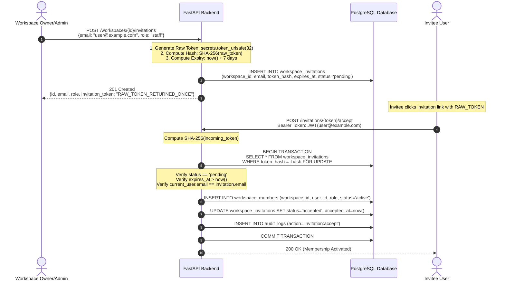

# ARTHSAVORA — INVITATION SECURITY & TOKEN MANAGEMENT SPECIFICATION

## 1. Executive Summary

Inviting members into financial workspaces requires strict security controls to prevent unauthorized access, credential leakage, email interception, and race conditions. This document outlines the cryptographic and operational safeguards governing Arthsavora's workspace invitation subsystem.

---

## 2. Core Security Invariants

1. **Zero Raw Token Persistence:** Raw invitation tokens are never stored in the database, never logged to stdout/files, and never returned in list queries.
2. **SHA-256 Hashing at Rest:** The database stores strictly a 64-character hexadecimal SHA-256 hash of the urlsafe token (`token_hash`).
3. **Ephemeral Exposure:** The raw token is returned **once and only once** to the creating client in the `POST /workspaces/{id}/invitations` response.
4. **Strict Recipient Binding:** An invitation can only be redeemed by an authenticated user whose verified email matches the invitation's recipient email.
5. **Atomic Row-Level Locking:** Invitation acceptance uses PostgreSQL `SELECT ... FOR UPDATE` locking to prevent double-spend / race conditions.
6. **Time-To-Live (TTL):** Invitations carry a mandatory 7-day expiration window. Expired invitations cannot be redeemed.

---

## 3. Cryptographic Token Lifecycle



---

## 4. Race Condition & Concurrency Mitigation

### 4.1 The Vulnerability
In a distributed financial system, concurrent network requests attempting to redeem the same token simultaneously could create duplicate memberships, corrupted audit logs, or invalid tenant role elevations.

### 4.2 The Solution: `with_for_update()`
Arthsavora prevents concurrent redemption by acquiring an exclusive row lock on the invitation record before inspecting status:

```python
# In InvitationRepository
async def get_by_token_hash(self, token_hash: str, for_update: bool = False) -> Optional[WorkspaceInvitation]:
    stmt = select(WorkspaceInvitation).where(WorkspaceInvitation.token_hash == token_hash)
    if for_update:
        stmt = stmt.with_for_update()
    result = await self.session.execute(stmt)
    return result.scalar_one_or_none()
```

If multiple requests arrive concurrently:
1. The first transaction acquires the row lock.
2. The second transaction blocks until the first completes.
3. When the second transaction acquires the row, the status has transitioned from `pending` to `accepted`.
4. The second transaction immediately aborts with `404 Not Found` or `422 Unprocessable Entity` ("Invitation has already been redeemed").

---

## 5. Recipient Email Binding Check

To defend against forwarded invitation links, intercepted emails, or social engineering attacks, the redeeming user's authenticated email **must** match the recipient email stored in the invitation:

```python
if current_user.email.lower().strip() != invitation.email.lower().strip():
    raise ForbiddenException(
        message="This invitation was issued to a different email address.",
        code="INVITATION_EMAIL_MISMATCH",
    )
```

Attempting to accept another user's invitation results in an immediate **HTTP 403 Forbidden**.

---

## 6. Invitation Revocation

A workspace owner or admin can revoke any pending invitation prior to acceptance:

- **Endpoint:** `POST /api/v1/workspaces/{workspace_id}/invitations/{invitation_id}/revoke`
- **Permission Required:** `Permission.INVITE_MEMBERS`
- **Execution:**
  1. Sets `status = 'revoked'` and `revoked_at = now()`.
  2. Emits audit log record: `action="invitation:revoke"`.
  3. Any subsequent attempt to use the raw token is rejected with `HTTP 404 Not Found`.
