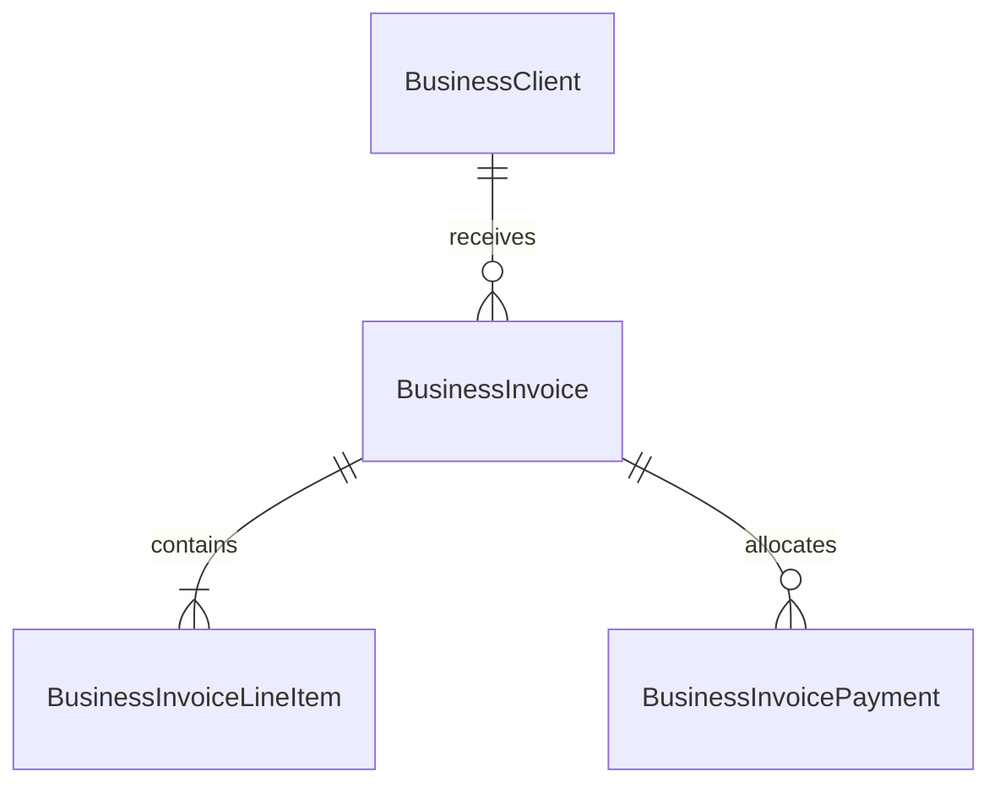
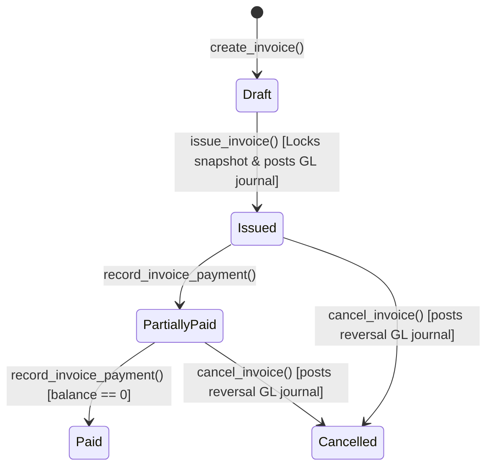

# Commercial Invoice Architecture & Tax Computation

## 1. Invoice Model & Line Items

An invoice (`BusinessInvoice`) is the commercial billing document issued to a client.

### Exact Minor Unit Arithmetic:
- `unit_price_paise`: Unit price in integer paise.
- `quantity`: Exact `Decimal` quantity (supports fractional billing, e.g. 12.5 consulting hours).
- `discount_paise`: Per-line or overall discount in paise.
- `subtotal_amount_paise = max(0, round(quantity * unit_price_paise) - discount_paise)`.
- `tax_amount_paise = round(subtotal_amount_paise * (tax_rate_percent / 100))`.
- `total_amount_paise = subtotal_amount_paise + tax_amount_paise`.

---

## 2. Indian GST Computation Framework

The engine natively calculates GST based on place of supply:

1. **Intra-State Supply (`is_interstate = False`)**:
   - CGST (Central GST) = `tax_rate_percent / 2`
   - SGST (State GST) = `tax_rate_percent / 2`
   - IGST = `0.0%`
2. **Inter-State Supply (`is_interstate = True`)**:
   - IGST (Integrated GST) = `tax_rate_percent`
   - CGST = `0.0%`
   - SGST = `0.0%`
3. **HSN/SAC Classification**:
   - Every line item supports standard 6-digit Harmonized System of Nomenclature (HSN) or Services Accounting Code (SAC).

---

## 3. Invoice Lifecycle State Machine

