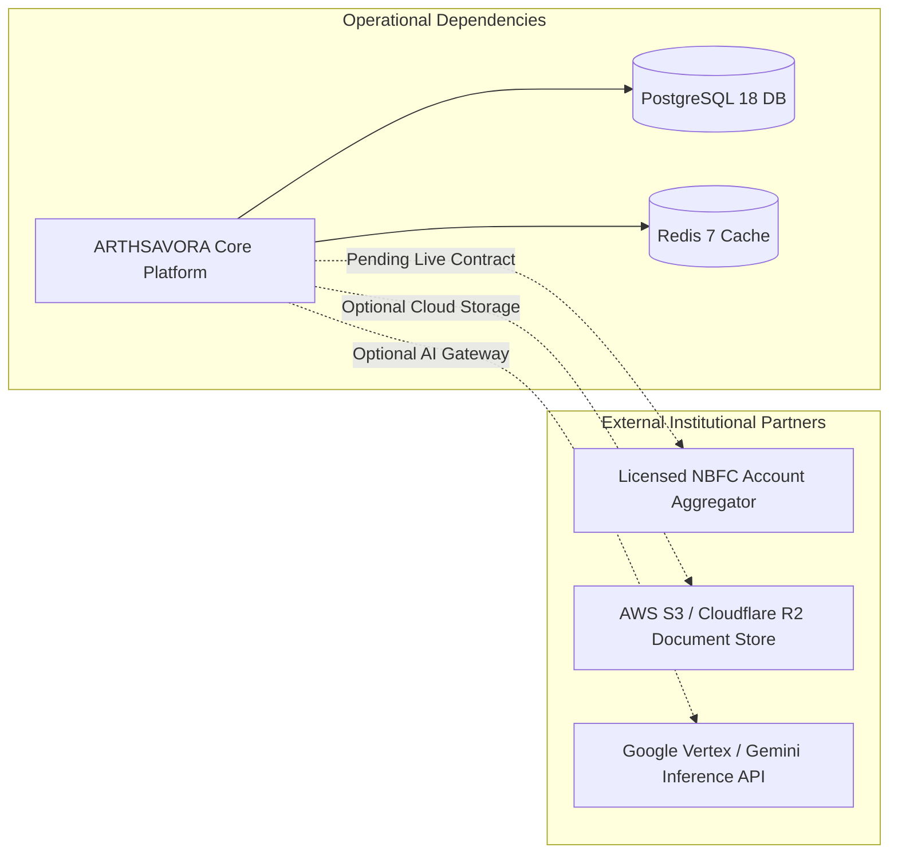

# Known Limitations and External Dependencies

## 1. External System Dependencies

While ARTHSAVORA's internal core operates with complete autonomy, certain advanced capabilities rely on third-party protocols and institutional partnerships:

---

## 2. Dependency Resilience Matrix

| External Dependency | Purpose in System | Failure Mode Impact | Fallback / Isolation Mechanism |
|---|---|---|---|
| **Account Aggregator Partner** | Automated bank statement sync | Live automated sync unavailable | Users upload bank statements via CSV/Excel importer |
| **Cloud Object Storage (S3)** | Permanent receipt image storage | Document upload returns error | Local disk storage fallback enabled in single-node/Docker deploy |
| **LLM Inference Provider** | Conversational financial queries | Assistant replies with rule summary | Deterministic rule-based insights and SQL summaries |
| **Redis Cache** | Session token blacklisting | Slowed session validation | Fail-safe authentication via PostgreSQL sessions |

---

## 3. Operational Prerequisites for Enterprise Scale

To scale from limited beta to general commercial availability, the following organizational items must be completed:
1. Finalize bilateral Data Access Agreement with a certified NBFC Account Aggregator (e.g. Setu / Finvu / Anumati).
2. Provision dedicated AWS / GCP production tenant with multi-AZ managed PostgreSQL and VPC peering.
3. Conduct external third-party penetration testing and source code security audit.
