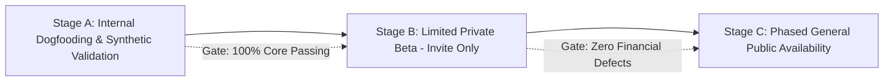

# Launch Strategy and Phased Rollout Framework

## 1. Launch Strategy Overview

Deploying institutional FinTech software requires risk containment, phased cohort expansion, and continuous data verification.

ARTHSAVORA follows a **Three-Stage Rollout Model**:

---

## 2. Rollout Stages and Gates

### Stage A: Internal Validation (Current Milestone — Prompt 30 Complete)
- **Cohort**: Core development team and internal testers.
- **Environment**: Staging & local production-like Docker environments.
- **Data**: Synthetic financial data, mock bank accounts, edge-case tax profiles.
- **Success Gate**: 100% passing tests (344 backend, 158 frontend), zero RLS leaks, balanced trial balances.

### Stage B: Limited Beta (Weeks 1–4 Post-Launch)
- **Cohort**: 50 invited freelancers, consultants, and small agencies.
- **Scope**: Personal finance, family finance, manual account setup, CSV imports, business invoicing, tax estimation.
- **Monitoring**: Real-time error alerting (Datadog/Sentry), weekly user feedback triage.
- **Success Gate**: $\ge 99.5\%$ API availability, zero unbalanced ledger reports, $< 0.1\%$ error rate.

### Stage C: Controlled Public Release (Post-Beta)
- **Cohort**: Unrestricted public signups with rate limiting and automated abuse detection.
- **Scope**: Full platform capabilities, including live Account Aggregator integration upon institutional partner onboarding.
